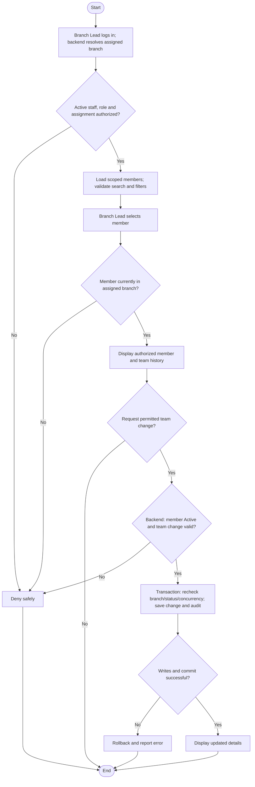

# Activity: Manage Branch Members

**Primary Actor:** Branch Lead
**Supporting Actors:** Backend authorization/member services, audit; HR Lead owns membership acceptance and transfer approval.
**Status:** First-pass documentation; not implemented or tested

## Purpose

View own-branch members and manage permitted team assignments without granting membership approval or broad status-change authority.

## Preconditions

- Active authenticated staff account, current Branch Lead role and exactly one authorized branch assignment.
- Backend derives branch from current assignment; target member must currently belong to that branch.
- Specific team-change permission and validation policies must be approved before execution.

## Inputs and Outputs

- Search/filter, member identity, requested permitted team change and concurrency expectations.
- Display permanent Volunteer ID, name, current branch/status and authorized team/history details. Area of interest and other member fields use approved specifications; no domain schema exists yet, so extra fields are PROPOSED.
- Output scoped list/detail or committed assignment result and audit; never a new membership approval.

## Main Flow

1. Branch Lead logs in and opens Branch Members; backend verifies active staff/role and resolves assigned branch.
2. Retrieve only permitted branch members; validate search/filters, then select member and recheck current branch ownership.
3. Show authorized member status/team history. Viewing alone changes nothing.
4. For a permitted team change, backend checks member Active, branch/team scope, action policy and current assignment state.
5. In a transaction revalidate authorization/member status and concurrency, save allowed assignment change and audit; commit before showing updated details.
6. An externally authorized Active-to-Inactive transition must apply BL-005: end all current active team assignments with end metadata and membership/assignment audit in the same transaction. This does not grant Branch Lead deactivation authority.

## Alternative / Error Flows

- Invalid login/role, no assigned branch, cross-branch member/team or invalid query: deny/reject without disclosure or changes.
- Inactive member or concurrent inactivation/transfer: reject new assignment; no active assignment may survive a successful Inactive transition as current work.
- Already-ended assignment or disallowed change: reject safely, preserving history.
- Assignment/member/audit write or commit failure: roll back all related changes; do not partly end assignments.

## Business Rules

- Backend checks branch scope on every protected request; client branch filters are not grants. Members have no separate staff login role.
- No direct membership acceptance, city-ID editing, transfer approval or finance approval by Branch Lead. IDs originate from initial HR acceptance and remain permanent.
- **BL-005 - DECIDED:** Every authorized Active-to-Inactive transition ends current active team assignments atomically, retaining original start dates/history and recording end metadata/audit. Member ID, branch history, collections, reports, amounts and prior audit remain unchanged.
- Inactive blocks new assignments, member-associated collections and active participation. Reacceptance restores same member Active without reopening ended assignments; any new assignment needs an explicit authorized Branch Lead action.
- Source Branch Lead may [request transfer](request-member-transfer.md); HR approves/rejects. Historical access remains separately permission-scoped.

## Postconditions

- Reads expose only permitted own-branch data. Successful team changes and audit commit together; failed changes leave prior state intact.
- Inactivation cannot commit without ending active assignments; historical records remain preserved.

## Activity Diagram

## Acceptance Criteria

- Branch A staff cannot read/change private branch B members or teams through request-ID tampering.
- Branch Lead cannot directly create membership or approve transfer; only permitted team actions succeed.
- Inactive/newly inactivated member cannot receive an assignment, including concurrent assignment/inactivation.
- Valid Active-member assignment and audit commit together. Inactivation ends active assignments with end metadata, preserves start dates/history and rolls back if any ending fails.
- Reacceptance does not reopen assignments. These are future synthetic-data test targets, not passing tests.

## Pending Decisions

- Exact team action/field policies, general member edit/status-change grants and independent-module status conflicts. No broad deactivation permission is implied.
