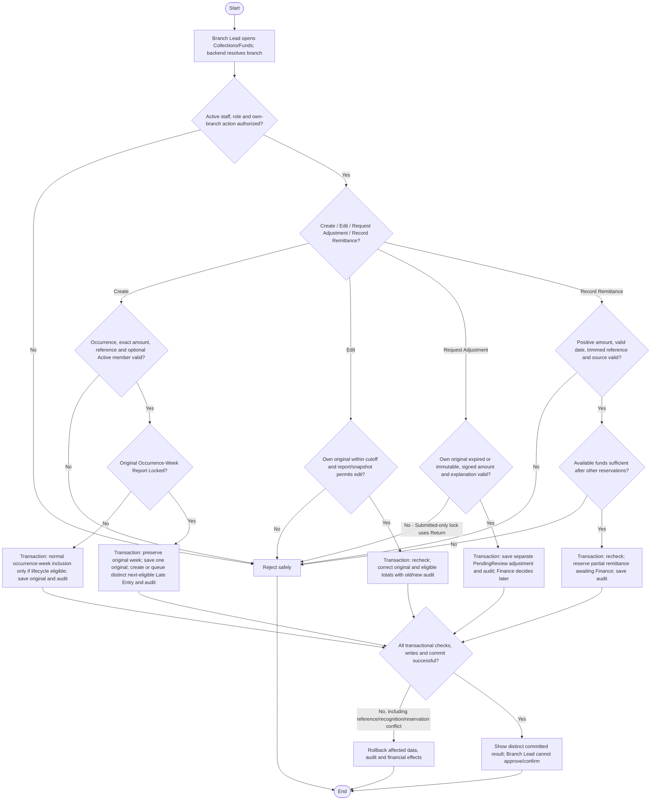

# Activity: Manage Offline Collections

**Primary Actor:** Branch Lead
**Supporting Actors:** Backend authorization/collection/report services, database and audit; Finance Reviewer handles review under approved finance scope.
**Status:** BL-001/BL-002 and FIN-001 to FIN-003 DECIDED; not implemented or tested

## Purpose

Record offline collections and correct only eligible own-branch entries, preserving submitted/approved figures, exact money and audit integrity.

## Preconditions

- Active authenticated Branch Lead with one current assigned branch, resolved server-side.
- Valid approved collection data; new member-associated collection requires an Active member in authorized branch scope.
- Final schema/contracts and monetary/classification rules remain to be approved; no payment integration.

## Inputs and Outputs

- Collection: reference, exact amount/currency, actual occurrence time, backend-created created_at/updated_at, scoped branch and optional Active member; no invented donor/CNIC/channel requirements.
- Adjustment: separate request reference, original collection/source branch, signed amount, mandatory correction explanation, requester/time, applicable supporting reference, PendingReview/Finance decision metadata. Never untyped collection replacement.
- Remittance: positive exact amount, valid transfer date, trimmed nonempty transfer reference and backend-derived source branch are required (FIN-009). Supporting upload OPTIONAL; if supported, enforce backend type/size/access/malware controls. No upload alone is not a failure; transfer reference does not prove receipt.
- Output distinct collection, adjustment request or awaiting-confirmation remittance with audit; no Branch Lead Finance approval/confirmation.

## Main Flow

1. Branch Lead opens own-branch Collections/Funds; backend verifies active staff/role and derives current assigned branch for all actions.
2. **Create Collection:** Validate actual occurrence, amount and optional Active member; original week follows occurrence under FIN-001, edit age follows created_at. If original week Approved/Locked, FIN-005 transactionally creates/queues distinct Late Entry recognition in earliest subsequent same-branch eligible open report, never Submitted/Approved; if none, retain awaiting inclusion. Save one original/reference, audit and idempotent recognition together; no negative adjustment or duplicate inclusion.
3. **Edit Collection:** Load own original, require authoritative now strictly before created_at + 7 x 24 hours, Draft/Returned or no report and no immutable inclusion. Transactionally recheck cutoff/status/concurrency and save values/old-new audit/eligible totals without resetting age.
4. **Request Adjustment:** For expired original or immutable approved inclusion, validate source, signed correction and mandatory explanation; save separate PendingReview request/audit atomically. FIN-006 Finance approves/rejects; Branch Lead cannot approve or recognize. Submitted-only lock follows Return, never automatic adjustment bypass.
5. **Record Remittance:** FIN-007 permits multiple partial records. Validate FIN-009 fields and amount within available-to-remit using all active committed reservations and confirmed transfers. Transactionally recheck/ reserve funds and save awaiting-confirmation remittance/audit; unconfirmed is not receipt. Finance independently confirms through separate workflow.
6. Display gross/normal recognition, Late Entry, Approved adjustments, pending reservations, confirmed funds, outstanding and available separately with exact arithmetic. Repeated/concurrent records/reference/recognition and reservations must not duplicate money or over-reserve.

## Alternative / Error Flows

- Unauthorized/cross-branch, missing record, invalid amount/date/reference/explanation or new Inactive-member collection: reject safely.
- Cutoff or immutable inclusion blocks original edit; Submitted blocks until Return. Eligible expired/immutable corrections use FIN-006 request, never rewrite originals.
- No eligible future report: retain original/Approved adjustment awaiting recognition; do not lose data or insert into Submitted/Approved snapshots.
- Over-remittance or concurrent reservation conflict: reject; mandatory fields missing/blank fail, but no upload alone does not fail.
- Data/audit/recognition/balance/commit failure rolls back all affected changes. Cancellation/release/negative-balance reconciliation not defined: flag remaining policy, never invent override.

## Business Rules

- **BL-001 - DECIDED:** cutoff = backend/database-created created_at + 7 x 24 hours. UTC elapsed time; frontend clock irrelevant. Editing/backdated/imported occurrence dates never extend/reset clock. At cutoff minus 1 ms eligible by age only; exactly cutoff or later ineligible.
- **BL-002 - DECIDED:** Authorization AND age AND report permission AND no approved snapshot inclusion AND integrity checks required. No report link is mandatory at creation; absent link still requires age/scope/immutability checks.

| Linked report state | Normal edit eligibility |
| --- | --- |
| Draft | Strictly within seven days only |
| Submitted | Locked until formal Return |
| Returned | Strictly within original seven days only |
| Approved | Permanently locked |
| Locked/finalized | Permanently locked |
| None | Age, scope and other integrity checks still apply |

- Audit every successful create/correction atomically; correction captures old/new values. No deletion/rewrite of history or approved snapshots.
- Exact NUMERIC or approved integer currency units; never binary floating point. Currency/rounding/formulas are pending; do not fabricate amounts or fixture totals.
- Offline collections only; no online payment processing. Collection entry, report submission and remittance are distinct events.

- Reconciliation separates gross collections, authorized adjustments, unconfirmed remittances, confirmed remittances, outstanding not yet confirmed centrally and immutable historical report totals. Exact official KPI/individual allocation semantics remain PENDING; FIN-007 operational outstanding/available formulas are DECIDED; official fixture totals must be reproduced exactly when available.

- **FIN-001/FIN-005 - DECIDED:** Actual occurrence selects original PKT week; locked original week routes one distinct audited Late Entry line (original collection/week retained) to earliest subsequent same-branch open eligible report, never Submitted/Approved, or awaiting inclusion. Same original cannot also appear as normal original-week recognition. Idempotent uniqueness guards entry/report-generation/approval races and cumulative totals; late is not a correction/negative adjustment.
- **FIN-002/FIN-006 - DECIDED:** Original protected; own-source Branch Lead requests with required signed amount/explanation, Finance alone decides PendingReview -> Approved/Rejected once. Only Approved financial adjustment recognized once in next eligible period, queue if unavailable; Rejected zero effect/history retained. Immutable originals/snapshots unchanged. No Submitted-only bypass.
- **FIN-003/FIN-007 - DECIDED:** Partial remittances individually Finance-confirmed. Outstanding = recognized net collections - confirmed remittances (subject to adjustment reconciliation); available = outstanding - active pending reservations. Submission reserves without confirming; protect concurrent submissions and confirmation, excluding the selected reservation from other pending claims on confirmation. No double deduction or over-remittance.
- **FIN-009 - DECIDED:** Required positive amount/date/nonempty reference/derived branch; optional controlled upload. Branch Lead cannot confirm. No payment integrations or automatic receipt inference.
- Audit every mutation with actor/role/time/action/reference, old/new values/status, branch/report context and required explanation; no credentials/private personal data. Official KPI/fixtures remain authoritative and financial gate NOT VERIFIED without them.

## Postconditions

- Valid create/correction, permitted derived figures and audit commit consistently. Original created_at remains; approved/submitted immutable figures stay unchanged.
- Failed requests preserve values/totals; committed historical obligations remain visible for authorized reconciliation.

## Activity Diagram

## Acceptance Criteria

- Own-branch authorization enforced; invalid reference/amount/date or new Inactive-member collection rejected. BL-001 cutoff minus 1 ms may pass other checks; at/after cutoff fails, Returned never resets it.
- Unlocked eligible original week uses occurrence; locked original creates/queues one future Late Entry preserving original date/week/snapshot. No eligible report means awaiting inclusion, not loss. Monday boundaries and concurrent entry/report/approval cannot double-recognize.
- Own-source eligible adjustment with explanation starts PendingReview; other branch/Submitted-only bypass fails. Only Finance Approved recognized once; rejected zero effect, original unchanged.
- Partial remittances allowed; concurrent requests cannot exceed available after reservations. Missing/zero/negative amount, missing/invalid date, blank reference fail; valid no-upload succeeds. Branch Lead cannot confirm; pending not confirmed receipts.
- Exact separate financial categories, audit/rollback and historical snapshots preserved. Official fixture gate NOT VERIFIED; future tests only.

## Pending Decisions

- Late-entry/adjustment evidence, backdating limits, multiple sequential adjustment limits and Finance decision explanations; negative corrections against already remitted/insufficient balances need recovery policy.
- Remittance cancellation/expiry/dispute/rejection/reservation release (stuck pending claims), individual collection allocation, settlement details, financial notifications/providers/recipients and exact official KPI/fixture data. No evidence-upload mandate or unresolved create/approve ownership remains.
