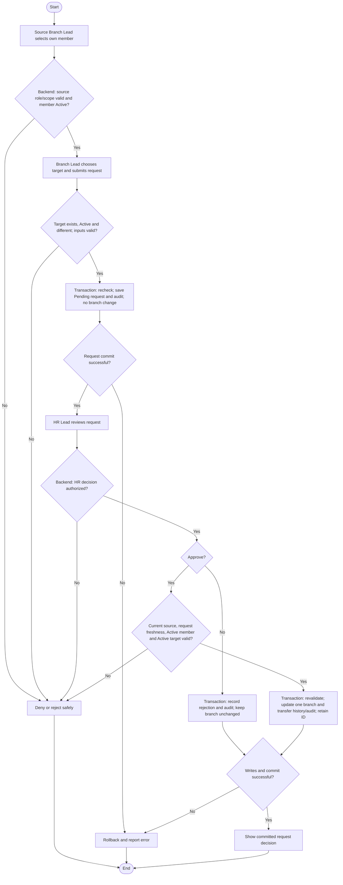

# Activity: Request Member Transfer

**Primary Actor:** Source Branch Lead
**Supporting Actors:** HR Lead (decision authority), backend authorization/member services, audit.
**Status:** BL-004 DECIDED; remaining transfer policies PENDING; not implemented or tested

## Purpose

Request a member transfer without directly changing current branch; HR Lead alone approves or rejects across authorized branches.

## Preconditions

- Active authenticated source Branch Lead with one current assigned branch; member currently belongs to it.
- Member Active; target operational branch exists, is Active and differs from source.
- HR decision requires valid centralized HR permission and current request/assignment validation.

## Inputs and Outputs

- Member ID, source derived by backend, target branch ID and request information. Reason field may be presented as PROPOSED; mandatory reason/other fields are PENDING.
- Output audited Pending request, rejection without branch change or committed HR-approved primary branch change.
- Same permanent Volunteer ID and immutable member primary key throughout.

## Main Flow

1. Source Branch Lead opens own-branch member and Request Transfer; backend verifies role, source scope and current primary branch.
2. Verify member Active; choose a different existing Active target and validate request data. Save Pending request and requester audit atomically without changing current branch.
3. HR Lead retrieves request, reviews member/source/target and available reason, then selects Approve or Reject.
4. Backend authorizes HR. Approval transaction rechecks request freshness, requesting source-lead scope, member still in source and Active, target still Active/different and applicable integrity policies.
5. Update one current primary branch, retain ID/key, record old/new branch, requester/HR decision identities/timestamps and audit/history, then commit together.
6. Rejection records request decision/history and audit atomically without changing member branch. Notification recipients/mechanism remain pending.

## Alternative / Error Flows

- Unauthorized/no source assignment, cross-branch member or stale source ownership: reject safely.
- Inactive member, same source/target or Forming/Paused/Closed/missing target: reject request or approval as applicable.
- Member status, target status or primary branch changes before approval: reject stale approval; no overwrite of newer assignment.
- Concurrent approval/requests, database/history/audit/commit failure: roll back; no duplicate current branches, member or partial transfer.
- Pending consent/open-finance handling needed for safe execution: flag unresolved policy, not an invented settlement requirement or bypass.

## Business Rules

- **BL-004 - DECIDED:** Only Active member and Active target eligible; check on request and again transactionally at HR approval. Source Branch Lead requests only own-branch member; HR alone approves/rejects. Same-branch request invalid.
- Pending/rejected requests do not change current branch. Branch Lead cannot approve own request or directly update primary branch.
- One current primary branch; transfer never creates a member or ID, resets counter or changes original city prefix. LHR-V0001 remains LHR-V0001 after transfer to Faisalabad.
- Historical source collections/reports/assignments retain their attribution and amounts. No cross-branch access escalation or implied source-branch Active requirement at approval.
- Every request/decision mutation is atomically audited; preserve history and deny stale/concurrent conflicting approvals.

## Postconditions

- Request/rejection leaves member branch intact. Valid approval commits one updated current branch and traceable history/audit while identity and historical financial data remain unchanged.
- Failure leaves previous request/member state consistent.

## Activity Diagram

## Acceptance Criteria

- Only current source Branch Lead requests; Inactive member, same target and non-Active target fail.
- Branch Lead cannot approve/directly transfer; authorized HR approval is necessary.
- Approval rechecks Active member/target and source ownership; unauthorized/stale/concurrent approvals cannot corrupt one-current-branch invariant.
- Volunteer ID/key, source financial attribution and historical amounts remain unchanged. Request/rejection never transfers member.
- All successful mutations audited atomically; failed writes/commit leave consistent prior records. These are future tests, not executed checks.

## Pending Decisions

- Target-lead consent, unfinished collections/open reports, cancellation and approval/rejection reason requirements, expiry/duplicate pending requests, source branch Active requirement at approval and notification recipients. No immediate settlement policy is invented.
