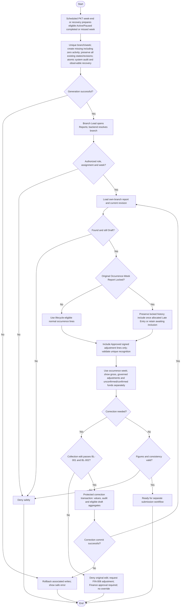

# Activity: Review Weekly Report Draft

**Primary Actor:** Branch Lead
**Supporting Actors:** System draft generator, backend authorization/report/collection services, database and audit.
**Status:** BL-003 and FIN-001/FIN-002/FIN-004 DECIDED; not implemented or tested

## Purpose

Inspect a system-generated branch/week draft and reconcile permitted corrections before submission, without treating a draft as approved data.

## Preconditions

- WR-001/WR-002 scheduled system generation/recovery prepares just-completed or missed eligible Active/Paused operational branch/week Drafts at authoritative PKT week boundary; not dependent on dashboard access. FIN-014 ordinary future-week Closed reports prohibited; legitimate pre-closure recognition container/period remains PENDING; Head Office not operational.
- Active authenticated Branch Lead with one server-derived branch assignment; only that branch's report may be viewed.
- Remaining reconciliation/KPI details and official fixtures must be confirmed for complete acceptance; do not invent them.

## Inputs and Outputs

- Selected reporting week; backend-authorized branch, canonical report ID/state/revision and source collection/member links.
- Display precise boundaries, included collections, exact totals and outstanding/unrouted amounts as supported by approved model.
- Output review/correction result or readiness for [submission](submit-and-resubmit-weekly-report.md); not approval.

## Main Flow

1. At authoritative Asia/Karachi Monday boundary, system generates just-completed reporting-week Draft for each eligible Active/Paused operational branch, including zero activity. Scheduled/recovery execution catches missing eligible weeks after downtime. Database unique branch/week plus transaction makes concurrent retries idempotent; create missing only, never overwrite/reset existing report/revision/state. Persist system audit/observability without fake user actor; no dashboard-trigger dependency or fabricated financial records.
2. Branch Lead opens Weekly Reports; backend authenticates, derives current assigned branch and validates selected week.
3. Retrieve own-branch canonical report and current state/revision. Only Draft is reviewed as a draft; Returned follows feedback/resubmission workflow, Submitted is not editable and Approved/Locked is immutable.
4. Display report interval and actual-occurrence-attributed collections/member links; show gross collections, distinct FIN-005 Late Entry lines referencing original occurrence week, FIN-006 Approved recognized signed adjustments, submitted/unconfirmed and Finance-confirmed remittances, exact figures and supported outstanding funds. No assumption that submission of a transfer equals confirmed receipt. Branch Lead checks consistency against approved aggregation and source records.
5. If correction needed, use [collection correction](manage-offline-collections.md): BL-001 cutoff and BL-002 report/snapshot locks apply; successful correction/audit and permitted draft totals remain consistent. Expired original cannot be corrected directly; FIN-002 requires a separate next-report adjustment under FIN-006 Branch Lead request/Finance decision. Recheck report state before updating; never overwrite a concurrently Submitted report.
6. Reload latest legitimately eligible Draft figures with version/source consistency; Returned latest figures follow separate feedback/resubmission activity. Preserve frozen historical submission revisions/final Approved snapshot. Valid zero-activity Draft may proceed to normal submission; otherwise show validation/lock errors without asserting readiness.

7. If financial CSV/PDF export is requested, independently recheck current branch assignment/record/filter scope, select the effective report revision/snapshot and exact totals, generate protected safe output and record sanitized successful-export audit under EXP-001 to EXP-004. Label Draft estimates explicitly; export performs no submission/approval.

## Alternative / Error Flows

- Export attempt with invalid/expired session, unauthorized role/current branch/direct ID, or expanding filter: reject server-side without private data or successful-export audit. Invalid selection/generation failure cannot change financial records or masquerade as successful export.

- Unauthorized/cross-branch/invalid week, missing draft or retrieval failure: safe error, no false report or invented totals.
- Concurrent draft generation resolves to one canonical branch/week record, not duplicates.
- Non-Draft state: route to appropriate permitted read/feedback activity, not draft editing.
- Expired original or submitted/approved snapshot inclusion: direct correction denied; FIN-006 Branch Lead request and Finance approval required for separate next-report adjustment. FIN-005 routes locked occurrence-week entry to one next-open eligible recognition line, preserving historical snapshot.
- Generation/correction/aggregate/audit/commit failure: rollback associated writes; no partial totals or historical rewrite.

## Business Rules

- **BL-003 - DECIDED:** Asia/Karachi week is Monday 00:00 inclusive to next Monday 00:00 exclusive (Monday through Sunday). Store precise interval instants, with UTC persistence; not ambiguous Sunday 23:59.
- Example: start 2026-10-26 00:00 Asia/Karachi, exclusive end 2026-11-02 00:00 Asia/Karachi. FIN-001 attributes by actual collection occurrence, not record creation, with no interval gaps/overlaps.
- One report per branch/week, exact decimal/currency-safe arithmetic and traceable source links. No binary floating approximation, direct manual fabricated total or guessed seed data.
- BL-001 seven elapsed days is not reporting week. BL-002 prevents Submitted review figures from silent correction and preserves approved snapshots permanently.
- Approved expected fixture totals remain exact acceptance targets, not numbers supplied by this document. No Branch Lead finance approval authority.

- **FIN-001 - DECIDED:** Actual collected_at/equivalent selects occurrence week, not created_at; late-entered original belongs to its occurrence period. Use authorized editable lifecycle only; FIN-005 next-open-report Late Entry recognition preserves locked original-week snapshot. created_at still controls seven-day edit cutoff.
- **FIN-002 - DECIDED:** Expired correction is separate signed original-linked adjustment in next applicable report, not original edit; recognized adjustment lines and gross collections shown separately. FIN-006 Branch Lead requests; Finance approves/rejects, and only Approved recognized once.
- **FIN-003 - DECIDED:** Branch-recorded unconfirmed remittance and Finance-confirmed remittance are separate; only confirmation affects confirmed outstanding aggregation. No guessed KPI formula or duplicate reduction.
- **FIN-004 - DECIDED:** Canonical states Draft, Submitted, Returned, Approved; Approved is already permanently Locked with approval/lock metadata committed together. No independent final-lock action.

- **FIN-005 - DECIDED:** Check original occurrence-week lock: no -> normal occurrence attribution in eligible report; yes -> distinct original-linked Late Entry referencing original week in earliest subsequent same-branch non-Approved report eligible for new lines, never Submitted. Queue if none; preserve history and exactly-once recognition with transaction/uniqueness/idempotency. No automatic negative adjustment or double cumulative count.
- **FIN-006 - DECIDED:** Separate signed original-linked correction request by source Branch Lead; Finance approves/rejects PendingReview once. Only Approved recognized once in next eligible report, queue if none; Rejected zero effect. Submitted-only lock uses Return, not adjustment bypass; no original/snapshot rewrite.
- **FIN-007 - DECIDED:** FIN-011 signedOutstanding = netRecognizedCollections - confirmedRemittances may be negative; reconciliationDeficit = max(0, -signedOutstanding); availableToRemit = max(0, signedOutstanding - active pending reservations), never double-deduct deficit. Use same scope/timing; count original-or-Late Entry once plus Approved recognized corrections. Separate partial pending versus confirmed remittances; report submission/approval never confirms receipt. Exact operational calculations do not replace official KPI/fixture semantics.
- **FIN-008 - DECIDED:** Return Submitted only with backend-validated meaningful trimmed nonempty reason; persist reason/actor/time/report/from-to/revision/audit atomically and show feedback to authorized Branch Lead. Blank fails leaving Submitted; cutoff unchanged and approval/return race safe.

- **FIN-010 - DECIDED:** All PKR draft totals/snapshots/dashboard/export calculations use NUMERIC(18,2)/Prisma Decimal and decimal-string APIs, at most two fractional digits. No JS number money arithmetic/nonfinite/float-derived values or silent excess-precision input rounding; decimal-safe calculations/comparisons, HALF_UP only where calculation genuinely needs it.
- **FIN-011 - DECIDED:** Approved corrections after remittance may create signed deficit; preserve locked originals, confirmed funds, Approved snapshots and adjustment/period history. Finance/Head Office receives authorized explicit deficit visibility; available never negative and insufficient remittance blocked. No automatic compensating payment/write-off; external clearing/recovery/period settlement remains PENDING.
- **FIN-012 - DECIDED:** Pending cancellation request/rejection retains reservation; only Finance-approved cancellation releases once with state/audit atomically. Report review never confirms/cancels remittance; confirmation/cancellation race has one valid outcome.
- **FIN-013 - DECIDED:** Multiple sequential corrections, one PendingReview per original; Finance decides each, protects cumulative original plus all Approved corrections from becoming negative and recognizes each once in eligible period. Approved awaiting recognition/PendingReview/Rejected do not count as recognized totals; preserve all prior approvals/originals. Review itself makes no adjustment decision.

- **WR-001/WR-002/WR-005 - DECIDED:** Automatic just-completed PKT-week Active/Paused Drafts, zero activity included, with idempotent missing-week recovery/canonical uniqueness. Head Office not operational, FIN-014 ordinary Closed future reports prohibited; legitimate pre-closure recognition container/period PENDING; existing history retained and no fake transactions. Scheduler is system process, exact hosting unselected.
- **WR-003 - DECIDED:** Draft/Returned latest eligible exact PKR values never overwrite preserved Submitted revision or final Approved snapshot. Submit/resubmit captures immutable version/submitter/time and locks originals while Submitted; Return respects original cutoff. Later adjustments/confirmed remittances cannot rewrite prior evidence.
- **WR-004 - DECIDED:** Future Finance approval checks unresolved issues by candidate branch/report/recognition scope and material eligible-figure effect, not all pending requests. Unrelated branch/period/non-affecting issue never automatically blocks; unapproved amounts excluded. Distinguish occurrence/recognition/reviewed periods and reassess after resolution; detailed multi-period treatment needs specification.
- **WR-006 - DECIDED:** Generation/edits/submission and Finance transitions recheck backend version/equivalent state, role/branch, source integrity and audit atomically. Reject stale/incompatible actions without partial effects or duplicate recognition; no Approved reopening/manual Lock.

- **FIN-014 - DECIDED:** Closed permits no new ordinary collections/future-week reports; retain original/report/snapshot/financial/member/audit history. Pre-closure reconciliation needs existing authorization/separate audit, no revived inactive/unassigned lead access. Exact discovery recognition container/period after closure PENDING; no new report type/reopening; Active/Paused drafts unchanged.
- **FIN-015 - DECIDED:** Same WR-004 relevance rule: transactionally recheck candidate branch/report/period/recognition material effect. Unrelated/mere request existence does not block; exclude unapproved amounts, resolve then reassess. No automatic adjustment approval/global submission ban/frozen rewrite.
- **FIN-016/FIN-017 - DECIDED:** Future eligible same-branch recognized collections offset cumulative deficit exactly once/in correct period, not other-branch funds or artificial transfers. Preserve immutable weekly figures/nonnegative available. Remittance uses branch-level availability, no mandatory collection-ID allocation; role separation/reservations/confirmation/cancellation/audit/concurrency safeguards unchanged.
- **FIN-018 - DECIDED:** Adjustment reason mandatory/file optional; valid no-file allowed, attachment not substitute for reason/correctness. Finance review/upload controls apply; remittance file optional, amount/date/reference required. See [authoritative financial definitions](../../domain-rules.md); provider/limits are technical configuration.

- **PERM-003 / EXP-001 to EXP-004 - DECIDED:** View current-assigned-branch authorized financial records/revisions and related financial workflow/audit history under [permissions](../../permissions.md). Branch scope backend-derived; guessed other-branch IDs/filters and former-branch access denied immediately, no unrelated HR/CMS/security audit or financial write grant. Optional CSV/PDF export separately authenticates/authorizes, validates period/branch/status/financial filters, selects same effective revision/snapshot and exact PKR totals for both formats, clearly labels Draft/frozen Submitted/Approved and financial categories. Server CSV injection/encoding protection preserves legitimate signed money; sanitize PDF and omit unrelated private data. Protect response caching/public access; each successful export appends sanitized actor/action/time/scope/filter/format/source revision metadata, not file bodies; denied calls never successful-export events. Ordinary viewing still changes no business state; export never edits immutable figures. Full [future test coverage](../../../project-context/modules/dashboard.md).

## Postconditions

- Branch Lead has reviewed own-branch Draft or received safe failure/state routing.
- Authorized corrections reflect in current draft with audit; immutable reports/history remain intact. Review alone performs no submission.

## Activity Diagram

## Acceptance Criteria

- Correct inclusive/exclusive PKT interval including Sunday/next-Monday boundaries; no duplicate canonical branch/week under concurrent generation.
- Branch A cannot view/edit branch B report; Submitted/Approved state cannot masquerade as editable Draft.
- Authorized in-window corrections update exact permitted draft aggregates; stale state/failed writes do not overwrite submitted/approved data.
- Official sample totals remain exact reconciliation targets when available; no guessed totals or floating-point errors.
- Late entry appears in actual occurrence week when permitted; Monday boundary tests use occurrence, not creation. Approved occurrence-week snapshot never silently changes.
- FIN-005 late lines include original-week reference, no duplicates and awaiting inclusion when no eligible report. Pending/Rejected adjustment requests contribute zero recognized correction.
- Gross and authorized adjustment lines distinct, unconfirmed transfer not settled, no double-counting and Approved always locked. Full business tests remain planned, not executed.

- FIN-010 values stay exact; FIN-011 negative signedOutstanding is not hidden or treated as available cash, and availableToRemit never negative. FIN-012 request/rejection retains claim, only approved cancellation releases once. FIN-013 sequential Approved effects count once; PendingReview/Rejected/queued-unrecognized deltas excluded. These remain future tests, not execution evidence.

- Planned WR-001/002/005 tests: PKT Monday completion, Active/Paused/zero activity, independent of dashboard opening, missed-week recovery, concurrent uniqueness and retry preserving Submitted/Returned/Approved without fake records. Closed handling not inferred.
- Planned WR-003/006 tests: eligible latest Draft/Returned recalculation, frozen submitted revisions, new preserved resubmission revision, immutable Approved final snapshot, scoped/versioned atomic audit and conflict rollback. WR-004 relevant/unrelated approval tests belong to Finance workflow; no tests executed.

- Planned FIN integration tests: preserve Closed history/no ordinary future report or new collection, deny unauthorized settlement; relevant material unresolved issue blocks candidate approval and unrelated issue does not. Correct same-branch/other-branch deficit behavior, no historic rewrite, exact branch-level partial remittance without collection allocation, reason/no-file validation and concurrent over-remittance prevention are planned for source workflows. No tests executed here.

- Planned PERM/EXP checks: permitted scoped read/export, denied cross-branch/direct-ID/stale-assignment and invalid sessions; CSV/PDF same revision/totals with safe text, immutable figures, private response and sanitized successful-export audit. No tests implemented/executed; libraries/layout/file naming/batching remain pending.

## Pending Decisions

- Late-entry evidence and adjustment-upload technical configuration, backdating limits, Finance adjustment decision explanation and exact external deficit clearing/refund/recovery/period settlement. FIN-010 money, FIN-011 deficit accounting and FIN-013 sequential/cumulative rules are DECIDED.
- Confirmed-remittance disputes/authority/accounting, external bank evidence validation, expiry/other rejection-release paths and individual allocations; FIN-012 Pending cancellation/release is DECIDED; financial notifications/provider/recipients; exact official KPI/fixtures, Exact legitimate pre-closure discovery recognition container/accounting period after closure, exact scheduler hosting and snapshot schema/storage configuration. Core WR generation/recovery/revision/zero-activity/concurrency behavior is DECIDED.
- Recognition routing, adjustment ownership/approval-before-recognition, partial/over-remittance rules and mandatory Return reason are DECIDED, not pending.
