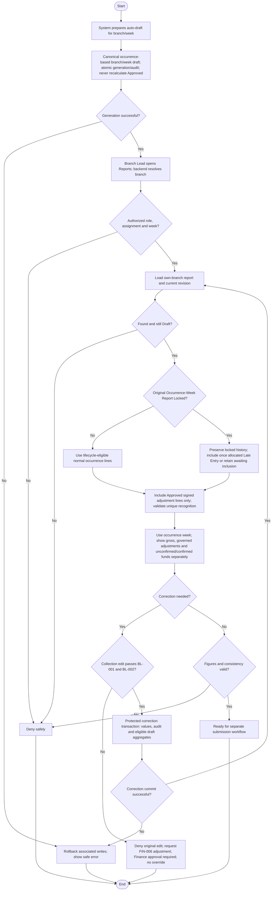

# Activity: Review Weekly Report Draft

**Primary Actor:** Branch Lead
**Supporting Actors:** System draft generator, backend authorization/report/collection services, database and audit.
**Status:** BL-003 and FIN-001/FIN-002/FIN-004 DECIDED; not implemented or tested

## Purpose

Inspect a system-generated branch/week draft and reconcile permitted corrections before submission, without treating a draft as approved data.

## Preconditions

- System prepares auto-draft for configured branch/week under the future approved generation policy.
- Active authenticated Branch Lead with one server-derived branch assignment; only that branch's report may be viewed.
- Remaining reconciliation/KPI details and official fixtures must be confirmed for complete acceptance; do not invent them.

## Inputs and Outputs

- Selected reporting week; backend-authorized branch, canonical report ID/state/revision and source collection/member links.
- Display precise boundaries, included collections, exact totals and outstanding/unrouted amounts as supported by approved model.
- Output review/correction result or readiness for [submission](submit-and-resubmit-weekly-report.md); not approval.

## Main Flow

1. System automatically prepares a draft for branch/week; enforce one canonical report with database uniqueness and concurrency-safe generation. Persist draft creation and appropriate audit atomically.
2. Branch Lead opens Weekly Reports; backend authenticates, derives current assigned branch and validates selected week.
3. Retrieve own-branch canonical report and current state/revision. Only Draft is reviewed as a draft; Returned follows feedback/resubmission workflow, Submitted is not editable and Approved/Locked is immutable.
4. Display report interval and actual-occurrence-attributed collections/member links; show gross collections, distinct FIN-005 Late Entry lines referencing original occurrence week, FIN-006 Approved recognized signed adjustments, submitted/unconfirmed and Finance-confirmed remittances, exact figures and supported outstanding funds. No assumption that submission of a transfer equals confirmed receipt. Branch Lead checks consistency against approved aggregation and source records.
5. If correction needed, use [collection correction](manage-offline-collections.md): BL-001 cutoff and BL-002 report/snapshot locks apply; successful correction/audit and permitted draft totals remain consistent. Expired original cannot be corrected directly; FIN-002 requires a separate next-report adjustment under FIN-006 Branch Lead request/Finance decision. Recheck report state before updating; never overwrite a concurrently Submitted report.
6. Reload/reconcile current draft figures. If valid, proceed to separate submission; otherwise show validation/lock errors without asserting readiness.

## Alternative / Error Flows

- Unauthorized/cross-branch/invalid week, missing draft or retrieval failure: safe error, no false report or invented totals.
- Concurrent draft generation resolves to one canonical branch/week record, not duplicates.
- Non-Draft state: route to appropriate permitted read/feedback activity, not draft editing.
- Expired original or submitted/approved snapshot inclusion: direct correction denied; FIN-006 Branch Lead request and Finance approval required for separate next-report adjustment. FIN-005 routes locked occurrence-week entry to one next-open eligible recognition line, preserving historical snapshot.
- Generation/correction/aggregate/audit/commit failure: rollback associated writes; no partial totals or historical rewrite.

## Business Rules

- **BL-003 - DECIDED:** Asia/Karachi week is Monday 00:00 inclusive to next Monday 00:00 exclusive (Monday through Sunday). Store precise interval instants, with UTC persistence; not ambiguous Sunday 23:59.
- Example: start 2026-10-26 00:00 Asia/Karachi, exclusive end 2026-11-02 00:00 Asia/Karachi. FIN-001 attributes by actual collection occurrence, not record creation, with no interval gaps/overlaps.
- One report per branch/week, exact decimal/currency-safe arithmetic and traceable source links. No binary floating approximation, direct manual fabricated total or guessed seed data.
- BL-001 seven elapsed days is not reporting week. BL-002 prevents Submitted review figures from silent correction and preserves approved snapshots permanently.
- Approved expected fixture totals remain exact acceptance targets, not numbers supplied by this document. No Branch Lead finance approval authority.

- **FIN-001 - DECIDED:** Actual collected_at/equivalent selects occurrence week, not created_at; late-entered original belongs to its occurrence period. Use authorized editable lifecycle only; FIN-005 next-open-report Late Entry recognition preserves locked original-week snapshot. created_at still controls seven-day edit cutoff.
- **FIN-002 - DECIDED:** Expired correction is separate signed original-linked adjustment in next applicable report, not original edit; recognized adjustment lines and gross collections shown separately. FIN-006 Branch Lead requests; Finance approves/rejects, and only Approved recognized once.
- **FIN-003 - DECIDED:** Branch-recorded unconfirmed remittance and Finance-confirmed remittance are separate; only confirmation affects confirmed outstanding aggregation. No guessed KPI formula or duplicate reduction.
- **FIN-004 - DECIDED:** Canonical states Draft, Submitted, Returned, Approved; Approved is already permanently Locked with approval/lock metadata committed together. No independent final-lock action.

- **FIN-005 - DECIDED:** Check original occurrence-week lock: no -> normal occurrence attribution in eligible report; yes -> distinct original-linked Late Entry referencing original week in earliest subsequent same-branch non-Approved report eligible for new lines, never Submitted. Queue if none; preserve history and exactly-once recognition with transaction/uniqueness/idempotency. No automatic negative adjustment or double cumulative count.
- **FIN-006 - DECIDED:** Separate signed original-linked correction request by source Branch Lead; Finance approves/rejects PendingReview once. Only Approved recognized once in next eligible report, queue if none; Rejected zero effect. Submitted-only lock uses Return, not adjustment bypass; no original/snapshot rewrite.
- **FIN-007 - DECIDED:** Outstanding recognized net less confirmed; available less active pending reservations. Separate partial pending versus confirmed remittances; report submission/approval never confirms receipt. Exact operational calculations do not replace official KPI/fixture semantics.
- **FIN-008 - DECIDED:** Return Submitted only with backend-validated meaningful trimmed nonempty reason; persist reason/actor/time/report/from-to/revision/audit atomically and show feedback to authorized Branch Lead. Blank fails leaving Submitted; cutoff unchanged and approval/return race safe.

## Postconditions

- Branch Lead has reviewed own-branch Draft or received safe failure/state routing.
- Authorized corrections reflect in current draft with audit; immutable reports/history remain intact. Review alone performs no submission.

## Activity Diagram

## Acceptance Criteria

- Correct inclusive/exclusive PKT interval including Sunday/next-Monday boundaries; no duplicate canonical branch/week under concurrent generation.
- Branch A cannot view/edit branch B report; Submitted/Approved state cannot masquerade as editable Draft.
- Authorized in-window corrections update exact permitted draft aggregates; stale state/failed writes do not overwrite submitted/approved data.
- Official sample totals remain exact reconciliation targets when available; no guessed totals or floating-point errors.
- Late entry appears in actual occurrence week when permitted; Monday boundary tests use occurrence, not creation. Approved occurrence-week snapshot never silently changes.
- FIN-005 late lines include original-week reference, no duplicates and awaiting inclusion when no eligible report. Pending/Rejected adjustment requests contribute zero recognized correction.
- Gross and authorized adjustment lines distinct, unconfirmed transfer not settled, no double-counting and Approved always locked. Full business tests remain planned, not executed.

## Pending Decisions

- Late-entry/adjustment evidence, backdating limits, sequential corrections/cumulative limits, Finance adjustment decision explanation and negative adjustment/remitted-cash recovery.
- Remittance cancellation/expiry/dispute/release, individual allocations and stuck reservations; financial notifications/provider/recipients; exact official KPIs/fixtures and unrelated auto-draft/snapshot implementation details.
- Recognition routing, adjustment ownership/approval-before-recognition, partial/over-remittance rules and mandatory Return reason are DECIDED, not pending.
