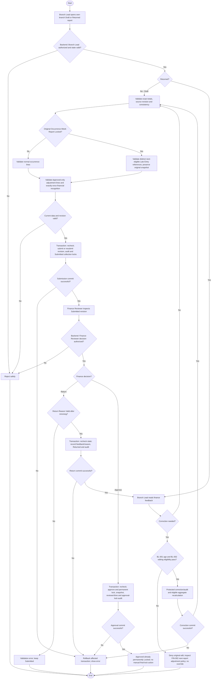

# Activity: Submit and Resubmit Weekly Report

**Primary Actor:** Branch Lead (own-branch submission/resubmission)
**Supporting Actors:** Finance Reviewer (return/approve only under finance permission), report/collection services, audit; Super Admin oversight only under established grants.
**Status:** Required lifecycle documented; BL-001 to BL-003 and FIN-001 to FIN-004 DECIDED; not implemented or tested

## Purpose

Submit a valid own-branch draft, inspect finance feedback and resubmit after only eligible corrections, preserving immutable approval and complete transition history.

## Preconditions

- Active authenticated Branch Lead with one server-derived branch assignment and allowed report state.
- Canonical branch/week report follows [BL-003 calendar](review-weekly-report-draft.md), approved exact financial model and current source/revision checks.
- Finance return/approval is independently backend-authorized; Branch Lead cannot self-approve.

## Inputs and Outputs

- Report identity, branch/week, current state/revision and exact source totals; review feedback/return reason under applicable finance workflow.
- Output submitted revision/snapshot with actor/time, Returned feedback, approved immutable snapshot or safe error.
- Transition audit: report, branch/week, actor, from/to status, timestamp, applicable reason, revision/snapshot and meaningful before/after values. No mutation/deletion of previous events.

## Main Flow

1. Branch Lead opens own-branch Draft. Backend rechecks role/branch/current state, totals and consistency against current sources.
2. In one protected transaction, capture appropriate submitted revision/snapshot, move Draft to Submitted, append actor/time/transition audit and enforce linked collection locks; commit before showing submission success to Finance Reviewer queue.
3. Finance Reviewer separately authorizes review. FIN-008 Return validates mandatory meaningful trimmed nonempty reason, records feedback and transition audit atomically and moves Submitted to Returned; approval follows permissible state checks and atomic approval audit.
4. On Returned, Branch Lead inspects feedback. Corrections use [BL-001/BL-002](manage-offline-collections.md): only original age less than seven days and permitted report/snapshot state. Return never resets created_at or grants override.
5. Reconcile current exact totals/revision after permitted correction, or without correction if appropriate and validations pass. Resubmit via protected state transition, new submission/revision event and audit; collections lock again while Submitted and finance reviews again.
6. Finance Reviewer approval sets canonical Approved (permanently Locked), captures immutable authorized revision, reviewer/time/lock metadata and approval/locking audit in the same transaction. No separate manual final-lock action or permission exists; Branch Lead cannot approve or Finance-confirm remittance.

## Alternative / Error Flows

- Wrong role, cross-branch report, missing/invalid state or stale revision: reject safely without submission or approval.
- Returned error concerns a collection at/after seven-day cutoff: deny original edit; FIN-002 requires separate original-linked signed next-report adjustment. FIN-006 Branch Lead request/Finance approval and next-eligible-report recognition apply; no return/resubmit bypass or financial override.
- Concurrent collection edit/submission/finance decision: protect source/revision/state validation so only compatible atomic result commits; cannot double-submit or rewrite Approved/Locked.
- Any state/history/audit/commit failure: rollback related changes; no partial locks, revisions or totals.
- Finance return/approval requires Finance Reviewer authorization even when shown in this end-to-end diagram. Branch Lead identity never supplies that permission.

## Business Rules

- **OFFICIAL lifecycle actions / FIN-004 representation:** Draft -> Submitted -> Returned -> Submitted (resubmission revision/event) -> Approved, with permanent locking applied atomically at approval. Canonical persisted states are Draft, Submitted, Returned, Approved; Locked describes the Approved effect, not a later manual state/action. Return is not mandatory before approval.
- **BL-001 - DECIDED:** Normal collection edits strictly before authoritative created_at + 7 x 24 hours UTC; exactly cutoff fails, edits/backdates never reset clock.
- **BL-002 - DECIDED:** Draft/Returned permit only eligible age/scoped correction; Submitted locks until formal Return, Approved/Locked and approved snapshot inclusion permanently lock. Return cannot reopen expired entries. Approved figures never change.
- **BL-003 - DECIDED:** Branch/week identity unique; Asia/Karachi Monday 00:00 inclusive to next Monday 00:00 exclusive. Exact money only. FIN-001 attributes by actual occurrence, not created_at; creation still controls seven-day edit cutoff.
- Branch Lead submit/resubmit only own branch. Finance Reviewer returns/approves; no self-approval or invented Super Admin override. FIN-004 final lock is automatic within Finance approval; no independent lock authority/timing policy is needed.
- Every transition, submitted revision and reason where applicable is auditable atomically. Track unsent funds under approved model; reporting alone does not establish remittance.
- Official fixture totals must reconcile exactly once supplied; never invent values or financial calculations.

- **FIN-001 - DECIDED:** Actual collected_at/equivalent selects PKT occurrence week; created_at is entry/edit age only. Late entered records cannot rewrite Submitted revision or Approved snapshot; FIN-005 separately recognizes locked occurrence-week Late Entry in next eligible report, without altering original week.
- **FIN-002 - DECIDED:** Expired original collection unchanged; corrections become separate signed original-linked lines in next applicable report under FIN-006 request/approval governance. Explain gross collections/authorized adjustments separately and avoid double application. Source Branch Lead requests; only Finance Reviewer approves/rejects and only Approved recognized.
- **FIN-003 - DECIDED:** Branch Lead records own-branch remittance; Finance Reviewer independently confirms. Report submission/approval never confirms funds receipt. Unconfirmed, confirmed and outstanding balances remain distinct under exact approved formulas.
- **FIN-004 - DECIDED:** Approval and final lock, snapshot, reviewer/time and append-only audit commit together. No Approved/editable persisted state and no later manual lock. Return/approval/collection races permit only consistent state/revision outcome.

- **FIN-005 - DECIDED:** Check original occurrence-week lock: no -> normal occurrence attribution in eligible report; yes -> distinct original-linked Late Entry referencing original week in earliest subsequent same-branch non-Approved report eligible for new lines, never Submitted. Queue if none; preserve history and exactly-once recognition with transaction/uniqueness/idempotency. No automatic negative adjustment or double cumulative count.
- **FIN-006 - DECIDED:** Separate signed original-linked correction request by source Branch Lead; Finance approves/rejects PendingReview once. Only Approved recognized once in next eligible report, queue if none; Rejected zero effect. Submitted-only lock uses Return, not adjustment bypass; no original/snapshot rewrite.
- **FIN-007 - DECIDED:** Outstanding recognized net less confirmed; available less active pending reservations. Separate partial pending versus confirmed remittances; report submission/approval never confirms receipt. Exact operational calculations do not replace official KPI/fixture semantics.
- **FIN-008 - DECIDED:** Return Submitted only with backend-validated meaningful trimmed nonempty reason; persist reason/actor/time/report/from-to/revision/audit atomically and show feedback to authorized Branch Lead. Blank fails leaving Submitted; cutoff unchanged and approval/return race safe.

## Postconditions

- Successful submission/resubmission is in finance review with linked edits locked and append-only transition/revision history.
- Returned contains traceable feedback; only eligible original edits or separately governed next-report adjustments are possible. Approved is already locked with immutable snapshot/history.
- Failed operations preserve consistent prior report/collection states and financial figures.

## Activity Diagram

## Acceptance Criteria

- Own-branch Draft submission/Returned resubmission only; other-branch and self-approval requests fail server-side.
- Submitted collection edits locked; authorized Finance Reviewer return audited; Returned correction still requires original age strictly under seven days.
- Repeated/concurrent transitions cannot double-submit, accept stale revision or overwrite Approved figures. Cutoff errors do not enable override.
- Every submit/return/resubmit/approve/lock transition records actor/state/time/report/branch/week/revision and applicable feedback atomically; audit failures roll back business changes.
- Finance approval automatically locks snapshot in same transaction; no Approved/unlocked intermediate state or later manual step. Failed approval/audit/lock writes leave prior state.
- Occurrence-based attribution and signed adjustment lines remain separate from gross/confirmed/unconfirmed remittances; no approval-as-settlement inference or double effect.
- FIN-005 one normal-or-Late Entry effect and FIN-006 Approved-only signed adjustment recognition validated before submission; no duplicates or immutable snapshot changes. FIN-008 blank/whitespace return fails; valid reason visible to authorized Branch Lead.
- PKT boundaries, exact totals and official financial fixtures remain future verification targets, without guessed data. No tests are implemented/executed by this document.

## Pending Decisions

- Late-entry/adjustment evidence, backdating limits, sequential corrections/cumulative limits, Finance adjustment decision explanation and negative adjustment/remitted-cash recovery.
- Remittance cancellation/expiry/dispute/release, individual allocations and stuck reservations; financial notifications/provider/recipients; exact official KPIs/fixtures and unrelated auto-draft/snapshot implementation details.
- Recognition routing, adjustment ownership/approval-before-recognition, partial/over-remittance rules and mandatory Return reason are DECIDED, not pending.
