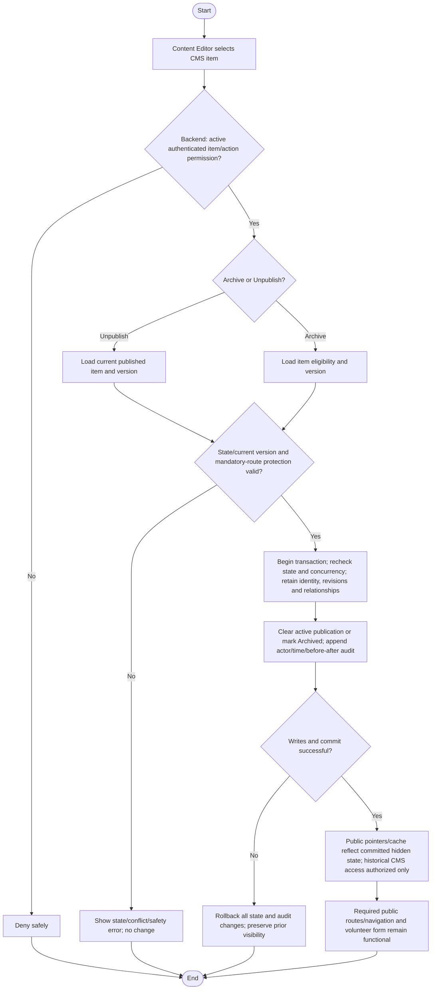

# Activity: Archive or Unpublish CMS Content

**Primary Actor:** Content Editor
**Supporting Actors:** Backend CMS/authorization, database/audit and public visibility/cache projection.
**Status:** CE-001/CE-005 DECIDED; archived restoration PENDING; not implemented or tested

## Purpose

Remove eligible public CMS content from active publication or retire it from active editorial/public listing while preserving identity, revisions, references and append-only audit.

## Preconditions

- Active authenticated Content Editor with backend item/action permission; current publication/archive state and version known.
- Unpublish targets currently published content; Archive targets eligible item under approved lifecycle validation. Do not infer restoration rights.
- Mandatory public route, navigation and account-free volunteer functionality must remain intact.

## Inputs and Outputs

- Stable CMS item identity/type, chosen Unpublish or Archive action and current version/state expectations. Confirmation UI policy remains PENDING, not a new approval requirement.
- Relevant actor/time, before/after publication/archive state, retained revision references and audit metadata; no exact table/column names asserted.
- Output committed visibility/archive result or unchanged-state safe error. Archived/unpublished records remain internally accessible only to authorized staff.

## Main Flow

1. Content Editor selects CMS item; backend authenticates active staff and verifies item/action permission. Editor chooses Unpublish or Archive.
2. Load current item/revisions and version, validate state/action and mandatory-route protection. Apply any defined UI confirmation without inventing Super Admin sign-off.
3. **Unpublish:** In protected transaction recheck eligibility/concurrency, clear active public publication reference/visibility while retaining identity, all revisions/relationships and editorial history; record actor/time/before-after audit.
4. **Archive (separate alternative):** In protected transaction recheck eligibility/concurrency, mark item Archived and exclude it from active editorial/public presentation, retaining all content identity/revisions/relationships; append actor/time/state-change audit.
5. Commit operation atomically. Public APIs/current publication pointer and cache projection must reflect committed visibility, with no partially public state. On failure rollback all related state/audit changes and retain prior visibility.
6. Authorized historical CMS view retains item/revisions. Required page routes/navigation/form remain available even when an editorial section is hidden; fallback details are not finalized.

## Alternative / Error Flows

- Unauthorized/inactive actor, missing item or invalid action/state: safe denial/not-found; no private history leakage.
- Already unpublished/archived or stale concurrent publish/archive request: safely reject/no-op under eventual repeat-operation policy without duplicate mutation or history loss.
- Attempt to disable mandatory route/form or hard-delete published content: deny; no normal Delete permission is documented.
- Database/audit/commit or visibility-coordination failure: do not report a partial successful operation; preserve atomic authoritative state and prevent stale public exposure. Exact cache implementation remains pending.
- Request to restore archived item: operational policy PENDING; do not invent reactivation/republication transition.

## Business Rules

- **CE-001 - DECIDED:** Authorized Content Editor may archive/unpublish CMS content without extra Publisher role or normal Super Admin publication approval. Server-side authorization, not button visibility, controls execution.
- **CE-005 - DECIDED:** No normal physical deletion of published CMS content. Unpublish removes active public visibility, retaining authorized editorial management and potential future publication subject to validation; Archive retires active item while preserving history. Both retain identity/revisions/relationships/audit and internal authorized access; neither is currently published public content afterward.
- Publication visibility and revision history are separate concepts; retained historical Published revisions must not be exposed as current by anonymous direct requests.
- Atomic state/audit records actor/item/old-new state/time; concurrent operations cannot produce mixed visibility or erase history. Cache/public pointers reflect committed state; no private internal media paths are exposed.
- **CE-004 - DECIDED:** Published event becoming Past is display classification only, not Archive/Unpublish/Delete/new revision. Past remains publicly readable under event visibility design until separately hidden.
- Protect Home, About, Programs, Branches, Events, Get Involved and Contact routes, public navigation and application backend/HR validation. Hiding editorial section cannot disable them; staff portal remains separate and public needs no account.
- CMS permissions do not grant staff/Branch Lead assignment, operational branch status, HR acceptance, collections/report/remittance or restricted internal audit access. Safe localized content/media, no real personal/CNIC sample data or online payments.

## Postconditions

- Success hides eligible item from current publication or archives it, retaining authorized internal history and mandatory public functionality with committed audit.
- Failure leaves prior authoritative item/visibility/history unchanged; no physical deletion or automatic restoration.

## Activity Diagram

## Acceptance Criteria

- Backend-authorized Content Editor can unpublish/archive eligible content; unauthorized/inactive/direct hard-delete requests fail.
- Success removes item from current public APIs/listing but preserves stable identity, previous revisions, relationships and audit; private history not anonymously exposed.
- Failed/concurrent mutation cannot partly hide/publish item or erase audit; actor/time/old-new state traceable and public projection matches committed state.
- Past classification alone never archives/unpublishes; explicit operation distinct. All seven mandatory routes and account-free application remain functional.
- No operational HR/branch/finance data changed or restoration grant inferred. These are future test criteria, not executed tests.

## Pending Decisions

- Exact archived restoration/republication lifecycle, repeat-action/confirmation UI details and any state-specific archive eligibility beyond approved high-level authority.
- Cache invalidation/visibility coordination mechanism, fallback content for hidden optional/mandatory editorial sections and editorial notifications.
- Media storage/type/size limits, rich-text editor/sanitizer and per-type schema remain pending in the shared lifecycle; no new deletion right.
