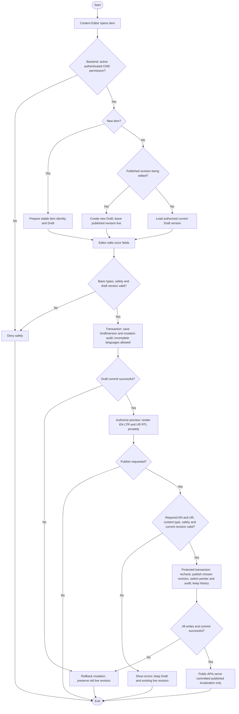

# Activity: Draft, Preview and Publish CMS Content

**Primary Actor:** Content Editor
**Supporting Actors:** Backend CMS/authorization, database and audit; public visitors read published content only.
**Status:** CE-001/CE-002/CE-003 DECIDED; not implemented or tested

## Purpose

Define the authoritative reusable draft/preview/publication workflow for program, event and public-page editorial content. Exact database fields/APIs are conceptual, not an implementation specification.

## Preconditions

- Valid authenticated active Content Editor with backend permission for item/action on every internal request, including preview; UI hiding is insufficient.
- Content type/item/revision identities are valid; type-specific required field schema must be approved before publication validation is implemented.
- No Super Admin approval is required for normal CMS publication. No Publisher role is introduced; five staff roles remain.

## Inputs and Outputs

- Stable logical item identity/type; localized en/ur content in one revision; draft/version expectations and optional supported media.
- Distinct current draft and published revision references, visibility, editor/create/update metadata, published time/publisher and append-only audit. These concepts are not finalized table/column names.
- Output saved incomplete Draft, protected EN/LTR and UR/RTL preview or atomically published chosen revision. Never anonymous draft content.

## Main Flow

1. Content Editor opens CMS item; backend authorizes active staff and permitted action. New item receives stable identity; editing published content creates a new Draft revision; unfinished draft editing uses its current saved version.
2. Edit localized content; backend validates basic types/content safety and draft version without requiring bilingual completeness. Save draft, editor/version metadata and appropriate mutation audit atomically, rejecting stale writes.
3. Select Preview; backend authorizes selected Draft and renders en LTR and ur RTL with warnings where incomplete. Preview performs no publication, pointer change or silent content modification.
4. Select Publish; backend loads exact selected Draft, rechecks permission/version/item visibility and validates required English fields, required Urdu fields, type-specific requirements and safe rendering constraints. Optional fields need not be filled.
5. In protected transaction revalidate eligibility/version and validated content, promote chosen revision, atomically switch published reference and append audit with actor/time/item/previous and new revisions. Preserve older revisions as history; commit together.
6. Public reads now serve only the committed published revision in chosen language. Public visibility/cache must reflect committed state; a failed operation cannot leak draft or partially switch languages.

## Alternative / Error Flows

- Inactive/unauthorized account, invalid item/revision or unavailable record: deny/not-found safely without draft disclosure.
- Invalid basic types, unsafe scripts/rich text or rejected media: show safe validation errors; incomplete language alone does not prevent a valid Draft save.
- Publish missing/blank required EN or UR field, invalid schedule/type or unsafe content: block publication, retain Draft and existing live revision.
- Concurrent stale edit/publish/archive or database/audit/commit failure: reject/rollback whole mutation; old live content remains unchanged and histories intact.
- Archived item requiring restoration: apply only future approved restoration policy; do not infer a republish bypass.

## Business Rules

- **CE-001 - DECIDED:** Content Editor creates/edits authorized Drafts, previews, publishes validated content and revises published items, without Super Admin sign-off. Archive/unpublish follows [visibility workflow](archive-unpublish-content.md).
- **CE-002 - DECIDED:** Both required en and ur fields in same item/revision must be present, nonempty after trimming where applicable, type-valid, safe and within approved limits before publication. Incomplete Draft allowed; public language switch serves corresponding published localization, en LTR/ur RTL. UI labels remain in i18n; no requirement to recreate them in CMS. Never automatically publish placeholders/machine translation as editorially approved.
- **CE-003 - DECIDED:** Published revision never edited in place. New Draft coexists with old live revision; successful atomic publication switches pointer, preserves history and logs previous/new revision. Failed publish leaves old revision live; concurrency/version checks prevent silent overwrite.
- Logical visibility is independent of revision state: an item can have a Draft and a live Published revision, or none live; historical published revisions are not automatically current public content. Do not flatten all into one contradictory status.
- Backend limits Content Editor to CMS, not staff/branch lifecycle/assignment, HR decisions, financial entries/reports/remittances or restricted internal audit. Preview/private revisions require authorization; public APIs select only currently published nonarchived content. No online payments or real personal/CNIC sample content.
- Safely validate/render localized rich text against script injection. If media supported validate type/size, disallow executables, hide private paths and require bilingual alt text for meaningful images; exact media/editor/sanitizer implementation remains PENDING.

## Postconditions

- Draft mutation commits version/audit without changing current publication. Preview is private and read-only.
- Successful publication changes both localized public versions via one revision pointer/audit transaction; failures preserve previous publication/history.

## Activity Diagram

## Acceptance Criteria

- Active permitted Content Editor drafts/publishes without Super Admin approval; unauthorized roles/direct API requests fail and no other domain grants result.
- Incomplete bilingual Draft saves; missing/whitespace required EN/UR/type-invalid/unsafe content cannot publish. Optional fields need not be filled; placeholders not auto-approved.
- Preview is authorized/read-only; anonymous APIs never expose drafts/history/archived content. Public en LTR/ur RTL switch uses matching published revision.
- Editing published item preserves live revision; successful publish switches atomically and preserves previous/audit metadata. Failed publication or stale concurrent writes cannot alter live content.
- No operational record mutation, real personal data or payments. These are future test specifications, not executed/implemented tests.

## Pending Decisions

- Exact mandatory per-type fields/limits, rich-text format/sanitization library, media types/dimensions/storage/limits, publication cache invalidation mechanics and editorial notifications.
- Archived restoration/republication policy and specialized optional-section fallbacks. High-level CE-001 to CE-003 requirements are final.
