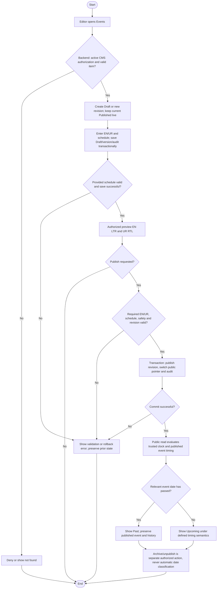

# Activity: Manage Events Content

**Primary Actor:** Content Editor
**Supporting Actors:** Backend CMS/authorization/audit and trusted event-time classification; public visitors read currently published events.
**Status:** CE-001 to CE-004 DECIDED; schedule representation details PENDING; not implemented or tested

## Purpose

Manage bilingual event drafts/revisions and automatically classify published events into Upcoming/Past without deleting or manually archiving completed events.

## Preconditions

- Active authenticated Content Editor authorized server-side for CMS item/action; existing identity/version valid when editing.
- Trusted clock, valid event timestamps and authoritative timezone interpretation available; ambiguous schedule types need approved semantics before execution.

## Inputs and Outputs

- **PROPOSED field schema:** en/ur title/description; valid start time, end timestamp or supported date-only schedule; public venue where applicable; optional supported branch/program association/media and publication action. Exact required per-type fields PENDING.
- No mandatory registration, ticketing or payment functionality. Associations do not grant branch/program operational edit permission.
- Output Draft/private preview or committed bilingual Published revision with computed Upcoming/Past display and retained history/audit.

## Main Flow

1. Content Editor opens Events; backend checks active staff/CMS authorization and retrieves permitted event identity/revisions.
2. Create a new Draft or new Draft revision of published event; reuse unfinished Draft only with current version check. Published schedule/details remain unchanged during drafting.
3. Enter localized content/schedule; server validates provided dates/time consistency and safe types. Save incomplete bilingual Draft and mutation audit atomically; missing required translations block Publish, not a valid Draft save.
4. Preview en LTR/ur RTL privately. Publish only after backend validates required bilingual fields, schedule, state, safety and exact revision under [shared workflow](draft-preview-publish-content.md).
5. Atomically switch published revision and append audit, preserving prior revisions. On public read, use committed event timing and trusted clock to calculate Upcoming/Past without manual archive.
6. Completed event appears in Past and remains publicly readable under event visibility design while Published; crossing time boundary does not revise, unpublish, archive, delete or mutate audit. Explicit archive/unpublish follows [separate activity](archive-unpublish-content.md).

## Alternative / Error Flows

- Unauthorized/inactive, missing event or retrieval failure: safe deny/not-found/error without disclosure.
- Invalid schedule/end-before-start/invalid local date: reject inconsistent provided schedule; do not silently convert to another date or depend solely on browser time.
- Incomplete required EN/UR on Publish, unsafe content/media or stale concurrent revision: reject publish; current public version stays.
- Draft save/publication/audit/commit failure: rollback associated mutation. Event already Past at publication is not automatically deleted or archived; classify under supported semantics.
- Undefined multi-day/date-only/timezone representation: flag pending scheduling details instead of inventing exact interpretation.

## Business Rules

- **CE-001 - DECIDED:** Authorized Content Editor drafts/publishes without Super Admin approval; backend checks every CMS request/preview, no extra role or finance/HR/staff/branch-lifecycle authority.
- **CE-002 - DECIDED:** Complete safe required en and ur content of same revision before publish; incomplete Draft allowed, optional fields not mandatory, English LTR/Urdu RTL. UI labels remain i18n.
- **CE-003 - DECIDED:** Published event edits create new Draft; live revision stays until atomic validated publication/audit, with stale updates rejected and historical revisions retained.
- **CE-004 - DECIDED:** Published event automatically moves from Upcoming display to Past after its relevant date passes, using trusted clock/defined timing. This is classification only, not state deletion/archive/unpublish/revision/audit rewrite; Draft/unpublished/archived events never appear in either public listing.
- **RECOMMENDED timing semantics:** With valid end timestamp, Past once now reaches end; date-only Past after local event date ends. Use Asia/Karachi unless an authoritative event-specific timezone exists. Exact date-only/multi-day/event-specific representation remains PENDING; recommendation is not a finalized storage model.
- **CE-005 - DECIDED:** Manual archive/unpublish preserves identity/history; time passing never triggers it. Safe rich text/media controls and bilingual meaningful-image alt text apply; no private file paths, real personal/CNIC sample data or payments.

## Postconditions

- Valid editorial mutation/history/audit committed or previous live state preserved. Public sees only current published revision and correct supported timing classification.
- Past events remain stored and publicly visible unless separately unpublished/archived; time classification alone changes no revisions/audit.

## Activity Diagram

## Acceptance Criteria

- Active authorized editor saves incomplete Draft; required missing EN/UR or invalid end-before-start schedule blocks Publish; invalid local dates never silently shift.
- Published edits remain Draft until valid atomic publish; stale concurrent edits/audit failure preserve live revision.
- Future event appears Upcoming; completed event moves to Past automatically with trusted-time boundary tests under approved schedule semantics, without manual archive/delete/revision changes.
- Published Past remains public; Draft/unpublished/archived events absent from Upcoming and Past APIs, and unauthorized preview denied.
- Event text edits cannot change operational branch/HR/finance records. History/audit preserved; these are future tests, not executed checks.

## Pending Decisions

- Exact event field requirements, date-only/multi-day/event-timezone representation and boundary implementation; timing recommendations above remain recommendations.
- Media formats/storage/dimensions/limits, rich-text editor/sanitizer, cache invalidation, optional content fallback, archived restoration and editorial notifications.
