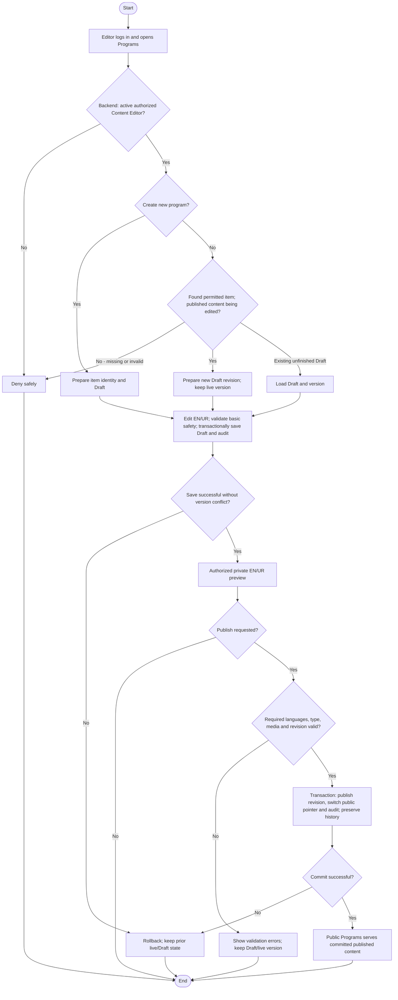

# Activity: Manage Programs Content

**Primary Actor:** Content Editor
**Supporting Actors:** Backend CMS/authorization and audit; public visitors read published program information.
**Status:** CE-001/CE-002/CE-003 DECIDED; not implemented or tested

## Purpose

Create, revise, preview and publish bilingual public program information for Education Support, Food Assistance, Healthcare Support and Emergency Relief, following the [shared CMS lifecycle](draft-preview-publish-content.md).

## Preconditions

- Active authenticated Content Editor; backend authorizes each CMS item/action, including Draft preview.
- Existing program identity/revision required for edits. CMS-001 fields are DECIDED; no implemented contract exists.

## Inputs and Outputs

- **CMS-001 - DECIDED:** English/Urdu title, summary and description required for Publish in the same revision; optional image, publication/workflow status and display ordering supported. Incomplete translations may be saved as Draft; image absence never blocks Publish. No new compulsory programme categories.
- Stable item and Draft/live revision/version metadata, output incomplete saved Draft/private preview/committed published program with audit.
- Supporting media if enabled must be validated/safely stored, with bilingual meaningful-image alt text and no private path exposure.

## Main Flow

1. Editor logs into staff portal and opens Programs; backend checks active CMS role and loads permitted items/revision metadata.
2. Choose Create or Edit. Create stable program identity/Draft for new item; editing current Published creates new Draft, editing unfinished Draft checks its saved version.
3. Update en/ur fields within HWF program scope; validate safe basic input and save Draft/version/mutation audit transactionally. Incomplete translations can be saved.
4. Preview authorized Draft in EN LTR/UR RTL without publishing. Old published revision remains public throughout editing.
5. If Publish requested, backend validates required EN/UR and type/media safety/current version; atomically publish revision, switch public reference and append actor/time/item/previous/new revision audit, preserving history.
6. After commit, public Programs shows chosen published localization only. Archive/unpublish uses [separate visibility activity](archive-unpublish-content.md); archived restoration is not inferred.

## Alternative / Error Flows

- Unauthorized/inactive staff or missing item/version: deny/not-found safely; no public Draft leakage.
- Invalid basic title/type/safety, unsupported media or concurrent draft conflict: reject without silent overwrite; missing translation alone does not prevent incomplete Draft save.
- Publish lacks required English/Urdu, fails state/type/safety or database/audit/commit: retain Draft/old live revision; rollback all publication changes.
- Archived item requires unresolved restoration policy; no hard delete or unapproved republish route.

## Business Rules

- **CE-001 - DECIDED:** Content Editor may draft/preview/publish authorized CMS without Super Admin approval or a sixth Publisher role.
- **CE-002 - DECIDED:** Required bilingual fields complete/safe before publish; en LTR/ur RTL from same logical revision. No automatic placeholder/machine-translation publication; UI labels remain i18n.
- **CE-003 - DECIDED:** Published content immutable in place; edit via new Draft, preserve old live/historical revision and atomic switch/audit; reject stale concurrent versions.
- Public program descriptions do not grant financial account, member, operational branch or restricted audit access. Backend prevents cross-domain mutation; safe rich-text/media only. No payments/real personal or CNIC sample data.
- **CE-005 - DECIDED:** Published programs retire through archive/unpublish with identity/revisions/relationships/audit preserved, never normal hard delete. Exact restoration policy remains PENDING.

- **CMS-004/CMS-005/CMS-007 - DECIDED:** Backend sanitizes rich text and validates actual image content/metadata/format/size/storage references for safe protected preview/publication; optional image absence valid. Retire lists/detail/cache immediately while preserving history. [Full contract](../../../project-context/modules/content-management.md).

## Postconditions

- Incomplete Draft saved/privately previewed or fully validated published revision committed; old live version unchanged until success.
- Program operational/financial records and historical revisions/audit remain untouched by public text edits.

## Activity Diagram

## Acceptance Criteria

- Authorized editor creates incomplete Draft and publishes valid bilingual program without Super Admin sign-off; unauthorized publication denied server-side.
- Missing required EN/UR blocks publish; EN/UR preview and public display use LTR/RTL. Draft never leaks publicly.
- Edit creates new Draft without changing live program; atomic publish updates public revision, preserves history/audit and rejects stale concurrent edit.
- Failed publish retains old public version; unsafe content/media rejected. Editorial changes cannot mutate member/branch/finance records.
- Four HWF programme areas reflected in planned public content; future tests only, not implementation/evidence of completed content.

- Planned CMS-001 acceptance: complete bilingual title/summary/description publishes without image; missing any required translation blocks Publish, not Draft. Ordering retained; unsafe rich text/images fail safely. Future tests only.

## Pending Decisions

- Additional constraints beyond CMS-001, safe format allowlist/dimensions/size/storage/transformation/editor/sanitizer implementation, cache mechanism, editorial notices and archived restoration. Core fields/safety/publication controls are DECIDED.
