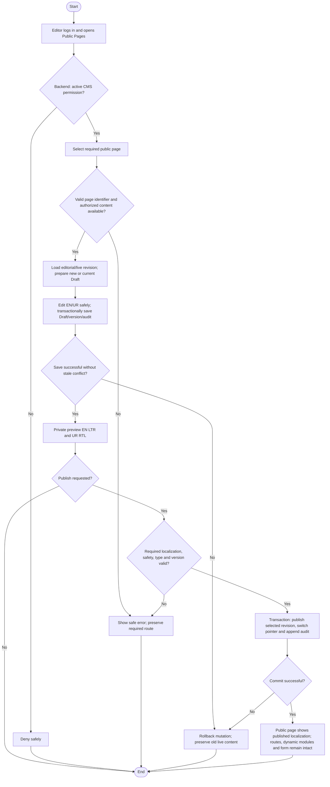

# Activity: Manage Public Website Pages

**Primary Actor:** Content Editor
**Supporting Actors:** Backend CMS/authorization/audit and public-page composition; visitors access public pages/application without staff accounts.
**Status:** CE-001/CE-002/CE-003/CE-005 DECIDED; not implemented or tested

## Purpose

Maintain authorized bilingual editorial sections of the seven required public pages while protecting routes, application functionality and separately managed operational data.

## Preconditions

- Active authenticated Content Editor and backend CMS permission for selected page/item/revision; direct Draft/Preview requests are protected.
- Required routes remain: Home `/`, About `/about`, Programs `/programs`, Branches `/branches`, Events `/events`, Get Involved `/get-involved`, Contact `/contact`. Existing route architecture is preserved, not changed by this task.

## Inputs and Outputs

- **CMS-003 - DECIDED:** Controlled page identifier/slug, EN/UR title and body, revision/publication status. Required translated title/body complete for Publish; partial Draft allowed. Additional sections/page copy remain pending; no invented official vision. Slug edits cannot remove mandatory routes.
- Outputs incomplete saved Draft/private preview or committed published page editorial revision, not route/schema/access-control changes.
- Dynamic Programs/Events use their CMS items; approved public Branches details come from authorized branch data. No arbitrary CMS HTML replacing application forms.

## Main Flow

1. Content Editor logs into staff portal and opens Public Pages; backend validates active account/CMS permission.
2. Select required page; load permitted editorial sections, current published revision and any unfinished Draft version.
3. Create/update Draft; editing published content creates new revision, not in-place live changes. Update en/ur safe editorial fields only.
4. Save Draft/version/audit atomically with basic safety/concurrency validation; incomplete bilingual editing permitted. Preview both en LTR/ur RTL through authorized internal access.
5. Request Publish; backend validates required localized fields/type/safety/version. Atomically switch published reference with actor/time/old-new revision audit, retaining prior content/history.
6. Public page serves committed localized content without staff login; language switching preserves functional navigation. Dynamic branch data, volunteer form validation/HR review and other domain functions remain in their authorized backend modules.
7. [Archive/unpublish](archive-unpublish-content.md) may hide editorial content, never remove required route/navigation or disable account-free volunteer application. Exact fallback presentation remains pending, not a route-removal grant.

## Alternative / Error Flows

- Unauthorized/inactive staff, invalid required page ID or missing data: safe error; missing CMS content must not break mandatory route availability.
- Unsafe HTML/script/media, invalid basic field type or stale draft/version: reject safely without silent overwrite.
- Missing required EN/UR on Publish or publication/audit/commit failure: retain Draft and previous public revision, no partial localization switch.
- Attempt to edit branch codes/status, HR acceptance/form validation, staff assignments, financial data, access policy or private dashboard: backend denies cross-domain request.

## Business Rules

- **CE-001 - DECIDED:** Content Editor manages authorized CMS Drafts/preview/publication without Super Admin sign-off; no extra Publisher role. No unrelated operational/restricted audit permission.
- **CE-002 - DECIDED:** Required English and Urdu editorial fields validated before publish; drafts may be incomplete. Same logical revision, EN LTR/UR RTL, no automatic placeholder/machine-translation approval. Existing i18n owns non-editorial UI labels.
- **CE-003 - DECIDED:** New Draft for published edits, old published stays live until atomic validated switch/audit. No anonymous Draft/historical-revision leakage or stale overwrite.
- **CE-005 - DECIDED:** Archive/unpublish preserves content/history; cannot physically delete published content or mandatory page routes. Required navigation/form remains functional without Login/Sign Up buttons; staff portal uses separate direct route.
- CMS editorial copy cannot change operational branch lifecycle/codes, HR decisions, staff, finance or backend authorization. Never replace account-free volunteer form with arbitrary CMS HTML or bypass backend input validation.
- Rich-text/media safe rendering required; no executables/private paths, real personal/CNIC sample content or online payment integration.

- **CMS-004/CMS-005/CMS-007 - DECIDED:** Backend validates both-language same-revision title/body and sanitizes rich text for public/private preview; safe staff-only image upload checks apply. Immediate public list/detail/cache retirement preserves identity/history and required routes with safe unavailable fallback, never Draft/staff metadata. [Full contract](../../../project-context/modules/content-management.md).

## Postconditions

- Authorized Draft or published editorial revision committed with audit/history; failed mutation preserves prior live content.
- All seven public routes and application functionality remain available; operational records untouched and private CMS data not exposed.

## Activity Diagram

## Acceptance Criteria

- All seven routes remain available without login; language switching preserves navigation, EN LTR/UR RTL and account-free volunteer application.
- Content Editor can save incomplete authorized Draft and publish valid bilingual content without Super Admin approval; missing language/safety failure blocks publication.
- Live version unchanged during editing/failure; history/audit preserved and no draft/archive data leaks through anonymous APIs.
- Direct CMS requests cannot change operational branch/HR/staff/finance/access-control data; public branch details keep authorized source data.
- Missing/unpublished editorial content cannot remove mandatory route or replace form validation. Future tests only; no website implementation is claimed.

- Planned CMS-003 acceptance: missing EN/UR title/body rejects Publish; arbitrary slug edits cannot break any required route; retired content gives safe fallback without Draft disclosure. Future tests only.

## Pending Decisions

- Additional per-page sections/constraints and approved page copy/branding, specific mandatory-route safe fallback presentation and specialized optional-section fallbacks. CMS-003 title/body/controlled identifier and route protection are DECIDED.
- Rich-text format/sanitizer, media storage/limits, cache invalidation, archive restoration/republication and editorial notifications.
