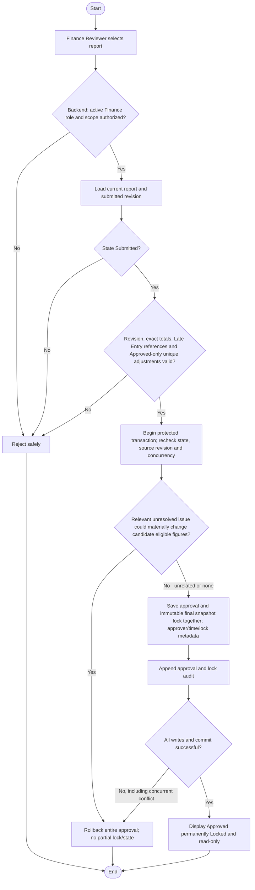

# Activity: Approve and Lock Weekly Report

**Primary Actor:** Finance Reviewer
**Supporting Actors:** Backend authorization/reporting, database and audit.
**Status:** FIN-004 DECIDED; not implemented or tested

## Purpose

Approve an authorized Submitted revision and final-lock it automatically in the same transaction, with no later user lock step.

## Preconditions

- Active authenticated Finance Reviewer with backend-authorized branch scope; Branch Lead cannot self-approve.
- Persisted report currently Submitted with immutable submission revision/version and exact consistency available. WR-004 approval requires no unresolved issue capable of materially changing candidate eligible figures in authorized branch/report/recognition scope, checked in transaction; unrelated/non-affecting requests do not automatically block.

## Inputs and Outputs

- Report identity, submitted revision, source collections, recognized adjustments, exact totals and permitted remittance context.
- Output canonical Approved, permanent lock metadata (locked_at/equivalent), approver/time, finalized immutable snapshot and audit; or unchanged prior state on failure.

## Main Flow

1. Finance Reviewer selects report; backend authorizes, loads current Submitted revision and validates financial/source consistency: unique recognition, valid Late Entry original/week references, Approved adjustment state and exact totals. Pending/Rejected adjustment lines cannot contribute recognized totals.
2. Begin protected transaction; recheck permissions/state/version/revision and relevant financial/concurrent constraints. Under WR-004 identify unresolved issues by candidate branch/report/recognition scope and potential material eligible-figure effect, separating original occurrence week, later recognition week and reviewed report. Relevant unresolved issue denies approval with no report-state change; unrelated branch/period/non-affecting request does not block. Never include unapproved adjustments; after resolution reassess. Needed submitted-figure corrections use authorized Return/resubmit, never in-place frozen revision changes.
3. Record approval actor/time and finalized snapshot, set Approved and apply permanent lock metadata in the same protected operation.
4. Append approval/locking audit event(s) with report/branch/week/revision and previous/new state; commit together.
5. Display Approved/Locked read-only result; there is no manual final-lock button or independent lock permission.

## Alternative / Error Flows

- Unauthorized, missing report, non-Submitted state, stale revision or invalid financial totals: reject safely.
- Concurrent approvals, return/approval or collection edit/approval: concurrency protection permits only compatible valid outcome; cannot duplicate approval events or rewrite finalized totals.
- Any snapshot/approval/lock/audit/commit failure: rollback all changes; no Approved-but-editable persisted report.

## Business Rules

- **FIN-004 - DECIDED:** Canonical states Draft, Submitted, Returned, Approved. Approved means permanently Locked; approval and locked_at/equivalent metadata are atomic, not a later transition. Locked is not an extra current state in this model.
- Finance Reviewer approves; normal Branch Lead workflow cannot reverse approval or alter approved snapshot. No manual approval-to-lock action or invented Super Admin override.
- FIN-005 Late Entry recognition preserves original week/history and occurs once; FIN-006 adjustment lines must be Approved before recognition, with valid original link and no duplicate correction. Reject unresolved/invalid included recognition; WR-004 blocks relevant unresolved material effects only, rechecked transactionally; unrelated/non-affecting requests do not automatically block. Basic relevance policy DECIDED; exact multi-period treatment requires explicit implementation-level specification.
- FIN-010 - DECIDED: PKR NUMERIC(18,2)/Prisma Decimal, decimal-string values with at most two fractional digits; reject nonfinite/unsupported precision/range/float-derived input, never JS number money arithmetic or silent excess-precision rounding. Decimal-safe calculations/comparisons and HALF_UP only where calculation needs rounding; preserve official fixture totals when supplied. FIN-001/FIN-005 late entries never recalculate approved history; FIN-002/FIN-006 Approved corrections are distinct eligible future-report evidence.
- Append-only audit and original revisions remain; no online payments or direct Finance collection edit authority is introduced.

- **FIN-011 - DECIDED:** Approved signed corrections may produce negative scoped signedOutstanding after confirmed remittance. Show deficit explicitly to authorized Finance/Head Office and availableToRemit = max(0, signedOutstanding - active pending reservations); never clamp outstanding or subtract deficit twice. Negative branch balance alone is not an invalid per-collection correction. Preserve all earlier Approved snapshots, confirmed remittances, original/adjustment history and occurrence/recognition periods; no automatic compensating payment/write-off. Exact external clearing/recovery/settlement remains PENDING.
- **FIN-013 - DECIDED:** Multiple sequential corrections allowed, at most one PendingReview per original. Finance adjustment approval rechecks cumulative original plus all Approved corrections (including awaiting recognition) plus candidate nonnegative. Report includes each Approved actually recognized adjustment once in correct eligible period, not PendingReview/Rejected/queued-unrecognized lines; preserve prior approvals.
- **FIN-012 - DECIDED:** Report approval does not confirm or cancel remittances. Only separate Finance-approved Pending cancellation releases reservation once; request/rejection retain it, confirmation/cancellation race cannot double-settle/release.

- **WR-003 - DECIDED:** Approve the consistent frozen authorized submitted revision and atomically retain immutable final snapshot with approval/lock/audit. Earlier submission/resubmission revisions and actor/time preserved; later adjustments, confirmed remittances or source records cannot rewrite final snapshot. Live Draft/Returned is not historical evidence.
- **WR-004 - DECIDED:** Unresolved issue that can materially affect candidate eligible figures blocks approval; unrelated branch/period/non-affecting request does not. Record successful approval audit; denied attempts never mutate report state. Document multi-period dependency explicitly and reassess after resolution; no global blanket block.
- **WR-005/WR-006 - DECIDED:** Eligible zero-activity Submitted report may be approved through normal financial/state/version/permission checks with zero activity totals and no fake transactions. All approval/Return/duplicate/version/source races permit only compatible outcome; state/final snapshot/lock/audit atomic or rollback. No Approved -> Draft/Returned/manual later Lock. WR-001/WR-002 generation/recovery never resets existing report.

- **FIN-014 - DECIDED:** Closed permits no new ordinary collections/future-week reports; retain original/report/snapshot/financial/member/audit history. Pre-closure reconciliation needs existing authorization/separate audit, no revived inactive/unassigned lead access. Exact discovery recognition container/period after closure PENDING; no new report type/reopening; Active/Paused drafts unchanged.
- **FIN-015 - DECIDED:** Same WR-004 relevance rule: transactionally recheck candidate branch/report/period/recognition material effect. Unrelated/mere request existence does not block; exclude unapproved amounts, resolve then reassess. No automatic adjustment approval/global submission ban/frozen rewrite.
- **FIN-016/FIN-017 - DECIDED:** Future eligible same-branch recognized collections offset cumulative deficit exactly once/in correct period, not other-branch funds or artificial transfers. Preserve immutable weekly figures/nonnegative available. Remittance uses branch-level availability, no mandatory collection-ID allocation; role separation/reservations/confirmation/cancellation/audit/concurrency safeguards unchanged.
- **FIN-018 - DECIDED:** Adjustment reason mandatory/file optional; valid no-file allowed, attachment not substitute for reason/correctness. Finance review/upload controls apply; remittance file optional, amount/date/reference required. See [authoritative financial definitions](../../domain-rules.md); provider/limits are technical configuration.

## Postconditions

- On commit Approved snapshot is already immutable and locked with reviewer/time/audit. On failure report/source history remains consistent and no partial approval exists.

## Activity Diagram

## Acceptance Criteria

- Only authorized Finance Reviewer approves Submitted; Branch Lead approval denied.
- Approved is locked immediately upon commit; no manual step or Approved/unlocked state exists.
- Included Late Entry must reference original/week and be recognized once; Pending/Rejected adjustment lines excluded and only Approved signed adjustments included. Unrelated pending request alone is not automatic rejection.
- Snapshot immutable; repeated/concurrent approval cannot duplicate event or incompatible state; Return/Approve race has one valid outcome.
- Concurrent collection writes cannot change final totals; failed audit/lock/commit rolls back approval entirely.
- Official exact fixture reconciliation remains required once fixtures available; tests are specified, not executed.

- FIN-010 exact snapshots/totals and FIN-013 Approved-only once-per-adjustment recognition apply. FIN-011 signed deficit remains visible, available nonnegative, with no historical rewrite/automatic payment; no inference that report approval confirms or cancels remittance. Future criteria only.

- Planned WR-004 tests: unresolved material candidate issue blocks approval, unrelated branch/period/non-affecting request does not; resolution triggers reassessment and unapproved amounts excluded. Distinguish original occurrence/recognition/reviewed periods without globally blocking all reports.
- Planned WR-003/005/006 tests: valid zero-activity approval, immutable submitted/final snapshots and older revision history, no later finance-event rewrite, at most one outcome in Return/approve/duplicate races, stale-version/unauthorized rejection and full state/snapshot/audit rollback. Approved never reopens; no tests executed.

- Planned finance/report checks: Closed history readable/Approved snapshots immutable, ordinary new Closed collections/future reports and unauthorized settlement denied. Relevant issue blocks candidate approval, unrelated one does not; cumulative same-branch future collections offset deficit while other-branch funds cannot, with no historical rewrite/fake transaction.
- Branch-level partial remittances keep exact Pending/Confirmed totals without mandatory collection allocation and concurrency prevents over-remittance. Adjustment reason/no-file accepted, missing reason fails, optional evidence cannot bypass validation/permissions. These are future criteria, not passing evidence.

## Pending Decisions

- Exact financial consistency/KPI formulas, fixture data and final snapshot schema/storage/locking implementation details; WR-003 revision semantics and FIN-004/WR-006 lock timing/invariants are DECIDED.
- Late-entry evidence and adjustment-upload technical configuration, exact external deficit-clearing/refund/recovery/period settlement, confirmed disputes, financial notifications, Exact legitimate pre-closure discovery recognition container/accounting period after closure, scheduler hosting and exact treatment of dependencies materially affecting more than one period. WR-004 basic relevant-issue approval policy is DECIDED, not blanket blocking. FIN-013 sequential/cumulative rules are DECIDED. Routing and adjustment request/approval ownership are DECIDED.
