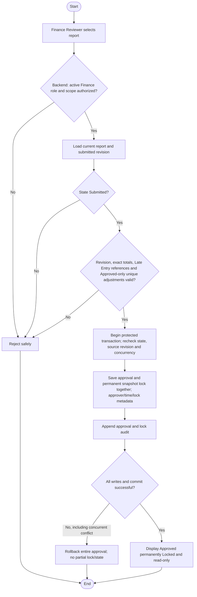

# Activity: Approve and Lock Weekly Report

**Primary Actor:** Finance Reviewer
**Supporting Actors:** Backend authorization/reporting, database and audit.
**Status:** FIN-004 DECIDED; not implemented or tested

## Purpose

Approve an authorized Submitted revision and final-lock it automatically in the same transaction, with no later user lock step.

## Preconditions

- Active authenticated Finance Reviewer with backend-authorized branch scope; Branch Lead cannot self-approve.
- Persisted report currently Submitted; submitted revision/snapshot and exact financial consistency can be validated.

## Inputs and Outputs

- Report identity, submitted revision, source collections, recognized adjustments, exact totals and permitted remittance context.
- Output canonical Approved, permanent lock metadata (locked_at/equivalent), approver/time, finalized immutable snapshot and audit; or unchanged prior state on failure.

## Main Flow

1. Finance Reviewer selects report; backend authorizes, loads current Submitted revision and validates financial/source consistency: unique recognition, valid Late Entry original/week references, Approved adjustment state and exact totals. Pending/Rejected adjustment lines cannot contribute recognized totals.
2. Begin protected transaction; recheck permissions/state/revision and relevant financial/concurrent source constraints.
3. Record approval actor/time and finalized snapshot, set Approved and apply permanent lock metadata in the same protected operation.
4. Append approval/locking audit event(s) with report/branch/week/revision and previous/new state; commit together.
5. Display Approved/Locked read-only result; there is no manual final-lock button or independent lock permission.

## Alternative / Error Flows

- Unauthorized, missing report, non-Submitted state, stale revision or invalid financial totals: reject safely.
- Concurrent approvals, return/approval or collection edit/approval: concurrency protection permits only compatible valid outcome; cannot duplicate approval events or rewrite finalized totals.
- Any snapshot/approval/lock/audit/commit failure: rollback all changes; no Approved-but-editable persisted report.

## Business Rules

- **FIN-004 - DECIDED:** Canonical states Draft, Submitted, Returned, Approved. Approved means permanently Locked; approval and locked_at/equivalent metadata are atomic, not a later transition. Locked is not an extra current state in this model.
- Finance Reviewer approves; normal Branch Lead workflow cannot reverse approval or alter approved snapshot. No manual approval-to-lock action or invented Super Admin override.
- FIN-005 Late Entry recognition preserves original week/history and occurs once; FIN-006 adjustment lines must be Approved before recognition, with valid original link and no duplicate correction. Reject unresolved/invalid included recognition; an unrelated pending adjustment request alone does not automatically block report approval (dependency policy PENDING).
- Exact integer minor units/NUMERIC; preserve official fixture totals when supplied. FIN-001/FIN-005 late entries never recalculate approved history; FIN-002/FIN-006 Approved corrections are distinct eligible future-report evidence.
- Append-only audit and original revisions remain; no online payments or direct Finance collection edit authority is introduced.

## Postconditions

- On commit Approved snapshot is already immutable and locked with reviewer/time/audit. On failure report/source history remains consistent and no partial approval exists.

## Activity Diagram

## Acceptance Criteria

- Only authorized Finance Reviewer approves Submitted; Branch Lead approval denied.
- Approved is locked immediately upon commit; no manual step or Approved/unlocked state exists.
- Included Late Entry must reference original/week and be recognized once; Pending/Rejected adjustment lines excluded and only Approved signed adjustments included. Unrelated pending request alone is not automatic rejection.
- Snapshot immutable; repeated/concurrent approval cannot duplicate event or incompatible state; Return/Approve race has one valid outcome.
- Concurrent collection writes cannot change final totals; failed audit/lock/commit rolls back approval entirely.
- Official exact fixture reconciliation remains required once fixtures available; tests are specified, not executed.

## Pending Decisions

- Exact financial consistency/KPI formulas, fixture data and snapshot implementation details; lock authority/timing is no longer pending.
- Late-entry/adjustment evidence, sequential adjustment limits, financial notifications and whether a particular pending adjustment creates an approval dependency. Routing and adjustment request/approval ownership are DECIDED.
