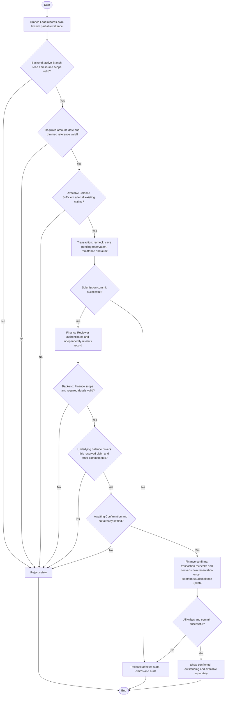

# Activity: Confirm Head Office Remittance

**Primary Actor:** Finance Reviewer
**Supporting Actors:** Branch Lead (own-branch partial remittance recording), backend authorization/finance/aggregation and audit.
**Status:** FIN-003/FIN-007/FIN-009 DECIDED; not implemented or tested

## Purpose

Independently confirm each eligible partial branch remittance without over-reservation, double settlement or treating submitted transfers as Head Office receipts.

## Preconditions

- Active authenticated staff and backend role/scope checks; Branch Lead records own branch, Finance Reviewer independently confirms across authorized scope.
- Existing eligible awaiting-confirmation record with committed reservation for Finance confirmation.
- Exact protected balance/recognition data and valid reference/date available; branch claim/reference alone is not receipt proof.

## Inputs and Outputs

- Required: positive exact amount, valid transfer date, trimmed nonempty transfer reference and source branch derived from Branch Lead assignment (FIN-009). Distinguish system record ID/reference from required transfer reference.
- Supporting evidence upload OPTIONAL; absence alone cannot invalidate otherwise valid record. If supported, enforce backend type, size, access and malware-safety controls. No donor/CNIC or bank gateway requirement.
- Recorder identity/time, current state, eligible references, Finance confirmer/time and audit; output confirmed result/consistent balances or safe error.

## Main Flow

1. Branch Lead records partial remittance through own-branch funds workflow; backend validates required details, scope and amount against available funds after all committed reservations/confirmed transfers.
2. Transactionally recheck balance/current scope, save awaiting-confirmation record and reservation with audit; submission does not increase confirmed funds or reduce outstanding-not-yet-confirmed.
3. Finance Reviewer authenticates, retrieves permitted pending/confirmed records and independently reviews branch/amount/date/reference and available supporting details. No evidence upload is required just to be valid.
4. Select Confirm; validate existing record details, awaiting state and sufficient underlying coverage of its existing reservation, considering all other pending claims and confirmed funds. Do not subtract its own reservation twice.
5. In protected transaction recheck authorization/state/financial constraints, convert that pending claim to Finance-confirmed effect, store actor/time and append audit with exact aggregate updates; commit once.
6. Display confirmed status/outstanding/available separately. Repeated/concurrent confirmation cannot settle twice; no silent source collection/report rewrite.

## Alternative / Error Flows

- Missing/zero/negative amount, missing/invalid date, blank reference, arbitrary source branch or unauthorized action: reject without mutation. Valid record without upload passes this requirement.
- Over-remittance or concurrent reservation conflict: reject submission/confirmation safely. A later negative adjustment causing insufficient coverage needs pending recovery policy, not an invented exception.
- Already confirmed/ineligible state: reject or safely return existing result with no duplicate confirmation/event/balance reduction.
- Business/audit/reservation/aggregate/commit failure: rollback all associated changes. No cancellation/dispute/release workflow is inferred; stuck pending reservation remains known unresolved edge case.

## Business Rules

- **FIN-003 - DECIDED:** Branch records, Finance independently confirms; Branch Lead cannot self-confirm, Finance cannot silently edit source collections.
- **FIN-007 - DECIDED:** Multiple partial remittances permitted, total eligible available cannot be exceeded. Outstanding-not-yet-confirmed = recognized net collections minus Finance-confirmed remittances, subject to approved adjustment reconciliation. Available-to-remit = outstanding minus active committed pending reservations. Submission reserves only; confirmation consumes its own reservation once and updates confirmed/outstanding without double subtraction. Concurrency safeguards protect the entire branch balance.
- **FIN-009 - DECIDED:** Required positive exact amount/date/trimmed reference/derived branch; upload optional and secure. Transfer reference is not independent proof of receipt. No new financial notification mandate.
- Separate normal collection and FIN-005 Late Entry recognition (one original effect), FIN-006 Approved signed corrections, pending/confirmed funds and financial views. Exact money only; no online payments/history deletion or approved snapshot mutation.
- Illustrative only, not official fixture: outstanding PKR 20,000, confirmed partials 8,000 and 7,000 leave outstanding 5,000; a new 6,000 claim fails (and pending reservations may further reduce available).
- Audit actor/role/time/action/reference, old/new state/values, branch/report context and required reasons without private credentials. Preserve official dashboard KPI semantics if different from operational measures; financial fixture gate NOT VERIFIED.

## Postconditions

- Awaiting record reserves without confirming; success converts eligible remittance to confirmed once with actor/time/audit and consistent balances. Snapshot/history unchanged.
- Failure leaves previous state/claim/aggregates consistent; no duplicate settlement or over-reservation.

## Activity Diagram

## Acceptance Criteria

- Required amount/date/reference/source validated; missing/blank/zero/negative fail, valid no-upload succeeds. Cross-branch/Branch Lead confirmation denied.
- Multiple partials accepted within available; concurrent submissions cannot reserve same funds or exceed balance. Pending is not confirmed receipt and outstanding/available differ.
- Finance confirms each eligible existing claim once; own reservation is not subtracted twice. Duplicate/concurrent confirmations create no second financial effect.
- Actor/time/amount/status/audit consistent; failed commit restores prior state, approved reports unchanged. Optional upload follows backend security controls.
- Official financial figures NOT VERIFIED without fixtures; criteria are future tests, not executed checks.

## Pending Decisions

- Cancellation/expiry/rejection/dispute and reservation release (stuck claims), exact individual collection allocations, settlement date refinements, negative-adjustment/confirmed-cash recovery and notifications/provider/recipients.
- Optional-upload technical controls and specific evidence formats; do not make upload mandatory. Exact official dashboard KPI formulas/fixtures remain unavailable.
