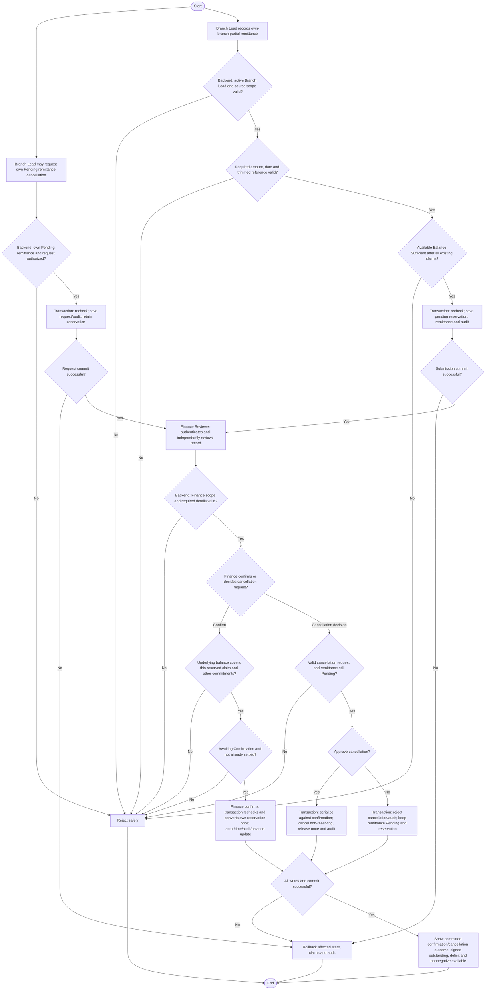

# Activity: Confirm Head Office Remittance

**Primary Actor:** Finance Reviewer
**Supporting Actors:** Branch Lead (own-branch partial remittance recording), backend authorization/finance/aggregation and audit.
**Status:** FIN-003/FIN-007/FIN-009 and FIN-010 to FIN-013 DECIDED; not implemented or tested

## Purpose

Independently confirm each eligible partial branch remittance without over-reservation, double settlement or treating submitted transfers as Head Office receipts.

## Preconditions

- Active authenticated staff and backend role/scope checks; Branch Lead records own branch, Finance Reviewer independently confirms across authorized scope.
- Existing eligible awaiting-confirmation record with committed reservation for Finance confirmation.
- Exact protected balance/recognition data and valid reference/date available; branch claim/reference alone is not receipt proof.

## Inputs and Outputs

- Required: positive exact amount, valid transfer date, trimmed nonempty transfer reference and source branch derived from Branch Lead assignment (FIN-009). Distinguish system record ID/reference from required transfer reference.
- Supporting evidence upload OPTIONAL; absence alone cannot invalidate otherwise valid record. If supported, enforce backend type, size, access and malware-safety controls. No donor/CNIC or bank gateway requirement.
- Recorder identity/time, current state, eligible references, Finance confirmer/time and audit; output confirmed result/consistent balances or safe error.

## Main Flow

1. Branch Lead records partial remittance through own-branch funds workflow using branch-level available balance with no mandatory original-collection allocation (FIN-017); backend validates required details, scope and amount against available funds after all committed reservations/confirmed transfers.
2. Transactionally recheck balance/current scope, save awaiting-confirmation record and reservation with audit; submission does not increase confirmed funds or reduce outstanding-not-yet-confirmed.
3. Finance Reviewer authenticates, retrieves permitted pending/confirmed records and independently reviews branch/amount/date/reference and available supporting details. No evidence upload is required just to be valid.
4. Select Confirm; validate existing record details, awaiting state and sufficient underlying coverage of its existing reservation, considering all other pending claims and confirmed funds. Do not subtract its own reservation twice.
5. In protected transaction recheck authorization/state/financial constraints, convert that pending claim to Finance-confirmed effect, store actor/time and append audit with exact aggregate updates; commit once.
6. Display confirmed status/outstanding/available separately. Repeated/concurrent confirmation cannot settle twice; no silent source collection/report rewrite.

7. **FIN-012 Pending cancellation:** Current own-branch Branch Lead requests cancellation, never finalizes it or directly cancels Confirmed. Recheck scope/Pending state and persist request/audit atomically without releasing reservation. Finance Reviewer independently approves/rejects a valid Pending request. Approval transaction rechecks against confirmation, sets non-reserving Cancelled, releases exactly once and audits; rejection keeps remittance Pending/reservation intact. Cancellation cannot succeed after confirmation, and confirmation cannot succeed after finalized cancellation; race has one valid result, failed writes roll back all effects.

## Alternative / Error Flows

- Missing/zero/negative amount, missing/invalid date, blank reference, arbitrary source branch or unauthorized action: reject without mutation. Valid record without upload passes this requirement.
- Over-remittance or concurrent reservation conflict: reject submission/confirmation safely. FIN-011 negative correction may create explicit signed deficit; block insufficient new remittance/confirmation while preserving original transactions. External deficit-clearing/refund/recovery/period settlement remains pending.
- Already confirmed/ineligible state: reject or safely return existing result with no duplicate confirmation/event/balance reduction.
- Business/audit/reservation/aggregate/commit failure: rollback all associated changes. FIN-012 governs Pending cancellation/release; confirmed dispute/settlement, external bank evidence and other expiry/rejection-release paths remain pending.

## Business Rules

- **FIN-003 - DECIDED:** Branch records, Finance independently confirms; Branch Lead cannot self-confirm, Finance cannot silently edit source collections.
- **FIN-007 - DECIDED:** Multiple partial remittances permitted, total eligible available cannot be exceeded. Outstanding-not-yet-confirmed = recognized net collections minus Finance-confirmed remittances, subject to approved adjustment reconciliation. FIN-011 signedOutstanding may be negative, reconciliationDeficit = max(0, -signedOutstanding), availableToRemit = max(0, signedOutstanding - active committed pending reservations); never subtract deficit twice. netRecognizedCollections counts each original-or-Late Entry once plus Approved recognized adjustments, using same scope/timing as confirmedRemittances. Submission reserves only; confirmation consumes its own reservation once and updates confirmed/outstanding without double subtraction. Concurrency safeguards protect the entire branch balance.
- **FIN-009 - DECIDED:** Required positive exact amount/date/trimmed reference/derived branch; upload optional and secure. Transfer reference is not independent proof of receipt. No new financial notification mandate.
- Separate normal collection and FIN-005 Late Entry recognition (one original effect), FIN-006 Approved signed corrections, pending/confirmed funds and financial views. Exact money only; no online payments/history deletion or approved snapshot mutation.
- Illustrative only, not official fixture: outstanding PKR 20,000, confirmed partials 8,000 and 7,000 leave outstanding 5,000; a new 6,000 claim fails (and pending reservations may further reduce available).
- Audit actor/role/time/action/reference, old/new state/values, branch/report context and required reasons without private credentials. Preserve official dashboard KPI semantics if different from operational measures; financial fixture gate NOT VERIFIED.

- **FIN-010 - DECIDED:** PKR NUMERIC(18,2)/Prisma Decimal; decimal-string APIs with at most two fractional digits. Reject nonfinite/unsupported precision/range/float-derived money, no JS number money arithmetic or silent direct-record rounding. Decimal-safe calculations/comparisons; HALF_UP only where genuinely needed.
- **FIN-011 - DECIDED:** Expose scoped negative signedOutstanding/positive reconciliationDeficit to authorized Finance/Head Office; available remains nonnegative after reservations. Preserve locked originals, Confirmed remittances, Approved snapshots, adjustments and occurrence/recognition history. Require audited reconciliation, no automatic compensating payment/write-off or automatic reservation cancellation.
- **FIN-012 - DECIDED:** Cancellation request/rejection never releases funds. Only Finance-approved Pending cancellation atomically changes to non-reserving state/releases once/audits. No negative/double release, Confirmed cancellation, cancelled confirmation or erasure/reversal of Confirmed history. Status vocabulary remains a design detail; other roles lack cancellation permission.
- **FIN-013 - DECIDED:** Only each Approved recognized sequential correction affects net once; PendingReview/Rejected and Approved awaiting recognition have no recognized effect. One PendingReview per original and cumulative Approved corrected collection value nonnegative are checked in adjustment approval, distinct from branch deficit.

- **FIN-014 - DECIDED:** Closed retains financial/report/member/audit history and terminal status, no ordinary new collection/future report; pre-closure obligations require existing authorized separately audited Finance reconciliation, never restored inactive/unassigned lead access or rewritten Approved snapshot. Exact post-closure discovery recognition container/period PENDING; no new settlement permission/endpoint.
- **FIN-015 - DECIDED boundary:** WR-004 report dependency checks concern candidate branch/report/period/recognition material effect only, not arbitrary pending records. Remittance confirmation remains separate role/state operation, never automatic report/adjustment approval or global submission prohibition.
- **FIN-016 - DECIDED:** Same-branch future eligible recognized collections offset cumulative deficit automatically, once/correct period via exact Decimal signedOutstanding/deficit/nonnegative available formulas. Other branches never offset; no cash transfer/synthetic collection/remittance, shifted timestamps or historical rewrite. Recognition/reservation/confirmation serialize without over-remittance; external/manual settlement and exceptional historical cases PENDING.
- **FIN-017 - DECIDED:** Each remittance belongs to one operational branch and uses branch-level availability, no mandatory allocation to original collection IDs. Amount/date/reference required, file optional; own-branch recording, independent Finance Pending confirmation, partial reservations, confirmed outstanding reduction and once-only cancellation release/audit preserved. Never Pending-as-Confirmed, double confirm/release or negative available.
- **FIN-018 - DECIDED:** Remittance upload stays optional under FIN-009. Adjustment request elsewhere needs nonempty reason/file optional; evidence not proof of correctness or substitute for permission/reason. Upload access/type/size/safe-storage controls required, exact provider/limits technical configuration only.

## Postconditions

- Awaiting record reserves without confirming; success converts eligible remittance to confirmed once with actor/time/audit and consistent balances. Snapshot/history unchanged.
- Failure leaves previous state/claim/aggregates consistent; no duplicate settlement or over-reservation.

## Activity Diagram

## Acceptance Criteria

- Required amount/date/reference/source validated; missing/blank/zero/negative fail, valid no-upload succeeds. Cross-branch/Branch Lead confirmation denied.
- Multiple partials accepted within available; concurrent submissions cannot reserve same funds or exceed balance. Pending is not confirmed receipt and outstanding/available differ.
- Finance confirms each eligible existing claim once; own reservation is not subtracted twice. Duplicate/concurrent confirmations create no second financial effect.
- Actor/time/amount/status/audit consistent; failed commit restores prior state, approved reports unchanged. Optional upload follows backend security controls.
- Official financial figures NOT VERIFIED without fixtures; criteria are future tests, not executed checks.

- Cancellation request/rejection retains full claim; Finance approval releases once atomically. Confirmed cannot cancel, Cancelled cannot confirm; concurrent decisions have one valid outcome and failures restore prior state/claim/audit. Unauthorized roles and cross-branch requests fail.
- Exact FIN-010 values/precision validated; FIN-011 negative signedOutstanding appears as deficit without rewriting history or auto-payment. availableToRemit never negative; insufficient coverage blocks remittance. Sequential correction effects count only once.

- Planned FIN-016/017 tests: exact cumulative -500 deficit plus same-branch recognized 800 gives 300 before new reservations; other-branch funds do not offset, correct periods/snapshots remain. Multiple partials preserve distinct Pending/Confirmed totals, no required collection-ID allocation; concurrent recognition/reservations/confirmations prevent over-remittance/double effects. Illustrative, not official fixture or executed tests.
- Valid no-file remittance accepted with amount/date/reference; evidence never bypasses financial/permission checks. Closed historical data retained and unauthorized post-closure settlement/new lead access denied; legitimate recognition container not invented. These are future criteria.

## Pending Decisions

- Confirmed-remittance dispute investigation/settlement, exact dispute authority/accounting, external bank evidence validation, expiry/other rejection-release paths, exceptional historical allocation/reconciliation, settlement date refinements, exact external deficit clearing/refund/recovery/period settlement and notifications/provider/recipients. FIN-012 Pending cancellation/release and FIN-011 deficit accounting are DECIDED.
- Optional-upload technical controls and specific evidence formats; do not make upload mandatory. Exact official dashboard KPI formulas/fixtures remain unavailable.
