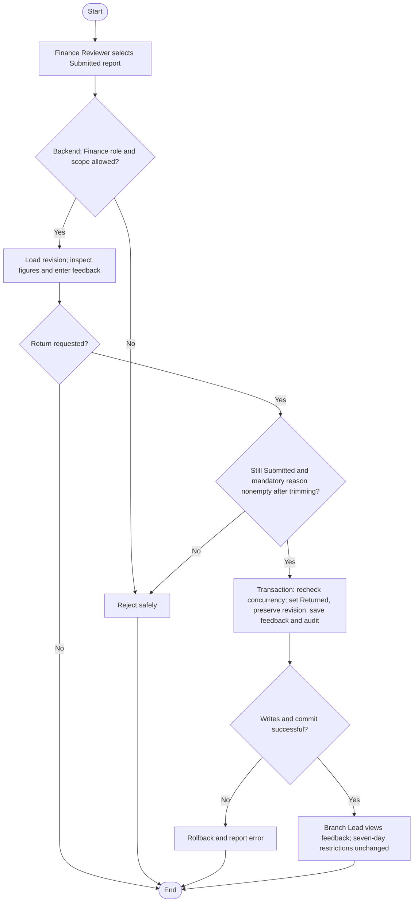

# Activity: Return Weekly Report

**Primary Actor:** Finance Reviewer
**Supporting Actors:** Backend reporting/authorization/audit; Branch Lead inspects feedback and corrects/resubmits own branch.
**Status:** Return authority documented; FIN-008 mandatory reason DECIDED; not implemented or tested

## Purpose

Return a Submitted revision for branch review while retaining source evidence and enforcing original collection-edit restrictions.

## Preconditions

- Active authenticated Finance Reviewer, backend-authorized for report branch.
- Current canonical state Submitted and persisted revision available; Approved is permanently locked, not returnable.

## Inputs and Outputs

- Report/revision identity, review explanation and current concurrency expectations.
- **FIN-008 - DECIDED:** meaningful trimmed nonempty reason required; backend rejects missing/whitespace, keeping Submitted. Store reason with actor/time/report/from-to/revision and atomic audit; authorized Branch Lead sees feedback.
- Output committed Returned state with actor/time/feedback/revision audit or safe error; original submission preserved.

## Main Flow

1. Select Submitted report; backend authenticates/authorizes Finance scope and loads submitted snapshot.
2. Finance Reviewer inspects exact collections, authorized adjustments/remittance context and selects Return with review explanation.
3. Validate current state/revision and mandatory trimmed nonempty meaningful reason; no Return may commit without it.
4. Begin transaction; concurrency-safely recheck Submitted/state/revision/permission, set Returned, store feedback/actor/time and append transition audit. Commit together.
5. Branch Lead reads feedback, makes only BL-001/BL-002 eligible corrections and [resubmits](../branch-lead/submit-and-resubmit-weekly-report.md) with a new revision/event.

## Alternative / Error Flows

- Unauthorized, missing/stale revision, non-Submitted or invalid feedback under approved policy: reject safely without return.
- Concurrent approval/return: at most one valid transition commits. Business/audit/commit failure rolls back all related changes.
- Expired collection error: original edit remains forbidden. FIN-002 requires next-report original-linked adjustment; FIN-006 source Branch Lead requests, Finance Reviewer approves/rejects once; only Approved recognized in next eligible report, so no bypass is granted by Return.

## Business Rules

- Return preserves submitted revision and prior decisions/audit. It never unlocks Approved, extends cutoff, gives Branch Lead approval authority or deletes original financial evidence.
- BL-001: strict authoritative created_at + 7 x 24 hours; exactly cutoff fails. BL-002: Returned correctable only inside original age window and without immutable inclusion; Submitted remains locked until formal Return.
- **FIN-002 - DECIDED:** Expired original stays unchanged; correction goes to separate auditable next-report adjustment under approved governance, not a historic snapshot edit.
- **FIN-004 - DECIDED:** Approved is already final-locked; no normal return path or later manual lock exists.
- Use exact monetary evidence and atomic audit; no invented official fixture amounts or payment processing.

## Postconditions

- Success: Returned/feedback/actor/time/audit committed with original submitted revision intact.
- Failure: previous state/figures/history unchanged; expired original remains protected.

## Activity Diagram

## Acceptance Criteria

- Unauthorized or Approved-report return fails; original revision/history never removed.
- Successful authorized return records feedback/actor/time/revision and audit atomically; blank/whitespace reason fails, valid reason is saved and visible to authorized Branch Lead under FIN-008.
- Cutoff/immutable restrictions unchanged; expired errors cannot be solved by direct original edit.
- Return/approve race cannot both commit; failed transaction leaves prior report state. Future tests only, not executed here.

## Pending Decisions

- FIN-006 evidence, sequential adjustment limits, Finance adjustment decision explanations and negative/remitted-cash reconciliation.
- Financial notifications and finer review constraints not settled by FIN-008. Return reason mandatory status and adjustment creation/approval authority are DECIDED.
