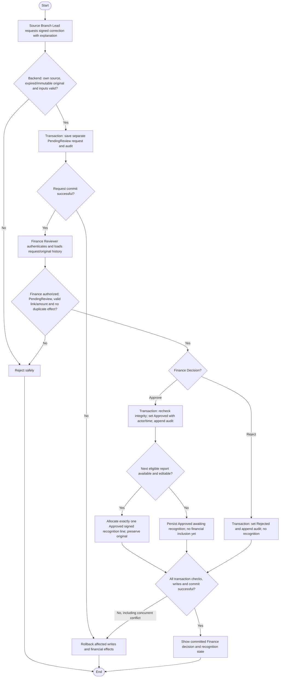

# Activity: Review Financial Adjustments

**Primary Actor:** Finance Reviewer (review/approve/reject)
**Supporting Actors:** Source Branch Lead (request), backend authorization/collection/reporting, audit.
**Status:** FIN-002/FIN-006 DECIDED; not implemented or tested

## Purpose

Review and decide separate correction requests while keeping protected original collections and historical report snapshots unchanged.

## Preconditions

- Active authenticated Finance Reviewer, backend-authorized for source branch; source Branch Lead alone requests within assigned branch.
- Original exists and is expired or immutable-approved inclusion prevents direct edit. Submitted-only lock follows Return, not adjustment bypass.
- Request starts PendingReview; decision/recognition protected against races and duplicate correction effect.

## Inputs and Outputs

- Unique request reference, original collection/source branch, proposed signed exact amount, mandatory correction explanation, requester/time, supporting reference where applicable, status and Finance decision metadata.
- Display original ID/amount/occurrence/creation/cutoff/immutable snapshot and target recognition context. No required donor personal data or real CNIC.
- Output Approved (recognized once or awaiting eligible report), Rejected (zero effect/history retained) or safe unchanged-state failure.

## Main Flow

1. Source Branch Lead opens eligible own original, enters signed correction and mandatory explanation; backend checks scope, expired/immutable eligibility and input, saves separate PendingReview request/audit atomically.
2. Finance Reviewer authenticates, opens pending request; backend scopes read/decision and loads original/report history.
3. Validate original/branch reference, request still PendingReview, exact amount/explanation and no duplicate recognized correction; inspect original/snapshot preservation and approved balance integrity. Do not invent sequential correction limits or cash recovery.
4. Finance selects Approve or Reject. Begin protected transaction; recheck permission/state/source/eligibility/duplicate/balance constraints.
5. Approve: save Approved/actor/time and create/activate exactly one auditable signed recognition line in next eligible subsequent same-branch report, never Submitted/Approved. If none exists, persist Approved awaiting recognition; allocation must be idempotent, not a second approval.
6. Reject: save Rejected/actor/time and no recognition line. Append decision audit in both paths, commit together and show result. Original/snapshots never overwritten.

## Alternative / Error Flows

- Unauthorized/cross-branch, missing original, invalid amount/explanation, Submitted-only bypass or wrong state: reject safely.
- Already-decided/concurrent approval or duplicate correction: no second approval/recognized effect. Multiple sequential correction permission/limits remain pending, not automatic override.
- Recognition report becomes Submitted/Approved concurrently: choose next eligible or retain Approved awaiting recognition; never mutate locked evidence.
- Undefined negative-balance recovery, remitted-cash effects or required evidence needed for safe decision: flag blocker; no invalid financial balance permitted by guesswork.
- Business/recognition/audit/commit failure: roll back all associated request/line/state changes; original history remains intact.

## Business Rules

- **FIN-002 - DECIDED:** Expired original remains unchanged; separate original-linked next-report correction, exact signed arithmetic and traceable gross versus adjustment totals.
- **FIN-006 - DECIDED:** Branch Lead requests, Finance approves/rejects once. States PendingReview, Approved, Rejected; only Approved affects totals and recognized once, Rejected zero effect. Correction cannot change original branch; no historical deletion or same correction twice. No Finance proposal grant is implied.
- Next eligible means earliest subsequent same-branch report able to receive new lines, excluding Submitted/Approved; if unavailable Approved awaits recognition. Protect approval/report-lock races with transaction/state/uniqueness/idempotency.
- FIN-005 Late Entry is real unrecognized collection, not a negative correction. Keep original normal-or-late recognition separate from Approved adjustments; no double original amount in cumulative views.
- Illustrative only: original COL-1001 PKR 5,000, corrected 4,500 -> Approved adjustment -500; original remains 5,000, exact recognized net 4,500. Not official fixture/global currency policy.
- Financial mutations audit actor/role/time/action/request/original reference, branch/report context, status/value changes and required explanation. No secret/unnecessary personal data; immutable snapshots/audit preserved.

## Postconditions

- Atomic Approved decision with one recognized/queued correction or Rejected with no recognized effect; actor/time/audit traceable. Original record/approved history unchanged.
- Failure preserves prior request/recognition/balance state; no unauthorized approval or duplicate line.

## Activity Diagram

## Acceptance Criteria

- Own-source eligible Branch Lead request succeeds; cross-branch, missing explanation and Submitted-only bypass fail. Finance alone approves/rejects.
- Original ID/amount/date/time/audit/snapshot unchanged; signed amount exact. PendingReview/Rejected have no recognized effect; Approved recognized once or retained awaiting inclusion.
- Two Finance approvals/report-lock race cannot duplicate events/lines or change locked history; same correction cannot double-apply. Valid original reference required.
- Missing evidence/sequential correction/recovery decisions remain explicit; unauthorized mutations and invalid balance cannot be assumed allowed. Future tests only, no execution claim.

## Pending Decisions

- Supporting evidence, multiple sequential adjustments and cumulative limits, Finance approve/reject explanation requirements, effects on confirmed remittance and negative-balance recovery/reconciliation.
- Financial notifications/provider/recipients and exact official KPI/fixtures. Request ownership, decision states, Approved-only recognition and no-report queuing are DECIDED.
