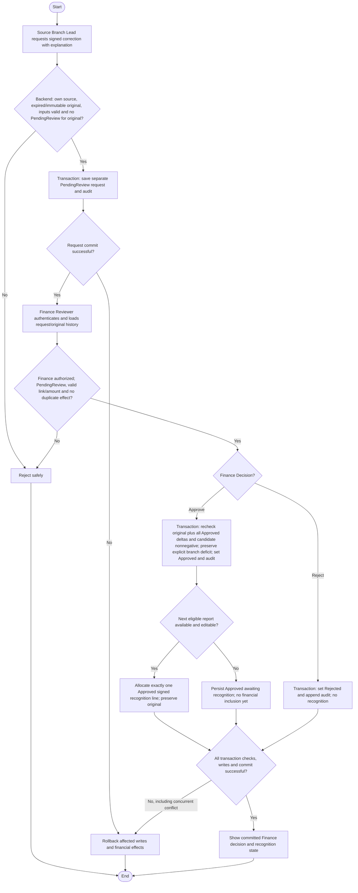

# Activity: Review Financial Adjustments

**Primary Actor:** Finance Reviewer (review/approve/reject)
**Supporting Actors:** Source Branch Lead (request), backend authorization/collection/reporting, audit.
**Status:** FIN-002/FIN-006 DECIDED; not implemented or tested

## Purpose

Review and decide separate correction requests while keeping protected original collections and historical report snapshots unchanged.

## Preconditions

- Active authenticated Finance Reviewer, backend-authorized for source branch; source Branch Lead alone requests within assigned branch.
- Original exists and is expired or immutable-approved inclusion prevents direct edit. Submitted-only lock follows Return, not adjustment bypass.
- Request starts PendingReview; decision/recognition protected against races and duplicate correction effect.

## Inputs and Outputs

- Unique request reference, original collection/source branch, proposed signed exact amount, mandatory correction explanation, requester/time, OPTIONAL supporting file/reference (FIN-018), status and Finance decision metadata. Nonempty reason is mandatory even if a file is attached; no-file alone is not a failure.
- Display original ID/amount/occurrence/creation/cutoff/immutable snapshot and target recognition context. No required donor personal data or real CNIC.
- Output Approved (recognized once or awaiting eligible report), Rejected (zero effect/history retained) or safe unchanged-state failure.

## Main Flow

1. Source Branch Lead opens eligible own original, enters signed correction and mandatory nonempty reason, optionally attaches controlled evidence; backend checks scope, expired/immutable eligibility and input, saves separate PendingReview request/audit atomically.
2. Finance Reviewer authenticates, opens pending request; backend scopes read/decision and loads original/report history.
3. Validate original/branch reference, request still PendingReview, exact amount/explanation and no duplicate recognized correction; inspect original/snapshot preservation and approved balance integrity. FIN-013 permits sequential requests, one PendingReview per original; approval transaction rechecks original plus all Approved deltas (including awaiting recognition) plus candidate >= zero. FIN-011 branch signedOutstanding may nevertheless be negative; do not invent external cash recovery.
4. Finance selects Approve or Reject. Begin protected transaction; recheck permission/state/source/eligibility/duplicate/balance constraints.
5. Approve: save Approved/actor/time and create/activate exactly one auditable signed recognition line in next eligible subsequent same-branch report, never Submitted/Approved. If none exists, persist Approved awaiting recognition; allocation must be idempotent, not a second approval.
6. Reject: save Rejected/actor/time and no recognition line. Append decision audit in both paths, commit together and show result. Original/snapshots never overwritten.

## Alternative / Error Flows

- Unauthorized/cross-branch, missing original, invalid amount/explanation, Submitted-only bypass or wrong state: reject safely.
- Already-decided/concurrent approval or duplicate correction: no second approval/recognized effect. Closing a PendingReview permits a subsequent request; no lifetime-one-adjustment limit. Concurrent requests cannot create two PendingReview records; serialize cumulative approval against all prior Approved corrections.
- Recognition report becomes Submitted/Approved concurrently: choose next eligible or retain Approved awaiting recognition; never mutate locked evidence.
- FIN-011 permits Approved negative correction after confirmed remittance and explicit branch signed deficit while cumulative corrected collection stays nonnegative. Preserve history, show deficit and block insufficient remittance; exact external deficit clearing/refund/recovery/period settlement and attachment technical configuration remain pending; FIN-018 reason/optional-file policy DECIDED, not automatic rejection merely for negative signedOutstanding.
- Business/recognition/audit/commit failure: roll back all associated request/line/state changes; original history remains intact.

## Business Rules

- **FIN-002 - DECIDED:** Expired original remains unchanged; separate original-linked next-report correction, exact signed arithmetic and traceable gross versus adjustment totals.
- **FIN-006 - DECIDED:** Branch Lead requests, Finance approves/rejects once. States PendingReview, Approved, Rejected; only Approved affects totals and recognized once, Rejected zero effect. Correction cannot change original branch; no historical deletion or same correction twice. No Finance proposal grant is implied.
- Next eligible means earliest subsequent same-branch report able to receive new lines, excluding Submitted/Approved; if unavailable Approved awaits recognition. Protect approval/report-lock races with transaction/state/uniqueness/idempotency.
- FIN-005 Late Entry is real unrecognized collection, not a negative correction. Keep original normal-or-late recognition separate from Approved adjustments; no double original amount in cumulative views.
- Illustrative only: original COL-1001 PKR 5,000, corrected 4,500 -> Approved adjustment -500; original remains 5,000, exact recognized net 4,500. Illustrative only, not official fixture data; PKR is decided under FIN-010.
- Financial mutations audit actor/role/time/action/request/original reference, branch/report context, status/value changes and required explanation. No secret/unnecessary personal data; immutable snapshots/audit preserved.

- **FIN-010 - DECIDED:** PKR NUMERIC(18,2)/Prisma Decimal and decimal-string transport; at most two fractional digits, reject nonfinite/unsupported precision/range/float-derived amounts. No JS number monetary arithmetic or silent direct-input rounding; decimal-safe comparison/calculation, HALF_UP only if calculation needs it. Adjustments signed; original collections/remittances positive.
- **FIN-011 - DECIDED:** Approved recognized correction may create negative signedOutstanding after confirmed remittance, without altering locked original, confirmed funds, Approved snapshots or prior adjustments. Scope-aware measures follow [domain rules](../../domain-rules.md): signedOutstanding = netRecognizedCollections - confirmedRemittances; deficit = max(0, -signedOutstanding); availableToRemit = max(0, signedOutstanding - active pending reservations), never double-deduct deficit. Authorized Finance/Head Office sees deficit; audited reconciliation required, no automatic payment/write-off. Maintain occurrence/recognition periods; external clearing/recovery/period settlement PENDING.
- **FIN-013 - DECIDED:** Multiple sequential original-linked requests, at most one PendingReview per original; each has unique immutable reference/request/decision/audit. Finance decides each; only Approved recognized exactly once in eligible period, Rejected zero. Preserve original/prior approvals and transactionally recheck original plus all Approved deltas (including awaiting recognition) plus candidate >= zero. Closing request permits another; branch signed deficit is a separate measure.
- **FIN-012 - DECIDED boundary:** Adjustment approval does not cancel pending claims or reverse Confirmed funds. Only separate own-branch cancellation request and Finance decision may release a Pending reservation under [remittance workflow](confirm-head-office-remittance.md).

- **WR-003/WR-004 - DECIDED:** Record original occurrence week, approved-adjustment recognition week and candidate report dependency separately. A PendingReview issue blocks Finance report approval only if unresolved and capable of materially changing that candidate branch/report's eligible figures; unrelated branches/periods/non-affecting requests do not automatically block. Do not include unapproved amounts, insert new lines into Submitted/Approved or rewrite preserved submission/final snapshots. Resolve adjustment independently under FIN-006/FIN-013, then reassess affected report eligibility; if frozen figures need correction use authorized Return/resubmit. Exact multi-period dependency treatment requires implementation-level specification.
- **WR-006 - DECIDED:** Adjustment decision/recognition and report transition rechecks must serialize versions/equivalent controls and eligible target state to avoid duplicate recognition or silent frozen changes. Preserve existing FIN original/approval/cumulative invariants and atomic audit; conflicts roll back related effects. Scheduler recovery under WR-001/WR-002/WR-005 may create missing eligible zero-activity Drafts but never resets an existing report or fabricates collections.

- **FIN-014 - DECIDED:** Closed branch history/locked original/Approved snapshots preserved, no new ordinary collection/future-week report or new access for inactive/unassigned lead. Legitimate pre-closure obligations require existing authorized Finance scope/separate audit and preserved occurrence/recognition metadata; exact post-closure-discovery recognition container/period PENDING. Generic next-eligible routing must not invent a Closed report type or reopen Approved.
- **FIN-015 - DECIDED:** WR-004 relevant unresolved adjustment/Late Entry/material dependency blocks report approval only if it could change candidate branch/report/period/recognition figures. Recheck report/version/dependency state transactionally, exclude unapproved amounts, resolve through authorized workflow then reassess; unrelated/mere existence not blocking, no automatic adjustment approval/global submission ban/frozen rewrite.
- **FIN-016 - DECIDED:** After Approved negative correction, same-branch future eligible recognized collections offset cumulative deficit automatically in exact accounting, once/correct period; other branches cannot offset. Preserve originals/confirmed remittances/Approved snapshots/adjustment history, no artificial transaction/date shift/cash transfer or negative available. Concurrency-safe recognition/reservations required; external/manual settlement and exceptional historical reconciliation PENDING.
- **FIN-017 - DECIDED boundary:** Remittance balance is branch-level, no mandatory original-collection allocation; an adjustment never rewrites confirmed remittances or invents allocation/settlement. Existing reservation/confirmation/cancellation/audit/deficit rules apply.
- **FIN-018 - DECIDED:** Adjustment nonempty reason required/file optional. Valid authorized no-file request allowed, attachment cannot replace reason or prove correctness; actor/original/signed proposal/decision/audit retained with Finance review. Any upload needs access/type/size/safe-storage and existing malware controls; provider/limits technical configuration pending. Remittance file optional/amount-date-reference required unchanged.

## Postconditions

- Atomic Approved decision with one recognized/queued correction or Rejected with no recognized effect; actor/time/audit traceable. Original record/approved history unchanged.
- Failure preserves prior request/recognition/balance state; no unauthorized approval or duplicate line.

## Activity Diagram

## Acceptance Criteria

- Own-source eligible Branch Lead request succeeds; cross-branch, missing explanation and Submitted-only bypass fail. Finance alone approves/rejects.
- Original ID/amount/date/time/audit/snapshot unchanged; signed amount exact. PendingReview/Rejected have no recognized effect; Approved recognized once or retained awaiting inclusion.
- Two Finance approvals/report-lock race cannot duplicate events/lines or change locked history; same correction cannot double-apply. Valid original reference required.
- Second simultaneous PendingReview fails; after decision a later sequential request may proceed. Original 10,000 with Approved -500 then -300 gives 9,200; another -9,201 fails. Include Approved awaiting recognition in cumulative check; recognized totals exclude it until eligible inclusion. Rejected zero effect and no lifetime limit. Illustrative only; future tests, not executed.

- Planned WR integration checks: relevant unresolved material report dependency blocks that candidate only; unrelated/non-affecting request does not, and resolution reassesses eligibility. No unapproved recognition or Submitted/Approved mutation; report-lock/adjustment-decision races cannot duplicate recognition or snapshot changes. Detailed multi-period treatment stays explicit specification work; no tests executed.

- Planned FIN-018 tests: authorized request with reason/no file succeeds, absent/blank reason fails even with file, and attachment cannot bypass scope/financial/cumulative validation or upload controls. Planned FIN-016 tests: negative adjustment creates correct signed deficit; later same-branch recognized collection offsets it, other branch does not, old snapshots/metadata untouched.
- FIN-015 relevant-versus-unrelated candidate blocking is checked transactionally without unapproved inclusion; FIN-014 unauthorized post-closure settlement/new ordinary collections/future reports denied and approved history remains readable/immutable. No tests executed; exact post-closure recognition mechanism still pending.

## Pending Decisions

- Attachment technical configuration, Finance approve/reject explanation requirements, exact external deficit-clearing/refund/recovery and cross-period settlement, exceptional dispute restrictions. FIN-011 deficit accounting and FIN-013 sequential/cumulative rules are DECIDED.
- Financial notifications/provider/recipients, detailed treatment of issues capable of materially affecting multiple reporting periods and exact official KPI/fixtures. WR-004 basic relevant-issue approval rule is DECIDED. Request ownership, decision states, Approved-only recognition and no-report queuing are DECIDED.
