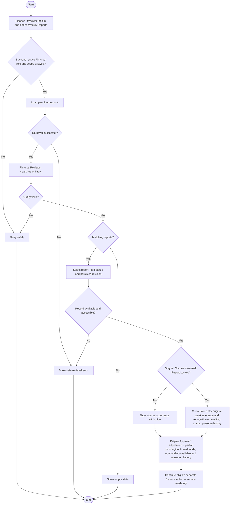

# Activity: View Weekly Reports

**Primary Actor:** Finance Reviewer
**Supporting Actors:** Backend authorization, reporting/aggregation and audit services.
**Status:** Requirements documented; not implemented or tested

## Purpose

Inspect submitted revisions and historical weekly reports across authorized HWF branches, without modifying financial evidence.

## Preconditions

- Active authenticated Finance Reviewer; backend verifies role and permitted central finance scope on every request.
- Persisted canonical branch/week reports and revision/source links are available; no fabricated financial fixtures.

## Inputs and Outputs

- Branch, week, status/date-range filters, search/pagination and report identity; validate server-side.
- List branch/city, precise PKT period, status, submission time and exact summary. Detail shows source collections, Approved recognized signed adjustments with original reference separately, Late Entry lines with original occurrence-week reference, submitted revision, remittance context and decision history.
- Distinguish gross collections, adjustments, submitted/unconfirmed remittances, Finance-confirmed remittances, outstanding funds and immutable historical report totals. FIN-011 signedOutstanding = netRecognizedCollections - confirmedRemittances within the same accounting scope/recognition timing, counting each original-or-Late Entry and Approved recognized signed adjustment once. Signed outstanding may be negative; reconciliationDeficit = max(0, -signedOutstanding), shown separately to authorized Finance/Head Office. availableToRemit = max(0, signedOutstanding - active committed pending reservations); never subtract deficit twice or hide it by clamping outstanding. Weekly recognition, original-occurrence views, cumulative dashboards and Head Office reconciliation need not have identical measure; official KPI/fixtures remain authoritative.

## Main Flow

1. Finance Reviewer logs in and opens Weekly Reports; backend verifies Finance permission and derives permitted scope.
2. Retrieve reports, validate/apply branch/week/status/date filters and display scoped results.
3. Select report; backend rechecks access/state/version. Draft/Returned displays latest eligible scoped calculation; Submitted displays its frozen preserved submission revision and Approved displays immutable final snapshot. Prior revisions remain historical evidence, distinct from live current balance/pending context.
4. Display exact financial details and submit/return/approve history, with gross amounts and adjustment/remittance categories separately explainable.
5. For Submitted, offer separately authorized [Return](return-weekly-report.md) or [Approve and automatic lock](approve-and-lock-weekly-report.md), with WR-004 relevant-issue checks freshly revalidated in approval transaction rather than trusting this read view. Approved is permanently locked/read-only; viewing alone changes nothing.

6. If financial CSV/PDF export is requested, independently reauthorize Finance scope and validate filters, resolve the effective report revision/snapshot and exact totals, generate protected safe output and record sanitized successful-export audit under EXP-001 to EXP-004. This is optional, not a side effect of viewing.

## Alternative / Error Flows

- Export attempt with invalid/expired session, unauthorized role/current branch/direct ID, or expanding filter: reject server-side without private data or successful-export audit. Invalid selection/generation failure cannot change financial records or masquerade as successful export.

- Unauthorized role/scope or invalid filters: deny/validate without exposing other data.
- Missing record, empty results or database failure: safe not-found/empty/error result.
- Stale action/current state: reload and revalidate in mutation workflow; read view grants no mutation.

## Business Rules

- **FIN-001 - DECIDED:** Occurrence time, not created_at, determines collection week under Monday 00:00 inclusive to next Monday 00:00 exclusive Asia/Karachi. FIN-005 locked occurrence-week entry is separately recognized once in next open eligible same-branch report or retained awaiting inclusion, never Submitted/Approved; original history unchanged.
- **FIN-002 - DECIDED:** Expired corrections use separate original-linked next-report adjustments, under FIN-006 source Branch Lead request/Finance approval, Approved-only recognition; Rejected/PendingReview zero effect. Never overwrite originals or double-count.
- **FIN-003 - DECIDED:** Branch-recorded but unconfirmed remittance is distinct from Finance-confirmed settlement; only confirmed remittances affect confirmed-remittance outstanding aggregation.
- **FIN-004 - DECIDED:** Canonical states are Draft, Submitted, Returned, Approved; Approved means permanently Locked with locked_at/equivalent metadata from the same approval transaction. Locked is an effect, not a separate manual action/state here.
- **FIN-010 - DECIDED:** PKR PostgreSQL NUMERIC(18,2)/Prisma Decimal, decimal-string monetary APIs and decimal-safe arithmetic/comparisons. Reject nonfinite/unsupported precision/range, float-derived amounts and direct money input above two fractional digits; never silently round direct records or use JavaScript number money arithmetic. Explicit HALF_UP only where calculation genuinely requires rounding. No payments or erased audit. Branch Lead cannot use central Finance permission or see other branches through their branch role.

- **FIN-005/FIN-006 - DECIDED:** Show original-week reference on distinct Late Entry, original collection on Approved signed correction, and awaiting inclusion separately if no eligible report. No normal-plus-late double effect; PendingReview/Rejected corrections contribute zero.
- **FIN-007/FIN-008 - DECIDED:** Separate partial pending reservation, confirmed, outstanding and available summaries; returned decision history includes mandatory meaningful trimmed nonempty reason. Read activity performs no recognition or return mutation.

- **FIN-011 - DECIDED:** Display signed outstanding, explicit deficit and nonnegative available separately under the scoped definitions above. Deficit permits no rewrite of locked originals, confirmed remittances, Approved snapshots or adjustment/period history, no automatic compensating payment/write-off. Confirmation must retain authorized coverage and avoid over-remittance; exact external clearing/refund/recovery/period settlement remains PENDING.
- **FIN-012 - DECIDED:** Own-branch Branch Lead requests Pending cancellation; Finance approves/rejects in its separate [remittance workflow](confirm-head-office-remittance.md). Request/rejection keeps Pending remittance/reservation. Approval atomically cancels to non-reserving state/releases exactly once/audits; confirmation/cancellation are mutually exclusive under concurrency. Confirmed cannot directly cancel/delete. Viewing itself releases no funds or changes state.
- **FIN-013 - DECIDED:** Multiple sequential source-linked requests are allowed, one PendingReview per original at a time; Finance decides/audits each. Original plus all Approved deltas (including awaiting recognition) plus candidate must remain nonnegative in the approval transaction. Closing/rejecting a request permits another; preserve original/prior approvals. Recognize each Approved once in eligible period; PendingReview/Rejected/Approved-awaiting-recognition do not contribute recognized totals. See [adjustment workflow](review-financial-adjustments.md).

- **WR-001/WR-002/WR-005 - DECIDED:** Reports come from scheduled/recovery system generation for eligible Active/Paused operational just-completed/missed PKT weeks, including zero activity; listing is not required trigger. Canonical unique branch/week and idempotent recovery preserve existing states/revisions, no Head Office operational report or fake records; FIN-014 ordinary Closed-branch future reports prohibited; legitimate pre-closure recognition container/period PENDING.
- **WR-003 - DECIDED:** Distinguish live Draft/Returned, frozen Submitted revision and final Approved snapshot; never show recalculated Draft as historical evidence or alter frozen figures for later confirmations/records. Resubmission preserves prior actor/time/revisions and creates new immutable evidence. Valid zero-activity reports follow normal audited decisions.
- **WR-004 - DECIDED:** Relevant unresolved issue capable of materially affecting candidate eligible figures blocks Finance approval transactionally; unrelated branch/period/non-affecting request does not. No unapproved adjustments in totals; distinguish occurrence week, recognition week and reviewed report. Reassess after resolution, preserving frozen evidence; exact multi-period treatment needs explicit specification. Viewing performs no approval or mutation.
- **WR-006 - DECIDED:** Decisions revalidate current state/version/equivalent control, role/branch and audit transactionally, not stale read claims. Conflicts cannot create partial/duplicate success/recognition; Approved cannot reopen and no manual Lock.

- **FIN-014 - DECIDED:** Closed permits no new ordinary collections/future-week reports; retain original/report/snapshot/financial/member/audit history. Pre-closure reconciliation needs existing authorization/separate audit, no revived inactive/unassigned lead access. Exact discovery recognition container/period after closure PENDING; no new report type/reopening; Active/Paused drafts unchanged.
- **FIN-015 - DECIDED:** Same WR-004 relevance rule: transactionally recheck candidate branch/report/period/recognition material effect. Unrelated/mere request existence does not block; exclude unapproved amounts, resolve then reassess. No automatic adjustment approval/global submission ban/frozen rewrite.
- **FIN-016/FIN-017 - DECIDED:** Future eligible same-branch recognized collections offset cumulative deficit exactly once/in correct period, not other-branch funds or artificial transfers. Preserve immutable weekly figures/nonnegative available. Remittance uses branch-level availability, no mandatory collection-ID allocation; role separation/reservations/confirmation/cancellation/audit/concurrency safeguards unchanged.
- **FIN-018 - DECIDED:** Adjustment reason mandatory/file optional; valid no-file allowed, attachment not substitute for reason/correctness. Finance review/upload controls apply; remittance file optional, amount/date/reference required. See [authoritative financial definitions](../../domain-rules.md); provider/limits are technical configuration.

- **PERM-002 / EXP-001 to EXP-004 - DECIDED:** View organization-wide authorized financial records/revisions and related financial workflow/audit history under [permissions](../../permissions.md). Finance organization-wide scope is server-authorized, including direct IDs/filters; Branch Leads cannot inherit it and lose former-branch access immediately. No unrelated HR/CMS/security audit or additional financial write grant. Optional CSV/PDF export separately authenticates/authorizes, validates period/branch/status/financial filters, selects same effective revision/snapshot and exact PKR totals for both formats, clearly labels Draft/frozen Submitted/Approved and financial categories. Server CSV injection/encoding protection preserves legitimate signed money; sanitize PDF and omit unrelated private data. Protect response caching/public access; each successful export appends sanitized actor/action/time/scope/filter/format/source revision metadata, not file bodies; denied calls never successful-export events. Ordinary viewing still changes no business state; export never edits immutable figures. Full [future test coverage](../../../project-context/modules/dashboard.md).

## Postconditions

- Authorized report/revision/history displayed or safe error; no status, financial data or business audit event is mutated merely by opening it.

## Activity Diagram

## Acceptance Criteria

- Finance Reviewer sees only permitted branches; Branch Lead/unauthorized users cannot inherit central finance access.
- Late Entry and Approved signed corrections reference original context and count once, pending remittances are not confirmed receipts, and outstanding/available shown separately. Return history contains mandatory explanation.
- Valid filters/revisions produce correct scoped data, approved read-only details and separately explained financial categories; viewing changes no report/audit business state.
- Backend fixture tests must reproduce actual official seed/dashboard values exactly when available; no fixture values or dashboard gate are verified here.
- Missing/invalid/empty/error paths safe; all criteria are future tests, not executed checks.

- Exact PKR decimal-string/two-digit rules apply; summaries show negative signedOutstanding as explicit deficit and nonnegative available after reservations. No original/snapshot rewrite, duplicate recognition or read-side confirmation/cancellation occurs. Cancellation/adjustment history follows FIN-012/FIN-013; these remain future test criteria.

- Future WR read tests distinguish current Draft/Returned from frozen Submitted/Approved and preserved older revisions, including zero-activity reports. Opening report performs no generation/state mutation. Relevant/unrelated approval, stale-view/conflict and unauthorized access checks execute in decision workflows; none are implemented tests.

- Planned finance/report checks: Closed history readable/Approved snapshots immutable, ordinary new Closed collections/future reports and unauthorized settlement denied. Relevant issue blocks candidate approval, unrelated one does not; cumulative same-branch future collections offset deficit while other-branch funds cannot, with no historical rewrite/fake transaction.
- Branch-level partial remittances keep exact Pending/Confirmed totals without mandatory collection allocation and concurrency prevents over-remittance. Adjustment reason/no-file accepted, missing reason fails, optional evidence cannot bypass validation/permissions. These are future criteria, not passing evidence.

- Planned PERM/EXP checks: permitted scoped read/export, denied unauthorized direct-ID/filter/session access and Branch Lead cross-branch/stale-assignment access; CSV/PDF same revision/totals with safe text, immutable figures, private response and sanitized successful-export audit. No tests implemented/executed; libraries/layout/file naming/batching remain pending.

## Pending Decisions

- Official KPI/fixture interpretation, late-entry evidence and attachment technical configuration, exact external deficit clearing/refund/recovery and cross-period settlement, confirmed-remittance dispute investigation/authority/accounting, external bank evidence validation, exceptional historical allocation/reconciliation and other expiry/rejection-release paths. FIN-010 money, FIN-011 scoped balances/deficits, FIN-012 Pending cancellation and FIN-013 sequential/cumulative rules are DECIDED, along with FIN-005 routing/FIN-006 authority/FIN-007 reservations.
- Filter defaults/limits and any additional detail grants/financial notifications not already approved; Exact legitimate pre-closure discovery recognition container/accounting period after closure, scheduler hosting and detailed multi-period issue treatment. WR-001 to WR-006 core behavior is DECIDED.
