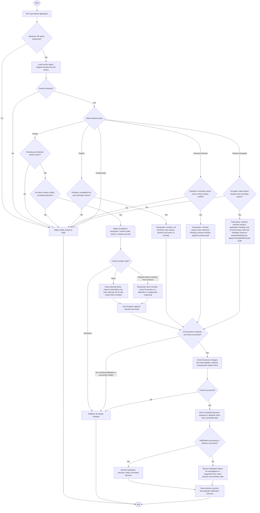

# Activity: Approve or Decline Volunteer Application

**Actor:** HR Lead
**Status:** HR-001 to HR-010 and HWF-XM-001 to HWF-XM-004 DECIDED; not implemented or tested

## Purpose

Define first acceptance, decline, both reversals and same-member reacceptance. Preserve [city-based identity](volunteer-identification.md), application links and append-only decision/audit history.

## Preconditions

- Backend authenticates and authorizes HR Lead within centralized organization-wide HR scope. Branch Lead, Content Editor and Finance Reviewer cannot accept/decline/reverse; HR inherits no unrelated permissions.
- Load current application, branch, original member link and history. Concurrency-protect relevant records and cross-record constraints; UI state is not authoritative.
- Pending may have no member or retain the original Inactive member after accepted reversal. A linked member never triggers first-time creation.

## Inputs

- Application ID/reference and requested action; selected/associated branch for acceptance/reacceptance. No silent branch reassignment or transfer is authorized.
- Mandatory trimmed nonempty decline/reversal reason. System supplies staff identity, original decision, previous/new status, member effect, reason and timestamps in audit metadata.
- No manual Volunteer ID assignment or credential/unnecessary personal data in audit.

## Main Flow

1. HR Lead selects application/action; backend verifies authorization, current state and original application/member linkage. Begin a transaction and lock or otherwise protect relevant records/constraints against concurrent changes; revalidate all applicable rules before writes.
2. **Accept Pending:** Require existing selected branch Active and HR-001 contact checks. Exclude this application and its legitimately linked member; another eligible application/member conflict rejects.
3. If no linked member, load the selected Active branch's authoritative city/city-code metadata and allocate one database-safe city ID from that city-wide sequence (never applicant residence/current location, HR office or free-text city) and create exactly one Active member with immutable primary key and one primary branch. If its original member is Inactive due to accepted reversal, reactivate that same member using its original primary key/ID, with no city allocation and no automatic reopening of ended team assignments. Any other linked state rejects. Set Accepted and append acceptance/reacceptance history/audit.
4. **Decline Pending:** Check no incompatible linked-member state; validate reason, set Declined and save reason, decision metadata and audit. Create no member. Do not delete/detach a retained member to force this path; safe handling of a new Decline with that link remains pending.
5. **Reverse Declined:** Require current Declined, valid reason and no other eligible contact conflict, excluding own legitimate records. Restore the same application/reference to Pending; preserve original decline reason, actor and timestamp; append reversal history/audit. No member/new reference.
6. **Reverse Accepted:** Require current Accepted, valid original linked member and reason. Load current active team assignments; in the protected transaction set existing member Inactive and application Pending, end all current active team assignments with end metadata and audit the member/assignment effects together; retain original assignment starts/history, link, primary key, Volunteer ID, branch/transfer and operational history. Append AcceptedReversed history/audit. Branch need not be Active and no fixed deadline or extra Super Admin approval applies.
7. Commit application/member/history/audit changes together; show success only after commit. Any validation/write/commit failure rolls back all related changes. After accepted reversal the member must not be treated as active; backend blocks new member-associated collections, team/activity assignments and Active-required participation, including concurrent deactivation/activity requests.
8. After commit, dispatch/enqueue decision email for initial acceptance, decline, either reversal and reacceptance using committed decision data. Record processing/delivery outcome; email failure leaves the application/member/audit unchanged and must not be reported as failed HR decision. Outbox/job delivery is RECOMMENDED: record notification intent with the transaction and deliver after commit; external delivery is never a condition for committing the business transaction.

## Alternative / Error Flows

- Unauthorized, missing record, invalid state/action, blank reason or broken link: reject safely. Pending reversal is invalid; repeated reversal/reacceptance cannot append another successful mutation for the old state.
- Forming/Paused/Closed branch, including concurrent status change: reject acceptance/reacceptance without silent reassignment. Otherwise valid accepted reversal does not require Active branch or recent decision age.
- Another HR-001 conflict blocks relevant contact-checked operations; legitimate self-linked contacts do not. Similar names alone never reject; no override of strict contact blocking is granted.
- Concurrent reversals, reacceptances, reversal/conflicting decisions and overlapping-contact applications must serialize/revalidate. No duplicate members/decisions, broken links or partial outcomes may commit.
- Counter, constraint, history/audit write or commit failure: rollback all business changes. Allocation gaps may remain; issued IDs are never recycled.
- Email delivery/processing failure: keep committed decision/member/history, mark notification failure for supported investigation/retry and show decision success with separate notification outcome. Never roll back because email failed.
- Unresolved independent-module inactive states or incompatible retained-member Decline: flag affected integration path; do not invent destructive cleanup. Core reversal outcomes are final.

## Business Rules

- **OFFICIAL / retained HWF:** Five authenticated roles, central HR, backend authorization, unique branch-associated members, PostgreSQL concurrency safety, English/Urdu RTL, no payments or volunteer staff login, no real CNIC/personal sample/test data.
- **HR-001 - DECIDED:** Intake rejects exact normalized email OR Pakistani phone against Pending applications, Accepted linked to active membership or active members, concurrency-safely. Historical Declined alone does not block reapplication. Shared-family-phone matches reject; contacts are not identity proof, and names alone never reject/merge. Reversal/reacceptance checks exclude own application and legitimate linked member; other eligible conflicts reject.
- **HR-002 - DECIDED:** First acceptance/reacceptance requires Active branch; Forming/Paused/Closed reject, with transaction-time protection against concurrent status changes. Accepted reversal to Inactive does not require Active branch.
- **HR-003 - DECIDED:** Mandatory trimmed nonempty decline reason, metadata and atomic audit; no new member.
- **HR-004 - DECIDED:** Fresh reapplication after decline creates a new unique-reference Pending record after conflict checks, not a member. Preserve old decision/audit and review independently. Reversal changes the original record/reference instead.
- **HR-005 - DECIDED:** HR Lead may reverse supported final decisions with controlled atomic audit and preserved history.
- **HR-006 - DECIDED:** Declined -> Pending on same reference, preserving original reason/actor/time. Record reversal actor/time/reason; other eligible contact conflicts deny safely. No member or new reference.
- **HR-007 - DECIDED:** Accepted -> Pending; existing linked member Inactive. Preserve immutable primary key, permanent ID, linkage, branch/transfer and financial/collection/report/operational history. Never physically delete member or release ID. AcceptedReversed is a history event, not a fourth application status.
- **HR-008 - DECIDED:** Reaccept Pending with its original reversal-linked Inactive member by restoring that member Active and application Accepted. Same ID/prefix/primary key, no second member, new ID, city allocation or counter reset; preserve reversal history and audit atomically.
- **HR-009 - DECIDED:** Authorized HR Lead only; trimmed nonempty reversal reason; no extra Super Admin approval. Audit staff identity, application reference, previous/new status, linked-member effect, reason and timestamp without secrets/unnecessary sensitive data. Pending cannot be reversed.
- **HR-010 - DECIDED:** No 7-day, 30-day or other fixed reversal limit. Historical timestamps stay unchanged; reversal has a new timestamp. Current authorization, integrity and eligibility still apply; no history deletion.

- **HWF-XM-001 - DECIDED:** First ID prefix comes exclusively from selected operational branch's authoritative city at initial successful acceptance. Read its current city metadata, not applicant residence/location, HR office, free text or blindly its immutable historical branch code. Same-city branches share the sequence. Reacceptance reuses original member/ID even if current branch city differs.
- **HWF-XM-002 - DECIDED:** Inactive members cannot receive new collections on their behalf, new team assignments, new volunteer activity/participation or Active-required actions. Backend enforces this for authorized staff; no Volunteer login role. Preserve member/ID, historical assignments/collections/reports/audit and financial amounts. Legitimate unpaid/unrouted collections remain in financial reporting/reconciliation until authorized finance handling. No invented exception to the separate seven-day collection-correction policy. BL-005 atomically ends current active team assignments on inactivation, preserving records/start dates and end metadata; no deletion. Stale assignments never permit new work. Reactivation does not recreate ended/cancelled/historical assignments.
- **HWF-XM-003 - DECIDED:** Source Branch Lead requests member transfer; HR Lead approves/rejects. No direct Branch Lead branch change; see [identity contract](volunteer-identification.md) for scope and pending transfer policy, separate from applicant decisions.
- **HWF-XM-004 - DECIDED:** Email the application address for each committed initial acceptance/decline, reversal and reacceptance, using application reference and appropriate committed decision status. Never include confidential duplicate matches, internal audit or credentials. Delivery failure cannot roll back decision/member/audit. Outbox/job mechanism is RECOMMENDED, not finalized; record processing outcome, support investigation/retry as designed and do not guarantee delivery. No sensitive applicant/credential notification logs.

- **BL-005 - DECIDED:** Every authorized Active-to-Inactive transition, including Accepted reversal, ends all currently active team assignments in the same transaction as application/member/audit changes. Record end metadata and assignment effects without deleting history or changing start dates, ID, branch history, collections/reports/amounts. Any assignment-ending failure rolls back reversal too. Reacceptance does not restore ended assignments; new ones require explicit authorized Branch Lead action.

| Operation | Application Before | Application After | Member Effect |
| --- | --- | --- | --- |
| First acceptance | Pending | Accepted | Create one Active member |
| Decline | Pending | Declined | No member created; reject incompatible link |
| Reverse decline | Declined | Pending | No member created |
| Reverse acceptance | Accepted | Pending | Existing member Inactive |
| Reaccept after accepted reversal | Pending | Accepted | Same member Active |
| Fresh reapplication after decline | New submission | New Pending record | No member on submission |

Current application states remain Pending, Accepted and Declined. Atomic operations recheck authorization/state, branch/contact/member constraints, save changes and append decision/audit history; never overwrite old events.

## Postconditions

- First acceptance creates one linked Active member; reacceptance restores the same member/ID without allocation. Both commit Accepted/history/audit.
- Decline commits reason/Declined/audit without new member. Both reversals restore original Pending/reference; accepted reversal retains Inactive member/link and all history.
- Decision email dispatch follows commit; success/failure leaves committed application/member state authoritative. Notification failure is separate from HR decision success.
- Failure/repeated incompatible requests leave previous records unchanged; every successful mutation has append-only audit/history.

## Activity Diagram

## Acceptance Criteria

- Only authorized HR Lead decides/reverses; other unauthorized roles fail. Reversal needs reason but no extra Super Admin approval or fixed expiry.
- First acceptance creates exactly one Active linked member; missing/whitespace decline reason fails and valid first decline creates no member.
- Declined reversal preserves reference/decline reason/actor/time, returns Pending, appends reversal audit and creates no member. Other eligible conflicts deny.
- Accepted reversal returns Pending and same member Inactive with ID/key/link/history preserved; event is AcceptedReversed. No Active-branch or age restriction; blank reason/repeated reversal fails without extra changes.
- Reacceptance reactivates same member/ID without record/ID allocation or counter reset; own contacts do not conflict, others do. Active branch mandatory.
- Test two reversals, two reacceptances, reversal versus conflicting decision, overlapping-contact applications and concurrent branch-status/reacceptance: no duplicate or partial records/broken links.
- Initial ID uses selected branch authoritative city even when residence differs; reversal/reacceptance allocate no replacement ID.
- Backend rejects new collections, team assignments and participation for Inactive members, including concurrent status/activity races; stale assignment records grant no exception. History, financial amounts and unpaid/unrouted collections remain available for authorized reconciliation.
- Reacceptance uses same member and does not duplicate historical collections/team relationships or recreate ended assignments. Accepted reversal ends all current active assignments with end metadata in the same transaction; assignment-ending failure rolls back member/application reversal and all related audit effects.
- Each committed acceptance, decline, reversal and reacceptance triggers notification intent/processing from committed data. Email failure retains decision/member/audit and never falsely reports rollback; notification status is restricted to authorized users.
- Failed history/audit/commit rolls back application/member changes. Preserve all operational history. These are future synthetic-data test criteria, not executed tests.

## Pending Decisions

- Independent-module member-state conflicts beyond decided assignment-ending effects; minimum new-work prohibition is DECIDED and cannot be bypassed. Affected integrations need safe policy before implementation.
- New Decline on Pending with retained member needs a compatible non-destructive policy; reject incompatible linkage, never infer deletion/unlinking.
- City-code governance/new-city assignment, reference format, precise normalization and proposed form details remain pending; selected-branch city source is DECIDED.
- Transfer consent, source-branch status at approval, financial handling, expiry/cancellation and duplicate-request details remain pending in the identity contract; BL-004 Active-member/Active-target request/approval checks are DECIDED; request/approval ownership is DECIDED.
- Email provider, retry limits, templates, sending infrastructure and exact outcome presentation/processing mechanism remain PENDING; decision email and post-commit failure isolation are DECIDED.
