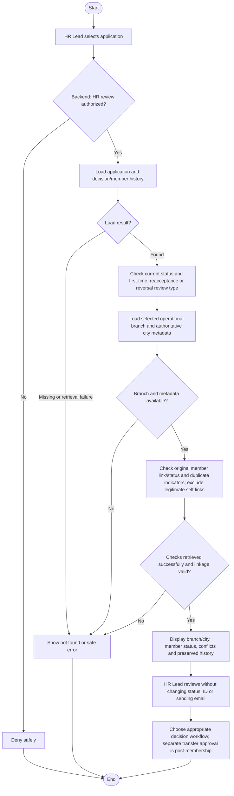

# Activity: Review Volunteer Application

**Actor:** HR Lead
**Status:** HR-001 to HR-010 and HWF-XM-001 to HWF-XM-004 DECIDED; workflows not implemented or tested

## Purpose

Review Pending applications or processed-decision reversal eligibility without changing status or creating membership. The [decision workflow](approve-decline-application.md) revalidates every mutation.

## Preconditions

- Backend authenticates HR Lead and authorizes centralized organization-wide HR review.
- Application exists; current status determines normal review versus processed history/reversal review.
- Applicant/member comparison information is restricted to authorized HR users.

## Inputs

The public form below is **PROPOSED**, including its required flags; it is not an approved finalized form schema.

| Field            | Required |
| ---------------- | -------- |
| Full Name        | Yes      |
| Email            | Yes      |
| Phone Number     | Yes      |
| City             | Yes      |
| Preferred Branch | Yes      |
| Area of Interest | Yes      |
| Motivation       | Yes      |
| Availability     | No       |

Areas of interest: Education Support, Food Assistance, Healthcare Support and Emergency Relief. Review input is the application reference/internal identity, not an issued Volunteer ID. Validate public inputs on frontend/backend; backend remains authoritative.

For processed review, include existing decision, decline reason where applicable, linked member and a proposed reversal reason. Reversal requires a trimmed nonempty reason, no extra Super Admin approval and no fixed deadline.

## Main Flow

1. HR Lead opens application; backend authorizes HR review and loads application, branch, original member link and decision history.
2. Determine type: Pending without member is first-time review; Pending with original Inactive member after accepted reversal is reacceptance review; Accepted/Declined is reversal/history review. Unexpected linkage/state is an integrity error, never a reason to create another member.
3. Normalize contacts and compare HR-001 eligible records, excluding own application and legitimately linked member. Display exact conflicts separately from nonconclusive similar-name warnings.
4. Display the selected operational branch's authoritative current city/city-code metadata: it alone determines first Volunteer ID prefix, never applicant residence/location, office or free text. First acceptance/reacceptance requires Active selected branch and fresh transactional checks. Reacceptance reuses original member/ID without city allocation; no silent reassignment.
5. Decline requires trimmed nonempty reason and compatible linked state. A new Decline with a retained member requires safe policy; do not delete/detach that member.
6. Reversal review shows original reason/actor/time. Require reversal reason: Declined returns same Pending/reference after other-contact checks, no member; Accepted returns Pending with same member Inactive, history intact, regardless of branch Active status or decision age.
7. Continue to the [decision workflow](approve-decline-application.md) with fresh checks. Reviewing never changes application/member status or sends decision email. Fresh reapplication is reviewed independently from reversing the old record.
8. Post-membership transfer review is a separate operation: source Branch Lead requests within their branch, HR approves/rejects. See [identity transfer contract](volunteer-identification.md); do not mix it into applicant review or directly edit branch assignment here.

## Alternative / Error Flows

- Unauthorized, missing record or data/comparison failure: safe error, no disclosure/mutation; unavailable checks are not a clean result.
- Other exact HR-001 contact conflict blocks acceptance/reacceptance or Declined reversal; legitimate self-links excluded. Family-phone limitation remains; names alone never reject.
- Non-Active branch blocks acceptance/reacceptance, not review or otherwise valid accepted reversal. Invalid/blank decline/reversal reason fails.
- Pending reversal invalid; processed records need the correct reversal action, not unconditional approval.
- Unexpected link or unresolved independent-module Inactive-state/legacy assignments: flag unsafe integration; do not invent cleanup or mutate during review.

## Business Rules

- **HR-001 - DECIDED:** Exact normalized email OR phone against Pending, Accepted with an active linked membership, or active members is an automatic public-submission conflict. Same email, same phone or shared family phone rejects regardless of whether identity is proven. Current application is excluded on rechecks; similar names alone do not reject. Use concurrency-safe enforcement.
- **HR-002 - DECIDED:** Only Active selected branches receive accepted members; backend transactionally rechecks status. Never silently move an applicant to another branch.
- **HR-003 - DECIDED:** Every decline requires a nonempty reason after trimming, stored with metadata and appropriate atomic audit; avoid unnecessary sensitive audit details.
- **HR-004 - DECIDED:** Reapplication creates a new reference/Pending record after active-conflict checks; old decline history remains unchanged and review is independent.
- **HR-005 - DECIDED:** HR supports controlled reversal, not unconditional reapproval.
- **HR-006 - DECIDED:** Declined reversal restores original Pending/reference after other-contact checks; preserves original decline reason/actor/time and creates no member.
- **HR-007 - DECIDED:** Accepted reversal restores Pending and original linked member Inactive, preserving identity/branch/transfer/operational history; AcceptedReversed is history only.
- **HR-008 - DECIDED:** Reacceptance reactivates same member/ID/key without allocation; Active branch required.
- **HR-009 - DECIDED:** Authorized HR Lead, trimmed nonempty reversal reason, no extra Super Admin approval; Pending reversal invalid.
- **HR-010 - DECIDED:** No fixed reversal time limit; retain original timestamps and append reversal timestamp; current integrity/permission checks apply.

- **HWF-XM-001 - DECIDED:** Verify selected branch authoritative city before first acceptance; residence never overrides it. Reacceptance retains original ID regardless of current branch city.
- **HWF-XM-002 - DECIDED:** Show linked membership status separately from application status. Inactive member is not an applicant with no member; block new collections, team/activity assignments and Active-required work through backend staff operations. Preserve identity, historical assignments/financial amounts/reports/audit and unpaid/unrouted collections. Stale assignments grant no new participation; reactivation does not recreate old assignments.
- **HWF-XM-003 - DECIDED:** Branch Lead requests transfer from authorized source branch; HR approves/rejects. Only approved transfer changes current primary branch with identity/history/audit preserved. Detailed eligibility/financial effects remain PENDING in the identity contract; dedicated transfer activity is planned, not created.
- **HWF-XM-004 - DECIDED:** Reviewing alone sends no decision email. Email follows a committed acceptance/decline/reversal/reacceptance; failed delivery cannot undo application/member changes. See [decision workflow](approve-decline-application.md).

- **OFFICIAL / retained HWF:** Centralized HR does not inherit staff/finance/content/branch operations. Branch Lead, Content Editor and Finance Reviewer cannot decide/reverse HR applications. No public CNIC requirement, real CNIC use or real personal sample/test data; no public comparison details. Review remains read-only with English/Urdu RTL and no payments.

## Postconditions

- Authorized HR has reviewed information, contact/similarity checks and normal-decision or reversal eligibility; no status/member/audit mutation occurs in review.
- Normal decisions and reversals require fresh transaction-time validation in their own workflow.

## Activity Diagram

## Acceptance Criteria

- Authorized review distinguishes first-time Pending, Pending with original Inactive member and processed reversal/history review; unexpected links never trigger new creation.
- Own application/legitimate member contacts do not conflict; other HR-001 conflicts block, names alone do not and different contacts do not prove identity.
- First acceptance/reacceptance requires Active branch; accepted reversal does not require Active branch or recent decision age.
- Decline/reversal require nonempty reasons; reversal needs no extra Super Admin approval. History retains original events and reasons.
- Authorized summary shows selected branch authoritative city and separate linked member status; residence does not select prefix. Review neither transfers a member nor sends decision email.
- Review alone changes no state/member/audit. Unauthorized/missing/data-error cases are safe. These are future synthetic-data test criteria, not executed tests.

## Pending Decisions

- Final proposed form, precise normalization/similarity thresholds and identity resolution beyond HR-001.
- Current assignment termination/preservation on Inactive members, independent-module state conflicts, pending transfer eligibility/finance details, email provider/retries/templates and safe treatment of a new Decline with retained member can block affected implementation paths. Inactive new-work restrictions, selected-branch city source, transfer ownership and decision email are DECIDED. Core reversal/reacceptance state, authority and time policy are DECIDED.
