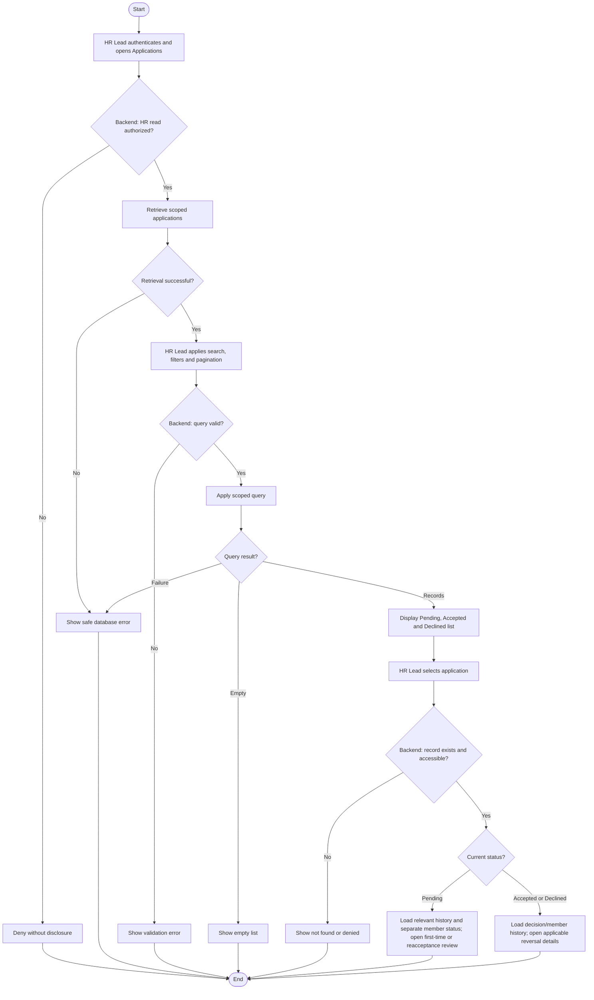

# Activity: View Volunteer Applications

**Actor:** HR Lead
**Status:** HR-001 to HR-010 and relevant cross-module decisions DECIDED; workflows not implemented or tested

## Purpose

View, search and monitor public applications through centralized Head Office HR. Include processed history and link to authorized review/decision reversal without changing records during viewing.

## Preconditions

- HR Lead logs in with authorized staff credentials; backend authenticates and authorizes every list/detail request across permitted HWF branches.
- Public applicants use Get Involved without staff accounts; frontend/backend validation and server rate limiting apply.
- Personal information, member IDs and conflict-match details are never publicly disclosed.

## Inputs

- Search: name or Application Reference ID; APP-000001 is a **PROPOSED** format, distinct from permanent city-based Volunteer IDs.
- Filters: branch, status, submission date and validated pagination.
- List: Application Reference ID, Full Name, Email, Phone, Preferred Branch, Status, Submission Date and Possible Duplicate Indicator (nonconclusive similarity signals).
- Permitted processed details include decline reason, decision metadata, traceable history and separate linked member status. Notification processing/delivery outcome may be shown only to authorized HR under the chosen mechanism; exact UI fields are not finalized; do not expose unnecessary sensitive data.

## Main Flow

1. HR Lead logs in and opens Applications; backend verifies organization-wide HR read scope and retrieves permitted records.
2. HR Lead applies name/reference search, branch/status/submission-date filters and pagination. Backend validates and permission-scopes every query; failures/empty results return safe errors/empty state.
3. Display Pending, Accepted and Declined current statuses and permitted original decisions/reversal history. Pending may be first-time with no member or reconsideration with the original linked Inactive member after accepted reversal.
4. On selection, backend rechecks record/access/current state/link. Pending opens first-time or reacceptance review; Accepted/Declined opens preserved history and applicable reversal details. Only eligible processed records show reversal action; backend remains authoritative.
5. Viewing changes no state and sends no decision email. Committed decision and linked member status remain authoritative even if notification fails. Both reversals restore original Pending/reference. Fresh public reapplication instead creates a separate new-reference Pending record after HR-001 checks; public intake is not an HR submission.

## Alternative / Error Flows

- Unauthorized HR request, invalid query, missing reference, empty results or database failure: show safe denial, validation, not-found, empty or error response; no application changes.
- HR-001 rejected intake has no application record/reference and does not appear as a Declined row. A separate rejected-submission monitoring feature is not specified.
- Two matching concurrent submissions: at most one eligible application is created; no private existing-record details are returned.

## Business Rules

- **HR-001 - DECIDED:** Reject exact normalized email OR phone matches against Pending applications, Accepted applications linked to an existing active membership, or existing active members. Historical Declined applications alone do not block intake. Use database constraints or another concurrency-safe mechanism. Contact prevention is not human identity proof; shared family phones are rejected by this strict policy, and different contacts may still be one person. Similar names alone never reject.
- **HR-003 - DECIDED:** Every decline stores a trimmed nonempty reason and decision metadata with atomic audit; permitted history displays that reason.
- **HR-004 - DECIDED:** Declined applicants may submit anew subject to HR-001. New reference and Pending record, no member; independently review it. Old record/decision/audit is not overwritten by reapplication. Example references APP-000015 (Declined) and APP-000049 (new Pending) are illustrative.
- **HR-005 - DECIDED:** HR Lead may reverse prior decisions; viewing does not execute it.
- **HR-006 - DECIDED:** Declined reversal restores same reference Pending, preserving original reason/actor/time and appending reversal history; no member/new reference. Other eligible contact conflicts deny safely.
- **HR-007 - DECIDED:** Accepted reversal restores Pending with original linked member Inactive; keep ID/key/branch/transfer/operational history. AcceptedReversed is a history event, not a fourth current state.
- **HR-008 - DECIDED:** Reacceptance restores same linked member Active with original ID; no new member or allocation. Distinguish this Pending from first-time review.
- **HR-009 - DECIDED:** Authorized HR Lead with mandatory trimmed nonempty reason; no extra Super Admin approval. Pending cannot be reversed.
- **HR-010 - DECIDED:** No fixed reversal time limit; original timestamps stay, reversal adds its own; current permissions/integrity checks apply.

- **HWF-XM-002 - DECIDED:** Application status and membership status differ: reversed Accepted is Pending with same linked member Inactive; reversed Declined is Pending with no newly created member. Authorized historical access remains; Inactive blocks new operational work, not history or legitimate financial reporting.
- **HWF-XM-004 - DECIDED:** Email notifications follow committed initial acceptance, decline, reversal and reacceptance; delivery failure changes no application/member/audit state. List/view triggers no email. Any notification outcome visibility is backend-authorized and separate from decision status; no guaranteed delivery or finalized delivery UI is implied.

- **OFFICIAL / retained HWF:** Five authenticated roles, centralized HR, English/Urdu RTL, no online payments and synthetic-only sample/test personal data. Branch Lead, Content Editor and Finance Reviewer cannot accept/decline/reverse HR decisions; HR does not inherit their unrelated operations.

## Postconditions

- Read flow returns permitted records/history or a safe error/empty state without status/member/audit changes.
- New reapplication and original-record reversal stay distinct; viewing creates neither and preserves all history.

## Activity Diagram

## Acceptance Criteria

- HR-authorized scoped search, filters and pagination include processed history; unauthorized users cannot read personal details.
- Same normalized email/different phone, different email/same phone, or both matching reject intake under HR-001; shared-family-phone conflicts also reject.
- Similar names/different contacts do not automatically reject. Concurrent matching submissions cannot both succeed; private match details stay hidden.
- Historical decline alone permits a fresh unique-reference Pending application; original reason/decision/audit remain intact and no member is created.
- Reversed applications reappear Pending with original reference/history; accepted reversal retains linked Inactive member while first-time Pending has none. Only eligible Accepted/Declined show reversal.
- Notification failure does not alter application/member status or remove audit. List/detail viewing sends no email; unauthorized users cannot read delivery outcomes/applicant data.
- Rejected intake produces no application row. Viewing/history navigation never executes a decision/reversal. These are future test criteria, not passing tests.

## Pending Decisions

- Final reference format, pagination limits, precise normalization specifications and any rejected-submission monitoring.
- Email provider/retry/template/infrastructure and exact notification-outcome UI remain PENDING; decision email/failure isolation are DECIDED. Current active-assignment transitions on Inactive members remain unresolved, but no new work is allowed. Reversal state/authority/timing remain DECIDED.
