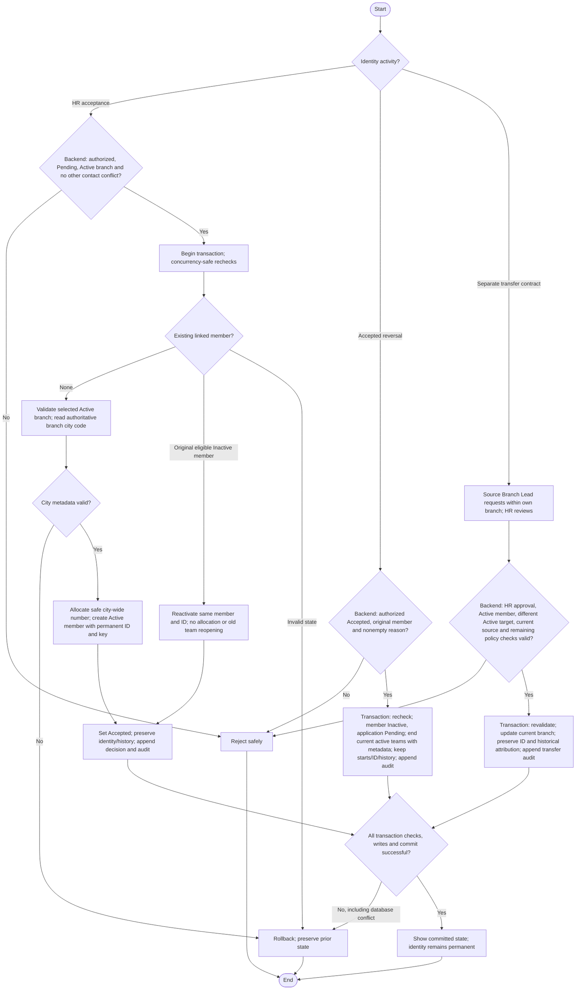

# Activity: Volunteer Identification & Branch Membership

**Actor:** HR Lead (acceptance initiator); system allocates identifiers
**Status:** City-based identity, HR-006 to HR-010 and HWF-XM-001 to HWF-XM-004 DECIDED; not implemented or tested

## Purpose

Define permanent city-based volunteer/member identification within the [acceptance transaction](approve-decline-application.md). The approved city-based format applies to permanent member identity across acceptance, reversal, reacceptance and transfer.

## Preconditions

- Backend authorizes HR Lead for acceptance/reacceptance or Accepted reversal and loads application/history/original member link.
- Acceptance/reacceptance requires Pending, Active selected branch and no other HR-001 conflict, excluding own application/legitimate member. Accepted reversal requires Accepted, original member and mandatory reason, not Active branch.
- PostgreSQL-safe city allocation, uniqueness and concurrency-protected transactions are requirements, not implemented schema changes.

## Inputs

- Application internal ID/reference, selected operational branch ID and its authoritative current city/city-code metadata for first issuance. Applicant residence/current location, HR office and free-text city never select the prefix.
- System-generated immutable internal member primary key, public Volunteer ID and separate current `branch_id` relationship. Reference example APP-000001 is **PROPOSED** and is not a Volunteer ID.

| City       | Branch code example | Volunteer ID examples |
| ---------- | ------------------- | --------------------- |
| Lahore     | LHR-001, LHR-002    | LHR-V0001, LHR-V0002  |
| Faisalabad | FSD-001, FSD-002    | FSD-V0001, FSD-V0002  |
| Islamabad  | ISB-001             | ISB-V0001             |

`V` distinguishes volunteer/member identity from branch identity; numbering is per city, not per branch.

## Main Flow

1. HR Lead selects Accept on Pending or Reverse Accepted on Accepted. Backend authorizes, validates state/link and begins a transaction with concurrency-safe rechecks.
2. **First acceptance only:** No linked member exists. Check Active branch/contacts; load selected branch's authoritative current city code (not its immutable historical branch-code prefix), safely allocate next city-wide ID, enforce uniqueness and create one Active member with immutable primary key and one primary branch.
3. **Reacceptance:** Pending retains original Inactive member due to accepted reversal. Verify link, Active branch and other contact constraints; set same member Active with same ID/key/prefix. No new member, sequence allocation, counter reset or automatic reopening of ended team assignments.
4. **Accepted reversal:** Require trimmed nonempty reason. Restore application Pending, set original linked member Inactive and end all current active team assignments with end metadata in the same transaction, retaining original starts/assignment history, primary key/ID/branch/transfer/operational history and appending AcceptedReversed member/assignment audit. No new ID, release or deletion; branch need not be Active and no fixed deadline or extra Super Admin approval applies.
5. Acceptance/reacceptance sets Accepted and appends decision/history/audit. Commit all changes together; failure rolls back all related changes; expose only committed outcomes.
6. Source Branch Lead may request transfer for an Active member in their own branch to a different Active operational branch; HR Lead reviews/approves or rejects across branches. Only valid HR approval changes current `branch_id` atomically, retaining original prefix/ID/key and historical attribution. Operational details remain PENDING; this is a concise cross-module contract, not a complete transfer state machine.
7. **Transfer contract (reason field PROPOSED; remaining details PENDING):** Source lead identifies source/target and proposes a reason; backend checks actor/source scope and current member branch, records Pending transfer request; HR reviews member/branches/reason. Approval revalidates authorization, member Active, different target Active, current source assignment and request freshness, updates one primary branch and records decision/audit atomically. Rejection records decision/audit without branch change. Notify parties only under the later approved transfer communication policy. The [transfer activity](../branch-lead/request-member-transfer.md) now documents request/approval; remaining operational policies are still pending.

## Alternative / Error Flows

- Unauthorized/missing record, incompatible state/link or blank reversal reason: reject safely. Pending with linked member never triggers first-time creation.
- Non-Active branch blocks acceptance/reacceptance, not otherwise valid Accepted reversal. Other eligible contacts conflict; own legitimate member/application do not.
- Missing/unverified selected branch city metadata blocks first issuance, not ID reuse. Unsupported linked state cannot fall back to allocating another ID.
- Concurrent allocation/decision/branch conflict or write/audit/commit failure: rollback business changes and retain previous state. Sequence gaps permit no decrement/recycling and do not prove issued membership.
- Unauthorized transfer, stale source assignment or concurrent conflicting approval: reject/rollback; no member duplication or cross-branch escalation.
- Independent-module member-state conflicts beyond decided team-assignment ending must be flagged before unsafe integration; never destroy history to resolve it.

## Business Rules

- **DECIDED HWF:** Generate an official Volunteer ID on first acceptance only, inside its transaction; expose it as issued only after commit. Each issued ID is globally unique, permanent, automatically generated and not manually editable.
- Use independent sequences per city prefix, shared across branches of that city. Counters never decrement/recycle issued IDs; reversal/reacceptance never allocates or resets them. Never use MAX(id) + 1; use a database-safe counter/sequence and uniqueness constraints for concurrent allocations.
- Never reuse issued IDs: closed or deleted historical memberships do not release them. This non-reuse rule grants no deletion permission; preserve historical records/audit.
- Preserve a separate internal immutable database primary key. Prefix records original registration city, not necessarily current city; current branch is stored separately and a transfer never changes ID.
- Names, emails and phone numbers are not unique person identities. Exact eligible contact matches reject under HR-001, including shared-family-phone matches; similar names alone do not reject or automatically merge. Different contacts do not prove distinct people. No real CNIC in the hackathon application or real personal data in examples/tests.
- **HR-001 - DECIDED:** Unique Volunteer IDs prevent record-identifier collisions; contact-based duplicate prevention is a separate safeguard, not human identity verification. Normalize email/Pakistani phone and reject new submissions on either exact match against Pending applications, Accepted applications linked to active membership or active members, using concurrency-safe enforcement. Recheck before acceptance/reacceptance, excluding own application and legitimately linked member; historical Declined alone does not block. Rejected public intake creates no application/member.
- **HR-005 - DECIDED:** Reversal preserves original identity/history.
- **HR-006 - DECIDED:** Declined reversal restores same Pending/reference after conflict checks; no member/ID, with original decline reason/actor/time intact.
- **HR-007 - DECIDED:** Accepted reversal retains original member Inactive, immutable primary key/ID, application link, branch/transfer and operational history. AcceptedReversed is a history event only; ID stays reserved.
- **HR-008 - DECIDED:** Reacceptance sets original member Active and application Accepted, reusing ID/key/prefix. No second member, city allocation, counter reset or erased reversal.
- **HR-009 - DECIDED:** Authorized HR Lead, trimmed nonempty reversal reason and atomic audit; no extra Super Admin approval.
- **HR-010 - DECIDED:** No fixed reversal time limit; preserve historical timestamps and append reversal time. Current authorization/integrity checks remain.

- **HWF-XM-001 - DECIDED:** Initial ID prefix exclusively uses the operational branch's authoritative city code selected for first successful acceptance, never residential/free-text city. LHR-001/LHR-002/LHR-003 share Lahore's counter; preserve original issuance prefix permanently across transfer/reversal/reacceptance. City-code governance remains PENDING.
- **HWF-XM-002 - DECIDED:** Inactive preserves identity/history but prohibits new collections on behalf of the member, team/activity assignments and Active-required participation. Authorized staff operations must check status server-side, concurrency-safely; stale assignments cannot authorize new work. Preserve historical assignments, collections, reports, amounts and audit, including unpaid/unrouted items for authorized finance reconciliation. No seven-day correction exception or physical assignment deletion; BL-005 ends current active assignments atomically with metadata/audit, preserving original starts/history. Reactivation never recreates ended/cancelled/historical assignments.
- **HWF-XM-003 - DECIDED:** Source Branch Lead requests, HR Lead approves/rejects transfers. One current primary branch, same member/ID/key; preserve source attribution of historical collections/reports and transfer history. Audit requester, approver/rejector, timestamps and old/new branch. No direct lead branch change or cross-branch access escalation; stale/concurrent approvals must fail safely. BL-004 Active-member/different-Active-target checks at request and approval are DECIDED; form details, consent, source-Active-at-approval and financial handling remain PENDING.

- **BL-004 - DECIDED:** Transfer requires Active member and different Active target at request and transactionally rechecked HR approval, source-scoped Branch Lead request and valid current source ownership/freshness. Inactive/non-Active target, same source/target and stale/unauthorized approvals reject. Keep same permanent ID/key and historical attribution.
- **BL-005 - DECIDED:** Any authorized Active-to-Inactive change ends all current active team assignments atomically with member/decision/audit, retaining starts and recording end metadata. Failure rolls back assignment endings and member/application changes. Never delete history; reactivation never reopens ended assignments, and new ones need explicit authorized Branch Lead action.

- **HWF-XM-004 - DECIDED:** Decision email follows committed HR changes without rollback on delivery failure; see [decision notification boundary](approve-decline-application.md). This identity activity adds no separate notification flow.

- **OFFICIAL alignment:** Automatic unique member creation, branch-associated members, backend authorization, atomic audit history and PostgreSQL concurrency safety. No extra staff role/account, payments or implemented transfer capability is introduced.

| Applicant Residence | Selected Branch    | Illustrative issued ID |
| ------------------- | ------------------ | ---------------------- |
| Faisalabad          | Lahore LHR-001     | LHR-V0001              |
| Lahore              | Faisalabad FSD-001 | FSD-V0001              |
| Lahore              | Lahore LHR-002     | LHR-V0002              |

Numbers illustrate the next available city counter; they are not guaranteed allocation results.

Illustrative synthetic examples: Ali at Model Town (LHR-001) receives LHR-V0001, Sara at DHA (LHR-002) receives LHR-V0002, and Ahmed at Johar Town (LHR-003) receives LHR-V0003. The same Lahore counter serves all three branches. If a future authorized transfer moves Ali to Faisalabad Main (FSD-001), LHR-V0001 remains unchanged; only current branch association changes.

## Postconditions

- First acceptance commits one Active linked member/new city ID and Accepted/history/audit. Reacceptance commits same member/ID Active without allocation.
- Accepted reversal commits Pending and same linked Inactive member with ID permanently reserved and history retained. No member/operational deletion.
- Failed operations preserve prior business state; every successful mutation is audited atomically.

## Activity Diagram

## Acceptance Criteria

- No two members receive the same Volunteer ID; concurrent same-city/different-branch approvals share a safe city sequence.
- Different cities have independent sequences; branch codes and application references cannot be confused with Volunteer IDs.
- ID and internal primary key are immutable, including across a future authorized branch transfer; generated IDs cannot be manually edited.
- Historical membership closure/deletion cannot release an issued ID; no deletion permission is implied.
- Exact eligible email OR phone conflicts reject new intake without a record; different contacts/similar name alone do not trigger automatic rejection. ID uniqueness does not prove person uniqueness.
- Reversal retains Inactive member/reserved ID; reacceptance restores that same key/ID without member creation, prefix change, allocation or counter reset. History remains intact.
- Reacceptance excludes own legitimate contacts but rejects other eligible conflicts; Active branch required on reacceptance, not accepted reversal.
- Failed creation/reactivation/reversal/history/audit/commit retains previous state. Concurrent reacceptance/reversal and branch-state races cannot create duplicates or partial outcomes; every success is audited.
- Residence never overrides selected branch city prefix; same-city branches share a safe counter even under concurrent approvals.
- Branch Lead can only request within their authorized source branch, not directly transfer. Only valid HR approval updates one primary branch; stale/concurrent unauthorized approvals fail without identity/history changes.
- Transfer across cities never regenerates an ID; historical collections/reports keep source attribution. Remaining consent/financial effects are not silently finalized; Active-member/different-Active-target request and approval checks are DECIDED.
- Inactive transition ends active assignments with end metadata atomically; preserve starts/history/identity/financial data and unpaid/unrouted collections. Failure rolls back member and assignment effects together; no reopening/duplication on reacceptance.
- Inactive member, same target or Forming/Paused/Closed target fails transfer; approval rechecks current Active eligibility and stale/concurrent source ownership safely.
- Automated identifier/workflow/permission tests must cover concurrency, duplicate approval and rollback with synthetic data; these are future targets, not executed checks.

## Pending Decisions

- City-code governance, codes for newly introduced cities, padding/overflow and allocation implementation details; first-prefix source is selected branch city, not pending.
- Transfer form fields beyond source/target, target-lead consent, cancellation/approval/rejection reason rules, expiry/duplicate pending-request handling, source branch Active requirement at final approval, in-progress/historical financial handling and notification recipients. Ownership and identity/history invariants are DECIDED; remaining transfer policies still limit implementation readiness; BL-004 eligibility is DECIDED.
- Independent-module state conflicts beyond BL-005 assignment ending and suspected-identity resolution beyond HR-001. No new work while Inactive is already DECIDED.
- Notification provider/retries/templates/infrastructure remain pending in the decision workflow; email and failure isolation are DECIDED.
