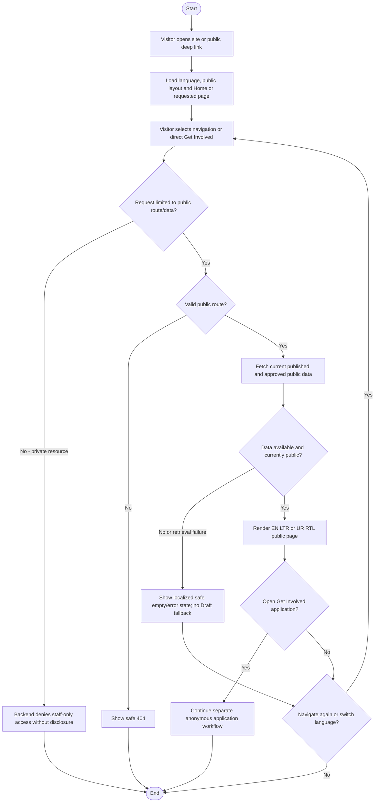

# Activity: Browse Public Website

**Primary Actor:** Public Visitor (unauthenticated external actor, not a staff RBAC role)
**Supporting Actors:** Public routing/content services; Content Editor controls publication, authorized branch administration controls operational data.
**Status:** Required workflow documented; page shells exist, full business/public-data behavior not implemented or verified

## Purpose

Discover HWF's mission, welfare programmes, branches, events and volunteer opportunities without an account. No public browsing permission grants internal management access.

## Preconditions

- Public site and required routes reachable; published data available or safe empty/fallback/error presentation supported.
- Public projections exclude staff/member/HR/finance/audit data; public interface supports en/LTR and ur/RTL.

## Inputs and Outputs

- Public path, chosen language and permitted content identifiers; no staff credential required.
- Output localized public page, published data or privacy-safe 404/empty/error response.

| Page         | Route         | Required public behavior                                                                           |
| ------------ | ------------- | -------------------------------------------------------------------------------------------------- |
| Home         | /             | HWF branding/mission/introduction; links to Programs/Get Involved and published highlights         |
| About        | /about        | Published mission, vision/background where approved; no invented vision or private administration  |
| Programs     | /programs     | Published Education Support, Food Assistance, Healthcare Support and Emergency Relief descriptions |
| Branches     | /branches     | Approved public operational details, Head Office distinguished; no private assignments/credentials |
| Events       | /events       | Currently published Upcoming/Past Events under CE-004; no Draft/archive/unpublished data           |
| Get Involved | /get-involved | Account-free application entry; explain submission is not membership approval                      |
| Contact      | /contact      | Published public contact guidance; no invented contact form/ticketing                              |

## Main Flow

1. Visitor opens Home or directly navigates to a required public page; load public layout, navigation and current/default language.
2. Choose page; validate allowed public route and fetch only current published CMS and approved public dynamic data.
3. Render localized page and safe content in selected direction. Public Branches projection is distinct from unrestricted operational branch queries.
4. Visitor browses another page, [switches language](switch-language.md) or follows/directly opens Get Involved to [apply](submit-volunteer-application.md); no staff login needed.
5. Private-resource requests require staff authorization and are denied to visitor; no sensitive route list/data disclosed. Visitor leaves or continues public navigation.

## Alternative / Error Flows

- Invalid public route: safe Not Found. Private resource/internal action: backend deny; do not confuse current public dashboard preview with an operational permission grant.
- Missing published content: safe empty/fallback; unavailable public service: friendly localized error without exceptions, private fields or fabricated records.
- Item archived/unpublished concurrently: visibility query/projection follows committed state; never fall back to Draft or private historical revision.
- Missing language resources follow defined static fallback; unresolved CMS/fallback presentation flagged, not automatic Draft translation exposure.

## Business Rules

- Exactly seven required core navigation pages above; explicitly approved public subpages may exist. No Login/Sign Up buttons in public navigation; staff portal is a separate direct route.
- Public Visitor is not a sixth authenticated role; Super Admin, Finance Reviewer, Content Editor, Branch Lead and HR Lead remain the five staff roles.
- Backend/public-data projections deny private dashboards, staff/branch management, application reviews/decisions, member records, collections/remittances/reports and internal audit; frontend hiding alone is insufficient.
- CE-001 to CE-005: authorized editorial publication without mandatory Super Admin sign-off, required bilingual publication, old published revision live during Draft edits, automatic Past display without deletion and preserved archive/unpublish history. Public sees only actively published content.
- Mission: underserved-community education, food, healthcare and emergency relief. Branch status public visibility and exact editorial content beyond approved facts remain PENDING; do not expose all internal branches by default.
- Public reads/rendering sanitized; no real personal/CNIC sample data or online payments. Contact guidance does not authorize a new message/ticket feature.

- **APP-001 to APP-008 - DECIDED application entry:** Get Involved links to the approved anonymous bilingual form with required fields/limits, Active-only operational branch options, explicit default-unchecked consent, normalized-contact checks, backend rate limit/honeypot and accessible localized validation/receipt with retained values. No CNIC/mandatory sensitive extras/CAPTCHA requirement. Submission creates Pending/reference/consent/audit, not member/account/Volunteer ID; later HR acceptance owns membership. See [submission workflow](submit-volunteer-application.md).
- APP-003 Active-only form choices do not decide public Branches directory visibility for Forming/Paused/Closed; existing public projections/CMS and five-role permissions unchanged. Exact legal consent wording/retention/privacy page, additional catalogues and rate tuning remain pending, not the core application controls.

- **CMS-001 to CMS-007 - DECIDED browsing boundary:** Program/Event/Page content follows [approved schemas](../../../project-context/modules/content-management.md), backend bilingual/sanitized publication and validated safe media. Controlled page slugs cannot remove seven routes; missing/retired content uses safe unavailable fallback, never Draft/staff metadata. Published events are Past at authoritative server now >= end instant with localized Asia/Karachi display; hidden events remain hidden. Archive/Unpublish immediately excludes public list/detail/direct-ID and newly fetched cached live content, preserving history. No editorial/HR/finance/branch permission granted.

## Postconditions

- Visitor sees permitted public information/error or begins separate application; browsing itself mutates no business data and grants no staff authority.
- All seven mandatory routes and account-free application remain independent of hiding one editorial section.

## Activity Diagram

## Acceptance Criteria

- All seven named routes work anonymously with required navigation and EN/LTR/UR/RTL; no staff account or public Login/Sign Up required.
- Public Programs/Branches/Events return only published/approved public fields; no Draft or private staff/member/HR/finance/audit details, including direct API requests.
- Get Involved accessible through navigation/deep link; submission distinction from membership clear. Required routes survive missing/unpublished editorial sections.
- Unknown/private/error requests safe without private route enumeration or sensitive internals. These are future behavioral tests, not completed implementation checks.

## Pending Decisions

- Public visibility of Forming/Paused/Closed branches, exact public branch fields, page copy/vision/branding and safe editorial empty/fallback design.
- CMS cache invalidation/details and missing-localization behavior beyond existing static i18n fallback. Official handbook unavailable; no official fixture gate verified.
