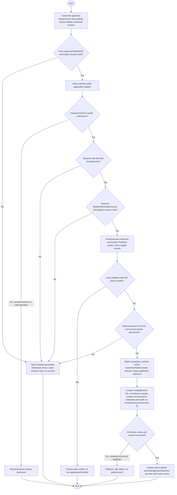

# Activity: Submit Public Volunteer Application

**Primary Actor:** Public Visitor (unauthenticated, not a staff role)
**Supporting Actors:** Public form/backend validation, application/reference service and audit; centralized HR Lead makes later decisions.
**Status:** Required workflow documented; public form/contracts and business endpoints not implemented or tested

## Purpose

Apply to volunteer at an operational HWF branch without a staff login. Successful submission creates a Pending application/reference only, never a member or Volunteer ID.

## Preconditions

- Public Get Involved reachable with bilingual form and authorized public branch options; frontend/backend validation and server write protection available in future implementation.
- Public submission permission grants no application-list/private-detail, HR decision, transfer, staff, finance or audit access.
- APP-001 to APP-008 finalize fields/requiredness, specified limits, Active-only intake, consent and anti-abuse/localization controls. Source form/contracts remain absent; additional catalogues/limits and legal text/retention are not finalized. See [application contract](../../../project-context/modules/applications.md).

## Inputs and Outputs

| Approved APP-001 field                   | Required at submission                          |
| ---------------------------------------- | ----------------------------------------------- |
| Full Name                                | Yes                                             |
| Email                                    | Yes                                             |
| Pakistani Mobile Number                  | Yes                                             |
| City                                     | Yes                                             |
| Preferred Active Operational Branch      | Yes                                             |
| Area of Interest                         | Yes                                             |
| Motivation                               | Yes                                             |
| Availability                             | No                                              |
| Privacy/data-processing consent checkbox | Yes; default unchecked, explicit check required |

Interests: Education Support, Food Assistance, Healthcare Support, Emergency Relief. APP-002 name 2-100 characters, email max 254, motivation 20-1000; valid supported Pakistani mobile canonical +923XXXXXXXXX, unsupported/invalid rejected, no truncation. Exact city/interest/availability catalogues/additional limits remain configuration or PENDING where business-significant. Do not collect CNIC or add mandatory DOB/gender/photos/ID uploads/sensitive fields.

Output committed unique application reference (APP-000001 is illustrative/proposed format), Pending confirmation and explanation of later HR review, or safe validation/conflict/rate-limit error without another person's data. LHR-V0001/FSD-V0001 are Member IDs, not application references.

## Main Flow

1. Visitor opens Get Involved without staff login; show en/LTR or ur/RTL form, only Active operational preferred-branch options and approved localized privacy/data-processing consent text/version. Checkbox defaults unchecked; Head Office/Forming/Paused/Closed excluded from form options.
2. Visitor completes approved fields, chooses eligible branch and explicitly checks consent. Client validates approved limits for convenience and associates field errors accessibly. Preserve values on ordinary validation failures/language changes; switching language neither submits/resets values nor assumes consent, and en/ur text uses same approved consent version.
3. On Submit backend enforces rate limiting plus honeypot, required fields/types/limits/supported choices and explicit consent; invalid/malformed/unchecked requests rejected with stable error codes for localized safe field/status messages. CAPTCHA not mandatory; no mandatory provider. Anti-abuse never bypasses validation or reveals classification/private data; private-resource attempts denied separately.
4. Trim/lowercase email without unapproved provider-specific transformations; normalize valid supported Pakistani mobile to +923XXXXXXXXX and reject invalid/unsupported formats. Apply APP-004/HR-001 exact eligible email OR phone checks consistently on server; no silent truncation.
5. If normalized email OR phone matches another Pending application, an Active member, or eligible Accepted application linked to Active membership, reject safely without creating application/member or revealing which record matched.
6. Server validates submitted branch ID exists and remains Active operational, not merely dropdown visibility. If unavailable/changed, reject safely and ask applicant to choose eligible branch, retaining other values; never auto-reassign. HR acceptance later rechecks Active independently.
7. Begin protected atomic persistence; concurrency-safely recheck Active branch/contact conflicts and consent, allocate unique new application reference, create one Pending application with branch link, normalized contacts, approved consent-text version/server acceptance timestamp and required submission audit/trace. Commit together; failed writes/commit roll back all changes.
8. Only after commit show localized safe acknowledgement/reference and HR-review notice; no applicant data in URLs/analytics/public content endpoints. No staff account, member or city sequence allocation. A previously Declined applicant may reapply with new reference after the same active-conflict checks; original record/reason/audit is preserved.

## Alternative / Error Flows

- Missing required field/unchecked consent, invalid email/mobile/choice or name/motivation/email bounds: stable server codes map to localized accessible field errors, preserve ordinary entered values and never truncate; backend authoritative. Consent never inferred from visit/input/language change.
- Missing/invalid/ineligible branch or branch eligibility changes concurrently: reject safely; no silent alternative branch selection.
- Exact active conflict, including shared family phone: generic user-friendly response, no new record or public duplicate-match details. Similar names/interest alone never reject; historical Declined alone never blocks.
- Rate-limit/honeypot failure: generic abuse-safe error without persistence, no internal classification/private-data details or validation bypass. Exact thresholds/technical tuning remain deployment choices; CAPTCHA not mandatory and no provider/OTP requirement added.
- Two simultaneous exact-contact submissions: concurrency-safe constraints/transactions allow at most one eligible application; unique reference conflict/write/audit/commit failure rolls back, never produces partial Pending/reference success.
- Anonymous attempt to read private applications/member/HR/audit or submit staff decision action: backend denies, no status-tracking/login/approval feature added.

## Business Rules

- **HR-001 - DECIDED:** Exact normalized email OR phone in eligible Pending/active-membership scope rejects intake; same email/different phone, different email/same phone and both same reject. Shared-family-phone limitation intentional. Names/contacts are not guaranteed person identities; different contacts can belong to one person. No automatic merge/name-only rejection.
- **HR-004 - DECIDED:** Historical Declined alone permits fresh new-reference Pending after other checks, independently reviewed; reapplication never overwrites old history or automatically creates member.
- **HR identity rules:** First successful authorized HR acceptance creates exactly one member/decision audit atomically and allocates globally unique permanent city ID using selected branch authoritative city, not applicant residence. Same-city branches share sequence; transfer/reversal retains identity and reacceptance restores same member/ID. These are later HR actions, not public permissions.
- Public applicants receive no staff account/sixth Volunteer role. No public CNIC collection or real personal/CNIC fixture data, payments, private applicant listing or invented status portal.
- **HWF-XM-004 - DECIDED:** Later acceptance/decline/reversal/reacceptance email follows committed HR decision and delivery failure cannot roll back it. No submission email requirement invented here.
- Validate server-side and sanitize any rendered content; do not log sensitive application bodies/private matches or expose stack traces/credentials. Static labels and form feedback bilingual, CMS content published-only.

- **APP-001/APP-002/APP-003/APP-004 - DECIDED:** Approved fields/limits, Active-only operational options/server rechecks, trim/lowercase email and canonical Pakistani mobile eligible email OR phone conflicts apply. Historical Declined alone permits new reference, names alone never reject, contacts not identity proof; no sensitive mandatory additions/automatic branch reassignment. Full [field contract](../../../project-context/modules/applications.md).
- **APP-005/APP-006 - DECIDED:** Explicit default-unchecked localized consent stores approved matching text version/server timestamp; backend rate limit/honeypot required, CAPTCHA not mandatory. Legal wording/retention/public privacy page and rate/deployment tuning remain pending, not core controls.
- **APP-007/APP-008 - DECIDED:** Atomic Pending/reference/normalized contacts/consent/audit only and safe anonymous localized acknowledgement. No member/account/Volunteer ID until later atomic HR acceptance; preserve existing reversal/reacceptance identity. Accessible en/ur labels/required/errors/status, stable server codes, ordinary form-value preservation and no applicant URLs/analytics/public-content leakage.

## Postconditions

- Success has one committed Pending application with unique reference, Active intake branch link, normalized contacts, approved consent version/server timestamp and required audit/trace, without member/Volunteer ID/account creation.
- Failure creates no partial application/member or private disclosure; past Declined/history stays unchanged.

## Activity Diagram

## Acceptance Criteria

- Anonymous valid submission creates exactly one Pending/reference/branch link and audit, no member/Volunteer ID/staff account. No CNIC collected.
- Backend validates approved fields/limits/mobile/explicit consent/Active branch and rate/honeypot independently of client checks; rejected/rate-limited/private-resource requests persist nothing and disclose no private records.
- Matching normalized Pending/Active member/eligible Accepted-linked-active email OR phone rejects; family-phone limitation explicit. Historical Declined/similar name/interest alone does not reject.
- Concurrent matching requests cannot both succeed; unique references and atomic audit/rollback prevent partial states. Reapplication uses new reference and preserves old decline history.
- en/ur form/feedback and branch options usable; later acceptance rechecks Active branch/selected city, with no public decision/transfer authority. All criteria are future tests, not execution evidence.

- Planned APP checks cover all required fields, length boundaries, invalid/canonical mobile and email normalization, duplicate email OR phone/concurrency, Declined reapplication/name-only nonrejection, Active-only options/server rejection, explicit consent/version/server timestamp, rate/honeypot, accessible en/ur errors/RTL/value preservation, Pending-only submission and later atomic same-ID HR acceptance/reacceptance. See [all 20 future cases](../../../project-context/modules/applications.md); none implemented/executed.

## Pending Decisions

- Additional city/interest/availability catalogues/unapproved limits/supported raw mobile-input configuration, exact legal consent wording/retention/public privacy-page publication, reference formatting and rate/honeypot deployment tuning. APP-001 to APP-008 fields/bounds/normalization/consent/abuse/localization rules are DECIDED; CAPTCHA not mandatory, no OTP requirement.
- General public Branches directory fields/status visibility remains separate and PENDING; APP-003 public application options are DECIDED Active-only, not a recommendation.
- No public status tracking, account registration, submission email or government verification requirement is introduced.
