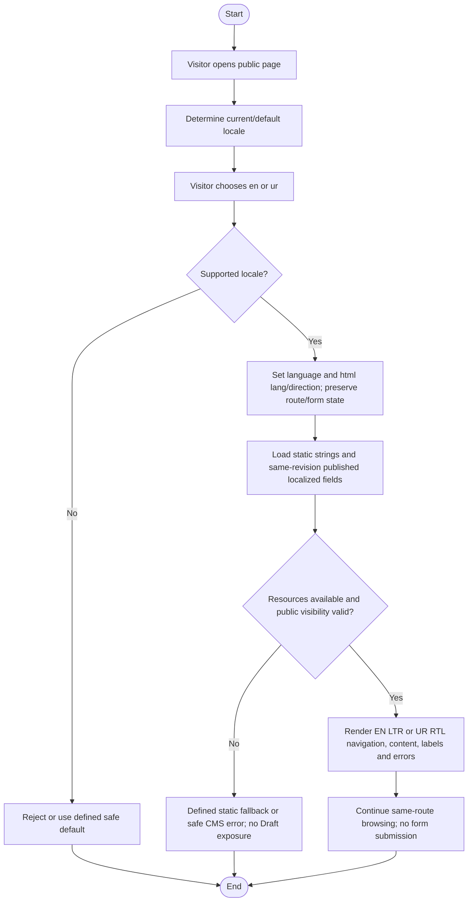

# Activity: Switch Between English and Urdu

**Primary Actor:** Public Visitor (unauthenticated, not a staff role)
**Supporting Actors:** Public frontend i18n/layout and published CMS read service.
**Status:** Shell language toggle exists; complete CMS/form localization is required, not implemented or tested

## Purpose

Switch public navigation, published content, form labels and validation feedback consistently while preserving route and usable form state without login or submission.

## Preconditions

- Public page reachable with en and ur static resources; currently published CMS revision passes CE-002 bilingual requirements.
- Only permitted public fields retrieved; no Draft preview or private records available through locale requests.

## Inputs and Outputs

- Locale en (English/LTR) or ur (Urdu/RTL), current route, applicant-entered in-memory form values and validation state, preserved under APP-008.
- Output same public route in selected language/direction, matching static keys and published localized content. No account preference or business mutation.
- Existing source initializes lng en and fallbackLng en; languageChanged sets html lang/dir. It defines no persisted anonymous preference. Relevant existing keys include pages.*, switchLanguage, navigation, skip, error/notFound; form keys/contracts are not present yet.

## Main Flow

1. Visitor opens public page; initialize language using current architecture (existing shell starts English, with English static fallback).
2. Visitor chooses English or Urdu; validate supported locale, update application language state and document lang/dir.
3. Load navigation, labels/actions and validation translations from static i18n; obtain corresponding en/ur fields from same currently published logical revision.
4. Render en LTR or ur RTL throughout navigation/forms/content, preserving the same route, applicant-entered values AND validation state under APP-008; translate labels and existing field/status errors, never reset or submit the form. No private input in URLs/analytics.
5. Continue navigation using current selection. Persist selection within public session navigation; cross-reload storage/URL/cookie design remains PENDING, no anonymous backend account preference invented.

## Alternative / Error Flows

- Unsupported locale: reject or safe defined default; never arbitrary private locale paths.
- Missing static key: use existing English fallback, subject to reviewed localization behavior. Unexpected missing published localization: safe error/fallback under approved design, never read unpublished Draft translation.
- CMS/resource fetch failure: privacy-safe localized error without partial/private content; do not mix en from old revision with ur from another revision.
- APP-008 preservation is required, not optional: locale/resource changes must retain applicant values and validation state without submission, value reset or private URL/analytics leakage. Missing translation implementation is a feature gap, not an unresolved permission to discard input.

## Business Rules

- CE-002 requires required en/ur CMS completeness at publication, same logical revision; UI labels supplied by i18n, not recreated CMS content.
- CE-003 draft editing never changes public localization until successful publication. A locale query grants no internal Draft/Preview authority.
- Direction applies to layout/navigation/forms appropriately, not indiscriminate mirroring of logos or universally directional assets. Email/phone/IDs stay readable and functionally correct; use appropriate mixed-direction handling.
- No authentication, new staff role, payments or real personal sample data. Language action only changes public presentation; backend private-resource protections remain.

## Postconditions

- Supported locale/direction and matching published text visible at same public route; current selection carried across navigation.
- No application submission, CMS publication, business audit/state mutation or private data exposure caused by locale change.

## Activity Diagram

## Acceptance Criteria

- en->ur and ur->en work anonymously with correct lang/dir, route preserved and current selection across navigation.
- Navigation/form labels/validation feedback use selected language; mixed-direction email/phone/IDs readable, logos not wrongly mirrored.
- Same published revision serves both locales; missing resources never reveal Draft/private preview and static fallback follows architecture.
- Switching en <-> ur preserves same route/form data/validation state and translates existing errors with correct LTR/RTL; no accidental submission, publication change or private URL/analytics leakage; fetch errors safe. These are future full-flow targets, not claims beyond current shell.

## Pending Decisions

- Exact cross-reload language-preference storage/URL/cookie design and missing CMS-localization fallback presentation remain pending. APP-008 same-route form-value/validation-state preservation and localized errors are DECIDED requirements; full form implementation remains absent.
- Native Urdu review and exact mixed-direction/media handling. No anonymous staff account preference introduced.
