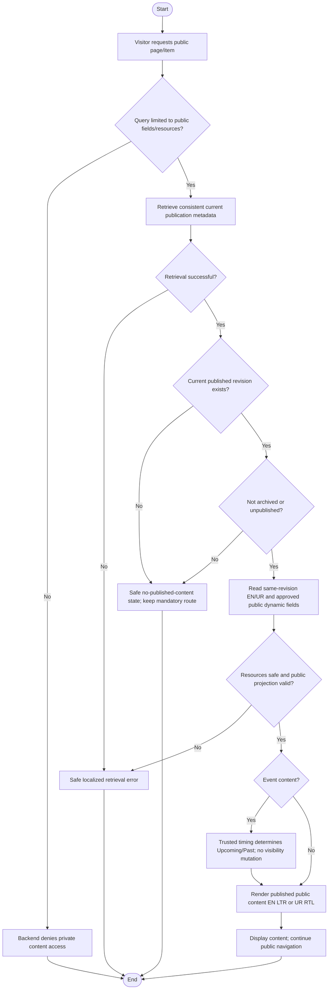

# Activity: View Published Programs, Events and Public Branch Information

**Primary Actor:** Public Visitor (unauthenticated external actor, not a staff role)
**Supporting Actors:** Public CMS projection, authorized branch-data projection, trusted event timing and frontend localized rendering.
**Status:** Required visibility behavior documented; CMS/dynamic public integrations not implemented or tested

## Purpose

Read actively published bilingual CMS items and permitted public branch details while excluding Drafts, internal history, private operational information and archived/unpublished material.

## Preconditions

- Requested public route accessible anonymously; backend response projections enforce publication/public-field boundaries regardless of URL guessing.
- Published en/ur content validated under CE-002, retrieved from a consistent current published logical revision.
- Public branch visibility follows approved administrative policy, not all internal records; Head Office is not a normal operational branch.

## Inputs and Outputs

- Public page/item identifier and en/ur locale; only public allowed queries, never internal revision ID/preview token as an anonymous grant.
- Output safe localized published text/media and permitted branch fields, or privacy-safe missing/empty/error result.
- Programs: published Education Support/Food Assistance/Healthcare Support/Emergency Relief descriptions; Events: published Upcoming/Past; Pages: public editorial sections. No CMS notes, revision history, staff credentials/assignments, member/application, audit or private finance fields.

## Main Flow

1. Visitor opens public page; service retrieves current committed publication metadata and selects only actively published, nonarchived content.
2. Independently retrieve only approved public branch/dynamic fields where relevant; rejected private projections never become fallback public data.
3. Select en/ur fields from the SAME published revision and render safely en LTR/ur RTL. Concurrent Draft edits do not alter this revision.
4. For Events, use trusted clock and defined CE-004 timing to classify Upcoming/Past. Still-published completed events remain accessible as Past, without auto-delete/archive/unpublish/new revision.
5. Display public content or safe empty/fallback if no active publication; visitor continues navigation without authentication.
6. Honor committed publish/archive/unpublish changes in public projection/cache under approved invalidation design. Required Home, About, Programs, Branches, Events, Get Involved and Contact routes and account-free application remain functional independently of an editorial item's visibility.

## Alternative / Error Flows

- No published revision or archived/unpublished item: do not render as active public content; safe empty/not-found/fallback according to eventual design, preserving required routes.
- Retrieval failure/unsupported locale/invalid item: privacy-safe localized error; no stack traces/internal identifiers/paths or Draft translation fallback.
- Concurrent publication: expose old or new committed consistent revision, never mixed localization/partial unpublished state. Concurrent archive/unpublish must immediately exclude retired content from lists/detail/direct-ID responses, with cache coordination preventing newly fetched retired data as live.
- Attempt private Draft/Preview/revision-history/resource query: backend denies public access; no public preview token or editor note leakage.

## Business Rules

- **CE-001/CE-002:** Content Editor publishes authorized content without mandatory Super Admin approval; required en/ur versions complete before publication. Public reading grants none of that editor authority; labels remain static i18n where appropriate.
- **CE-003:** Editing live content creates Draft; anonymous API serves only current committed Published revision, never Draft/historical/private variants. Publication reference consistent/atomic.
- **CE-004:** Past is automatic public display classification after event period, not Archive/Unpublish/Delete. CMS-002/CMS-006 require Asia/Karachi scheduling/display, unambiguous instants and authoritative server now >= end for Past, no longer upcoming/current at end. See [event workflow](../content-editor/manage-events-content.md); date-only/multi-day variations beyond start/end remain implementation detail or separately pending.
- **CE-005:** Archive/Unpublish retains internal identity/revisions/audit but removes active public visibility; historical retention is not anonymous read authority.
- Seven mandatory routes are `/`, `/about`, `/programs`, `/branches`, `/events`, `/get-involved`, `/contact`; no public Login/Sign Up requirement. CMS visibility cannot disable volunteer application/backend HR validation or grant operational branch edit authority.
- Only approved public branch projection; no confidential staff contact/credentials, member details, financial aggregates or assignments. Head Office administrative identity distinct; public visibility by branch status remains PENDING.
- Sanitize localized rich text/media; no unsafe scripts/private file paths. No online payments, real personal/CNIC samples or sixth authenticated role. No internal HR/finance/audit operation exposed to visitors.

- **CMS-001 to CMS-007 - DECIDED public contract:** Serve only sanitized actively published same-revision bilingual Program/Event/Page fields and validated safe images, never Draft/staff metadata/private paths. Mandatory routes survive controlled-slug edits/missing/retired content with safe fallback. At end instant a published event is Past, not auto-archived; hidden events stay hidden. Immediate list/detail/direct-ID/cache retirement preserves private history. [Full content contract](../../../project-context/modules/content-management.md).

## Postconditions

- Visitor sees permitted current published data/classification or safe error/empty state; no content, application/member or audit mutation from read.
- Published Past remains visible unless explicitly archived/unpublished; required routes/form unaffected by editorial hiding.

## Activity Diagram

## Acceptance Criteria

- Anonymous visitors read Published programs/events/public pages and only approved branch fields; Draft/archive/unpublished/private history never leaks via direct API queries.
- Both locales correspond to same committed revision; concurrent publish/Draft edit never yields partial version or unpublished translation.
- Published Past event remains public; automatic classification changes no archive/audit/revision. Unpublished event absent from both listings.
- All seven public routes and account-free application remain available; hiding editorial content never removes route/form.
- Restricted staff/member/HR/finance/audit data excluded and errors safe. Cache/public projections reflect committed visibility under eventual design; future tests only, no implementation or visual rendering verification claimed.

## Pending Decisions

- Exact public branch fields/status visibility, date-only/multi-day variations beyond approved start/end and specialized safe missing-content/localization fallback presentation. Asia/Karachi and exact end-time boundary are DECIDED.
- Cache invalidation/storage/TTL mechanism and rich-text/media implementation choices. CMS-005 safety and CMS-007 immediate retirement/newly fetched visibility guarantees are DECIDED, not deferred.
- Official handbook unavailable; no fixture amounts or official gate verification asserted.
