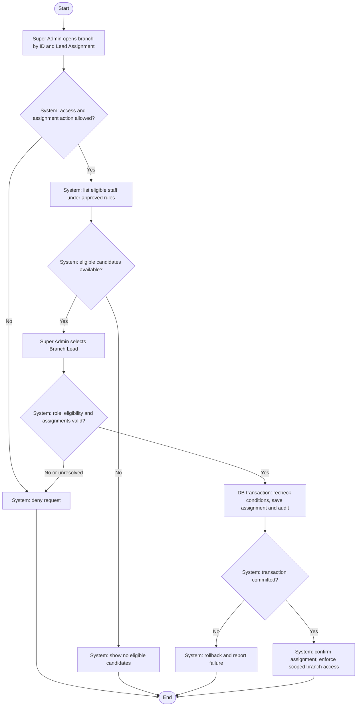

# Activity: Assign Branch Lead

**Actor:** Super Admin
**Status:** Proposed / Partially Confirmed

## Purpose

Assign an authorized Branch Lead to an operational branch. This is proposed, unimplemented behaviour. See [branch specification](../../../project-context/modules/branches.md) and [permissions](../../permissions.md).

## Preconditions

- Super Admin is authenticated and has an approved assignment permission.
- The operational branch and candidate staff account exist.
- Eligibility and assignment policies applicable to the request have been approved; pending replacement or multi-branch policies are not implicit grants.

## Main Flow

1. Super Admin opens Branch Management and selects a branch by ID.
2. System verifies authorized access; Super Admin opens Branch Lead Assignment.
3. System displays staff accounts eligible under approved rules.
4. Super Admin selects a Branch Lead candidate.
5. System checks the account's Branch Lead role, eligibility and current branch assignments against approved policies.
6. In one database transaction, system rechecks the relevant assignment conditions, saves the assignment and records it in the audit trail. This prevents concurrent changes from bypassing the one-lead design.
7. System confirms only after commit. The assigned Branch Lead can access only branch data authorized by backend role and branch-scoping policies.

## Alternative / Error Flows

- Unauthenticated or unauthorized actor, missing branch or unavailable candidate: reject without assignment changes or unauthorized data disclosure.
- No eligible accounts: show no selectable candidates; do not create an account implicitly.
- Candidate lacks the Branch Lead role or fails approved eligibility/assignment rules: reject the request.
- Existing assignment, deactivated candidate or concurrent assignment change: validate the approved policy; if the applicable rule is unresolved, do not assume replacement or eligibility is allowed.
- Assignment or audit failure: roll back both and report failure.

## Business Rules

- **Confirmed HWF Decisions:** Each operational branch initially has one assigned Branch Lead. Branch Lead is one of exactly five authenticated roles.
- **Confirmed access constraint:** Backend enforces branch permissions; assignment to one branch does not grant access to another branch's protected records. Any future multi-branch access requires explicitly approved assignments and policies.
- **Pending Decisions:** Whether one lead may manage multiple branches, reassignment, effects of lead deactivation, temporary operation without a lead, additional replacement approval and detailed eligibility rules. Do not infer answers from the eligible-account list or this workflow.

## Postconditions

- Successful assignment and audit entry are committed together, consistent with the approved one-lead policy.
- Branch access derives from authorized assignments and permissions. Failed requests leave assignments unchanged.

## Activity Diagram

## Acceptance Criteria

- Backend rejects assignment requests without an approved permission.
- Candidate listing and submission use the approved eligibility policy; a non-Branch-Lead account cannot be assigned.
- A successful assignment and audit entry commit together; failed or conflicting concurrent requests do not leave duplicate leads or partial changes.
- Assignment does not expose another branch's protected records through altered request IDs or direct API calls.
- Replacement/multi-branch requests cannot bypass unresolved policies. These are future verification targets, not completed tests.
