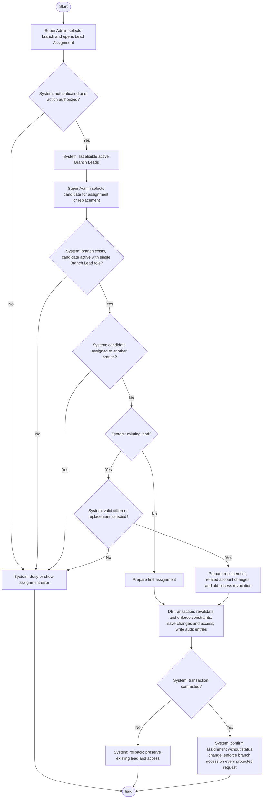

# Activity: Assign Branch Lead

**Actor:** Super Admin
**Status:** Partially Confirmed

## Purpose

Assign or replace an operational branch's authorized lead. SA-002 through SA-004 and SA-006 are DECIDED; this workflow is not implemented. See [staff management](manage-staff-accounts.md) for provisioning and related account changes; other detailed permissions remain PENDING.

## Preconditions

- Super Admin is authenticated and has backend authorization for the requested assignment and any related account/role changes.
- Target branch exists; candidate is an active staff account with exactly the Branch Lead role and is not assigned to another branch.
- An assigned lead cannot be removed or deactivated without a valid replacement.

## Main Flow

1. Super Admin opens Branch Management, selects a branch by ID and opens Branch Lead Assignment.
2. System authorizes access and displays eligible active Branch Lead accounts not assigned to another branch.
3. Super Admin selects a candidate for first assignment or selects a different candidate to replace the existing lead. Related deactivation/role changes originate from [staff management](manage-staff-accounts.md).
4. System validates the branch, candidate's single role/active status, current assignment and one-branch constraint; an existing lead requires the replacement path.
5. In one database transaction, system rechecks current assignment and candidate eligibility, applies assignment/replacement and related authorized account changes, revokes old branch access when replacing, and records previous/new assignments and related changes in audit entries. Database constraints prevent conflicting assignments.
6. On commit, system confirms assignment success without changing branch status. An eligible active assigned lead makes a Forming/Paused branch eligible for a separate Super Admin activation request under SA-005/SA-006; assignment never automatically activates it. Every subsequent protected request enforces current role and branch assignment, so existing sessions/cached authorization cannot retain old branch access.

## Alternative / Error Flows

- Unauthenticated/unauthorized actor or missing branch/candidate: reject without changes or protected disclosure.
- No eligible active candidate: show no selectable replacement; block removal/deactivation of the assigned lead.
- Inactive or non-Branch-Lead candidate, candidate assigned to another branch or conflicting concurrent assignment: reject without overriding the other assignment.
- Removal/deactivation without a valid replacement: reject; selecting the existing lead does not satisfy a replacement request.
- Validation, constraint, business write or audit failure: roll back all related account/assignment/access changes, preserving the existing lead and access.

## Business Rules

- **SA-002 - DECIDED: Single System Role.** Each staff account has exactly one official role. Role changes require Super Admin authorization and auditing and cannot leave invalid lead assignments; removing an assigned lead through a role change requires replacement.
- **SA-003 - DECIDED: Single Branch Assignment.** A lead manages only one branch at a time; a branch has at most one assigned active lead. Enforce both with database constraints and transactional validation. Check branch-level access on every protected request.
- **SA-004 - DECIDED: Mandatory Replacement Before Deactivation.** Super Admin selects an eligible active replacement before an assigned lead is deactivated or removed. Validate candidate and current assignment; atomically replace, apply related account changes, revoke old branch access and audit. Failure leaves existing lead/access intact; historical members, collections, reports and audit records remain unchanged.
- **SA-006 - DECIDED: Branch Activation Requirements.** A Forming branch may temporarily exist without a lead. Forming/Paused can become Active only with an eligible active lead already assigned under SA-003; inactive staff do not qualify. Assignment enables eligibility only and never changes status; backend separately validates and atomically audits activation through [Manage Branches](manage-branches.md).
- Each operational branch is intended to have one assigned Branch Lead; the initial Forming period may precede assignment under SA-006. Existing-lead replacement is allowed subject to authorization; this does not authorize transferring a candidate out of another branch without satisfying that branch's replacement requirement.
- **PENDING:** Additional replacement approval and detailed eligibility beyond active/single-role/unassigned-elsewhere checks. These do not permit removing an existing lead without replacement or multiple simultaneous branches.

## Postconditions

- Assignment/replacement and appropriate audit entries commit together, with at most one active assigned lead per branch and one branch per lead.
- Replacement revokes old branch access as part of the operation; historical business records remain unchanged.
- Assignment leaves branch status unchanged; failed replacement preserves the existing account/assignment/access state.

## Activity Diagram

## Acceptance Criteria

- Backend rejects unauthorized assignment/account-change requests and inactive/non-Branch-Lead candidates.
- Candidates already assigned to another branch are rejected; concurrent requests cannot violate one branch per lead or one active assigned lead per branch.
- Assigned-lead removal/deactivation requires a valid different active replacement; role changes cannot bypass this requirement.
- Replacement, related account/assignment changes, access revocation and audit commit together; failed validation/transactions preserve existing lead/access.
- Old sessions/cached grants cannot access the former branch after replacement, and altered request IDs cannot bypass branch isolation.
- Active lead assignment to Forming/Paused enables eligibility for a separate activation check but never automatically activates; Forming may initially have no lead.
- Members, collections, reports and audit history remain unchanged. These are future verification targets, not completed tests.
