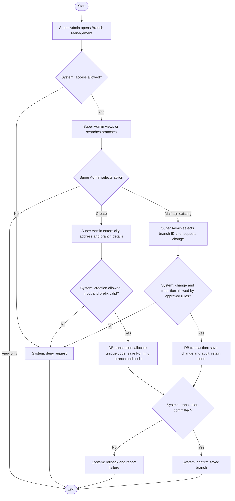

# Activity: Manage Branches

**Actor:** Super Admin
**Status:** Proposed / Partially Confirmed

## Purpose

Create and maintain HWF operational branches. This workflow is not implemented. See [branch specification](../../../project-context/modules/branches.md) and [domain rules](../../domain-rules.md); detailed action permissions remain pending.

## Preconditions

- Super Admin is authenticated in the internal portal and has the approved permission for the selected action.
- City-prefix mappings and required branch fields are approved before creation is enabled.
- Lifecycle changes require an approved transition policy; the list of statuses alone does not authorize transitions.

## Main Flow

1. Super Admin opens Branch Management; system checks access and displays permitted branches for viewing/search.
2. Super Admin selects Create Branch and enters branch information, including city and address.
3. System validates the information and resolves the city's uniquely mapped prefix.
4. In a database transaction, system safely allocates a city-prefix sequence, generates a unique code, saves the branch with a unique database ID and initial **Forming** status, and writes the creation audit entry.
5. System confirms creation only after commit.
6. Independently of creation, Super Admin may select an existing branch by ID and maintain its information or request a lifecycle transition. System validates approved permissions and rules, then saves the change and audit entry atomically.
7. Branch Lead assignment is a separate [activity](assign-branch-lead.md); this flow does not decide whether assignment is required at creation.

## Alternative / Error Flows

- Unauthenticated or unauthorized request: deny without exposing protected branch data or making changes.
- Invalid fields or missing/ambiguous city-prefix mapping: reject creation for correction; do not invent a prefix.
- Concurrent allocation conflict: the concurrency-safe allocation must not produce duplicate codes; if it cannot complete, report failure without a partial branch.
- Disallowed or unapproved lifecycle transition: reject without changing status.
- Business write or audit failure: roll back the transaction and report failure.
- Multiple branches in a city or an address shared with Head Office are not, by themselves, uniqueness errors.

## Business Rules

- **Confirmed HWF Decisions:** Head Office is not an operational branch. Multiple branches may exist in one city and a branch may share Head Office's address. New branches start Forming, as specified in this workflow request.
- **Confirmed identification rules:** Unique database ID and automatically generated unique code; examples LHR-001, FSD-001 and ISB-001. Prefixes map uniquely to cities, numbering is per prefix and allocation is concurrency-safe. Never reuse a code, including after closure; moving city retains the original code. Identify/authorize records by branch ID, not name, city or address.
- **Official Requirements:** Statuses are Forming, Active, Paused and Closed; important changes are audited atomically.
- **Pending Decisions:** Exact registration fields, permitted transitions, paused/closed operation restrictions, reopening, prefix administration and whether creation may precede lead assignment. No transition graph or reopening right is implied.

## Postconditions

- Successful creation stores a Forming branch with unique ID/code and audit entry.
- An approved update/transition and its audit entry are committed together; an existing branch code remains unchanged on city updates.
- Failed mutations leave no partial branch changes. Viewing/searching changes no branch records.

## Activity Diagram

## Acceptance Criteria

- Unauthorized viewing or mutation is denied by the backend.
- Valid authorized creation stores Forming status and a unique database ID and city-based code, with its audit entry.
- Concurrent creation cannot duplicate codes; a closed branch's code is not reused.
- Same-city branches and shared Head Office addresses are allowed; changing city preserves the existing code.
- Lifecycle requests without an approved allowed transition are rejected.
- Failed branch/audit writes leave no partial mutation. These criteria are future verification targets, not implemented tests.
