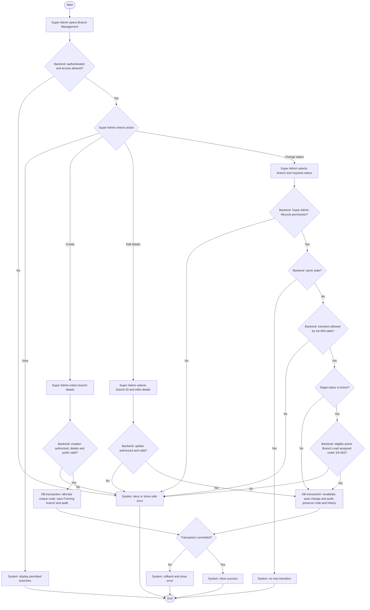

# Activity: Manage Branches

**Actor:** Super Admin
**Status:** Partially Confirmed

## Purpose

Create and maintain HWF operational branches. This workflow is not implemented. See [branch specification](../../../project-context/modules/branches.md) and [domain rules](../../domain-rules.md); SA-005/SA-006 below finalize lifecycle authority and activation requirements; other detailed permissions remain PENDING.

## Preconditions

- Super Admin is authenticated in the internal portal and has the approved permission for the selected action.
- City-prefix mappings and required branch fields are approved before creation is enabled.
- Backend enforces the SA-005 transition table and SA-006 activation requirements, including under concurrent assignment/account changes.

## Main Flow

1. Super Admin opens Branch Management; system checks access and displays permitted branches for viewing/search.
2. Super Admin selects Create Branch and enters branch information, including city and address.
3. System validates the information and resolves the city's uniquely mapped prefix.
4. In a database transaction, system safely allocates a city-prefix sequence, generates a unique code, saves the branch with a unique database ID and initial **Forming** status, and writes the creation audit entry.
5. System confirms creation only after commit.
6. Independently of creation, Super Admin selects a branch by ID to maintain information or request a new status. Backend verifies the selected action's permission; lifecycle changes are Super Admin-only under SA-005.
7. For status changes, backend handles a same-state request without a new transition, otherwise checks the table below. Invalid transitions are rejected. If the target is Active, verify an eligible active Branch Lead is already assigned under SA-003.
8. In one transaction, revalidate current status and any activation prerequisites against concurrent changes, save the allowed update/status change and its audit entry. Confirm success after commit; roll back on failure. Closure preserves branch code and history and does not bypass SA-004.
9. A Forming branch may exist temporarily without a lead. [Lead assignment](assign-branch-lead.md) is separate and never automatically activates the branch.

## Alternative / Error Flows

- Unauthenticated or unauthorized request: deny without exposing protected branch data or making changes.
- Invalid fields or missing/ambiguous city-prefix mapping: reject creation for correction; do not invent a prefix.
- Concurrent allocation conflict: the concurrency-safe allocation must not produce duplicate codes; if it cannot complete, report failure without a partial branch.
- Transition outside SA-005 or activation without an eligible assigned active lead: reject without changing status. Same-state requests create no transition. Closed branches cannot reopen.
- Business write or audit failure: roll back the transaction and report failure.
- Multiple branches in a city or an address shared with Head Office are not, by themselves, uniqueness errors.

## Business Rules

- **Confirmed HWF Decisions:** Head Office is not an operational branch. Multiple branches may exist in one city and a branch may share Head Office's address. New branches start Forming, as specified in this workflow request.
- **Confirmed identification rules:** Unique database ID and automatically generated unique code; examples LHR-001, FSD-001 and ISB-001. Prefixes map uniquely to cities, numbering is per prefix and allocation is concurrency-safe. Never reuse a code, including after closure; moving city retains the original code. Identify/authorize records by branch ID, not name, city or address.
- **SA-003 - DECIDED:** A Branch Lead manages only one branch at a time; each branch has at most one assigned active lead. Enforce database constraints, transactional validation and branch-level checks on every protected request.
- **SA-004 - DECIDED:** Removing/deactivating an assigned lead requires an eligible active replacement, atomic account/assignment/access changes and audit; failure preserves existing lead/access and historical records. Use [Assign Branch Lead](assign-branch-lead.md); branch maintenance or closure must not bypass this rule. SA-006 permits initial Forming branches without a lead; removal of an existing lead still requires replacement.
- **OFFICIAL:** Statuses are Forming, Active, Paused and Closed; important changes are audited atomically.
- **SA-005 - DECIDED: Branch Status Lifecycle.** New branches start Forming. Only Super Admin may change lifecycle status. Backend authorizes and validates each transition against this exact table; same-state requests create no new transition. Every valid transition is audited atomically. Closed is terminal; closure preserves code and historical records, and codes are never reused.

| Current Status | Allowed Next Status |
| -------------- | ------------------- |
| Forming        | Active, Closed      |
| Active         | Paused, Closed      |
| Paused         | Active, Closed      |
| Closed         | None                |

- **SA-006 - DECIDED: Branch Activation Requirements.** Forming may temporarily have no lead, but Forming/Paused can become Active only with an already assigned eligible active Branch Lead. SA-003's one-branch rule applies; inactive staff do not qualify. Backend checks apply even if Activate is hidden; activation and audit commit atomically. Assignment alone never changes status.
- **PENDING:** Exact registration fields, remaining operating restrictions for Paused/Closed beyond FIN-014, exact post-closure pre-closure-discovery recognition container/period and prefix administration. Lifecycle transitions, terminal closure and initial Forming-without-lead policy are no longer pending.

- **FIN-014 - DECIDED:** Closure retains original collections, existing Submitted/Returned/Approved reports and immutable snapshots, adjustment/remittance/audit/member histories. Closed remains terminal; prohibit new ordinary offline collections/ordinary future-week reports or pretending Active. Legitimate pre-closure obligations may need separately audited Finance reconciliation under existing role scope, preserving occurrence/recognition metadata. Exact post-closure-discovery recognition container/accounting period for pre-closure Late Entry/Approved adjustment remains PENDING; no new report type/reopened Approved snapshot/access for inactive or unassigned lead. Active/Paused automatic drafts unchanged; closure cannot bypass SA-004/AUTH safeguards.

## Postconditions

- Successful creation stores a Forming branch with unique ID/code and audit entry.
- An authorized valid update/transition and its audit entry commit together; activation satisfies SA-006 and closure preserves code/history. Same-state requests leave status unchanged.
- Failed mutations leave no partial branch changes. Viewing/searching changes no branch records.

## Activity Diagram

Closure must leave historical financial/report/member/audit evidence intact; new ordinary Closed-branch collection and ordinary future-week generation denied, authorized historical reads preserved and unauthorized settlement/inactive or unassigned lead requests denied. These are planned FIN-014 tests, not executed.

## Acceptance Criteria

- Unauthorized viewing or mutation is denied by the backend.
- Valid authorized creation stores Forming status and a unique database ID and city-based code, with its audit entry.
- Concurrent creation cannot duplicate codes; a closed branch's code is not reused.
- Same-city branches and shared Head Office addresses are allowed; changing city preserves the existing code.
- Only Super Admin may change lifecycle status; all table-allowed transitions succeed when other required conditions hold, and every unlisted transition is rejected server-side.
- Closed branches cannot reopen; same-state requests create no status transition. Closure retains code/history and codes are never reused.
- Forming/Paused cannot become Active without an eligible assigned active lead; inactive accounts do not qualify. Frontend visibility cannot bypass this check.
- Assigning a lead never automatically activates a branch. Branch maintenance cannot bypass SA-004 replacement.
- Failed branch/audit writes leave no partial mutation. These criteria are future verification targets, not implemented tests.
