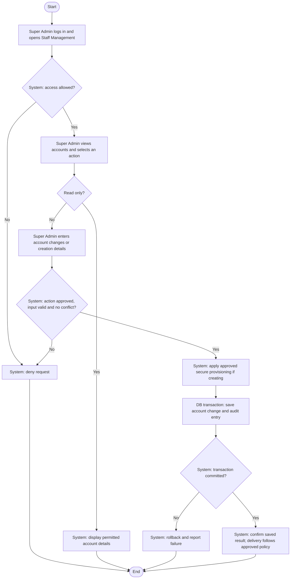

# Activity: Manage Staff Accounts

**Actor:** Super Admin
**Status:** Proposed / Partially Confirmed

## Purpose

Manage authorized HWF staff accounts. This is a proposed workflow, not implemented functionality. See [role responsibilities](../../permissions.md) and [security design](../../security.md); detailed action grants remain pending.

## Preconditions

- An authorized administrative account and internal portal are available in the future implementation.
- The selected action has an explicitly approved backend permission; a role title alone is not a grant.
- Provisioning and required-field policies must be approved before account creation is enabled.

## Main Flow

1. Super Admin logs in to the internal management portal and opens Staff Management.
2. System checks access and displays permitted existing staff accounts.
3. Super Admin selects Create Account, assigns an official role and enters required staff information.
4. System validates input and the requested role against approved permissions. Official roles are Super Admin, Finance Reviewer, Content Editor, Branch Lead and HR Lead.
5. System checks existing accounts and approved uniqueness constraints.
6. System performs the approved secure provisioning process; invitation versus temporary-password delivery remains pending.
7. In one database transaction, system saves the account with protected credential material as applicable and an appropriate audit entry. It confirms success only after commit; external delivery, if selected, must not be represented as part of that database transaction.
8. As separate actions, Super Admin may view, update, activate or deactivate accounts subject to approved permissions. Mutations repeat validation and conflict checks and commit the change and audit entry atomically.

## Alternative / Error Flows

- Invalid login or insufficient permission: deny access without account changes.
- Invalid fields, unapproved role assignment or uniqueness conflict: reject the request and show a safe error; do not create a duplicate account.
- Pending provisioning policy or account-protection rule affecting the request: do not treat the unresolved action as approved.
- Business write or audit failure: roll back both and report failure. Delivery failure handling depends on the selected provisioning design and must not falsely report delivery success.
- Deactivated account attempts authentication: reject it. Handling already-active sessions is pending.

## Business Rules

- **Confirmed constraints:** No public self-registration or staff self-selection of privileged roles. Passwords must never be stored in plain text; the planned security design uses Argon2id. Deactivated accounts cannot authenticate. Preserve existing audit history.
- **Confirmed HWF Decisions:** Exactly five authenticated roles; members are records without an additional login role. Staff use an authorized administrative provisioning process.
- **Pending Decisions:** Invitation versus temporary password, multiple roles per user, self-deactivation, last-active-Super-Admin protection, exact account fields/uniqueness, recovery and deactivation effects on existing sessions. Do not infer these policies from this flow.

## Postconditions

- A successful mutation and its audit entry are committed together, with prior audit history intact.
- Read-only viewing changes no staff records. Rejected or rolled-back mutations leave account data unchanged.

## Activity Diagram

## Acceptance Criteria

- An unauthorized request cannot list or mutate staff accounts; approved viewing returns only permitted records.
- Creation rejects invalid data, uniqueness conflicts and unapproved role assignments; only official role values are accepted.
- When provisioning policy and grants are approved, successful creation uses that policy without storing plain-text passwords.
- Account changes and audit entries commit together; an audit/write failure leaves no partial mutation.
- Deactivated accounts cannot authenticate, and activation/deactivation does not erase prior audit history.
- These are future verification targets, not passing tests; unresolved protection and provisioning policies require separate approval.
