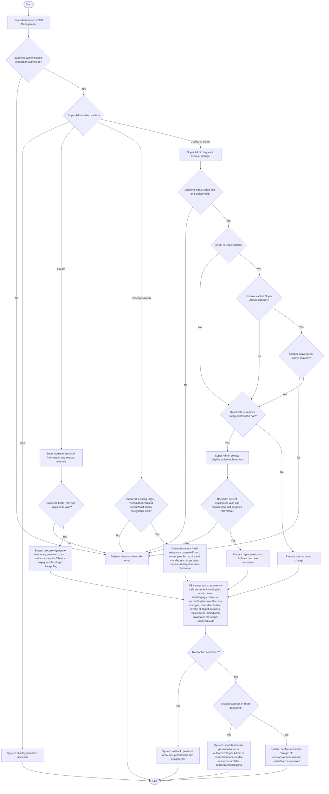

# Activity: Manage Staff Accounts

**Actor:** Super Admin
**Status:** Partially Confirmed

## Purpose

Manage authorized HWF staff accounts. SA-001 through SA-004 and SA-007/SA-008 below are DECIDED; workflows remain unimplemented. See [role responsibilities](../../permissions.md) and [security design](../../security.md); other detailed action grants remain PENDING.

## Preconditions

- Super Admin is authenticated and authorized by the backend for the selected action.
- Required fields/uniqueness checks must be finalized before creation; AUTH-001 one-time protected creation/reset response and AUTH-002 reset authority are DECIDED. Backend session/CSRF/authorization controls must be implemented; this workflow remains documentation.
- Deactivating or removing an assigned Branch Lead requires an eligible active replacement; unresolved account-protection rules are not implicit approval.

## Main Flow

1. Super Admin logs in, opens Staff Management and views permitted accounts.
2. For creation, Super Admin enters required information and selects exactly one role: Super Admin, Finance Reviewer, Content Editor, Branch Lead or HR Lead.
3. System validates authorization, fields, uniqueness and single-role constraints. It securely generates a temporary password and hash, and sets expiration exactly 24 hours after issuance plus mandatory first-login password-change controls.
4. In one database transaction, system saves only the password hash, the account controls and a credential-free audit entry. After commit, show the cryptographically random temporary password once only to authorized Super Admin in an authenticated protected noncacheable creation response, allowing secure capture. Never expose it later in list/detail/retrieval, email, logs/audit/analytics/exception traces, URL/history or persistent client storage. Persist no plaintext/reversible encryption; lost disclosure requires fresh authorized reset, not retrieval.
5. At a later first login, staff enters temporary credentials; backend validates credentials and expiration. At or after issuance plus 24 hours, reject authentication and require a new temporary credential through an authorized reset process. Before expiry, valid credentials create a restricted session permitting only minimum password replacement and session termination; only after successful change and secure session rotation/invalidation may normal current-role/branch-authorized work proceed. First-login change is not completed during account creation.
6. As separate actions, Super Admin may view, update, activate or deactivate accounts subject to approved permissions. Role changes require Super Admin authorization and auditing and must retain exactly one official role. For a Super Admin target, determine whether the change removes active Super Admin authority; if so, reject unless another active Super Admin remains, including self-directed changes.
7. Before deactivating an assigned Branch Lead or changing their role in a way that removes their assignment, Super Admin selects an eligible active replacement using [Assign Branch Lead](assign-branch-lead.md). System validates the candidate and current assignment, rejecting a candidate assigned to another branch.
8. In one transaction, system revalidates current conditions, including last-active-Super-Admin protection safely under concurrent requests, applies replacement and related account/role changes, revokes old branch access and writes audit entries. Deactivation immediately revokes all target sessions and blocks new login/old protected requests with consistent status/audit. Other valid mutations likewise commit account changes and audit together; activation restores no old sessions/expired temporary password and uses secure authorized credentials. Confirm success only after commit.

9. **Password Reset (AUTH-002):** Super Admin selects existing target; backend checks reset authorization/allowed state and last-admin/account restrictions. Generate new secure temporary password and hash, server issuance/+24h expiry and mandatory-change state. In one transaction replace hash/controls, revoke all target active sessions and append sanitized audit. After commit disclose new secret once through AUTH-001 protected response; no old-password retrieval or public/email recovery. Failure rolls back all persistent changes.

## Alternative / Error Flows

- Invalid login, insufficient permission, invalid input, uniqueness conflict or multiple/invalid roles: deny or reject without changes.
- Missing/inactive/ineligible replacement or candidate assigned elsewhere: block assigned-lead deactivation/removal and retain existing assignments and access.
- Concurrent assignment conflict or account/audit write failure: roll back all related changes; existing lead, account state and access remain intact.
- Expired temporary password: reject authentication and require an authorized reset to obtain a new temporary credential. AUTH-001/AUTH-002 fix protected one-time Super Admin disclosure/reset; a lost disclosure requires fresh authorized reset, not retrieval. Do not falsely report a failed transaction as successful.
- Deactivation/demotion that would remove the last active Super Admin: reject, including self-directed or concurrent attempts; leave account and permissions unchanged.
- AUTH-004 deactivated accounts cannot authenticate or continue any old session; immediately revoke all target sessions. Reactivation restores no old sessions/expired temporary credential. AUTH-006 replacement immediately denies old branch access regardless of session/cache state.

## Business Rules

- **SA-001 - DECIDED: Temporary Password Provisioning.** System-generated temporary passwords, secure hash storage only, mandatory first-login password change and expiration. Never include passwords in logs or audit records; API disclosure is restricted to a controlled one-time provisioning mechanism. AUTH-001 finalizes one-time protected post-commit Super Admin creation/reset disclosure with no caching, later retrieval or plaintext email; SA-007 fixes expiry at 24 hours from authoritative server issuance.
- **SA-002 - DECIDED: Single System Role.** Each staff account has exactly one of the five roles; simultaneous roles are unsupported. Role changes require Super Admin authorization and audit logging and cannot leave invalid Branch Lead assignments.
- **SA-003 - DECIDED: Single Branch Assignment.** One branch per Branch Lead at a time; at most one assigned active lead per branch. Database constraints and transactional validation prevent conflicts. Backend checks branch-level access on every protected request.
- **SA-004 - DECIDED: Mandatory Replacement Before Deactivation.** An assigned lead cannot be deactivated or removed without a valid active replacement. Replacement, related account/assignment changes, access revocation and audit logging are atomic. Historical members, collections, reports and audit records remain unchanged. Failure preserves the existing lead and access assignments.
- **SA-007 - DECIDED: Temporary Password Expiration.** Expires exactly 24 hours after issuance. Backend rejects expired credentials; valid credentials before expiry still require first-login password change before normal protected operations. Store only a secure hash; never store/log plaintext or expose it in audit. Expiry before use requires a new temporary credential through an authorized reset process. AUTH-001/AUTH-002 finalize one-time protected Super Admin disclosure/reset with all-target-session revocation and sanitized atomic audit.
- **SA-008 - DECIDED: Last Active Super Admin Protection.** Always retain at least one active Super Admin. The last active Super Admin cannot be deactivated or changed to another role, even by themselves. Enforce the remaining-admin check safely under concurrent requests in the same atomic mutation/audit operation; two administrators cannot concurrently remove each other's authority and leave zero. Rejection preserves account, permissions and audit history.
- No public staff self-registration or staff self-selection of privileged roles. Members are records, not an additional login role; existing audit history survives account changes.
- **PENDING:** Self-deactivation restrictions beyond SA-008, exact account fields/uniqueness, password-strength/Argon2id parameters, login rate thresholds, session-store deployment, cookie/token/origin/proxy/CORS configuration, security monitoring/incident response and other unspecified grants. AUTH-001 to AUTH-006 disclosure/reset/lifetime/deactivation/browser/replacement controls are DECIDED.

- **AUTH-001/AUTH-002 - DECIDED:** Secure temporary hash/24h server expiry/mandatory change; one protected noncacheable creation/reset disclosure to Super Admin after commit. Restricted first login permits minimum password replacement/logout. Reset revokes all target sessions and audits in same transaction; never retrieve/email/log plaintext or allow public recovery.
- **AUTH-003/AUTH-005 - DECIDED:** Revocable server sessions expire at earliest 8h idle/24h absolute, authorized-only idle refresh, no resurrection/absolute extension. Logout revokes, password change securely rotates/invalidates. HttpOnly opaque cookie, Secure production, restrictive topology scope/SameSite, CSRF plus trusted Origin/CORS, login throttle/generic errors and current role/branch/active checks apply. No localStorage secrets/logged session IDs.
- **AUTH-004/AUTH-006 - DECIDED:** Deactivation immediately revokes all sessions; activation revives neither sessions nor expired temporary credentials. Replacement atomically preserves eligible Active-branch leadership, invalidates old scope immediately and audits old/new assignments; no automatic other-branch grant. Preserve identity/history and SA-008 under concurrency. See [security](../../security.md).

## Postconditions

- Successful creation stores a secure hash, expiration at issuance plus 24 hours and first-login change requirement; no credential appears in audit/logs or ordinary responses.
- Valid mutations and audits commit together. Successful replacement removes old branch access without changing historical business records.
- At least one active Super Admin remains after every successful mutation, including concurrent changes.
- Reads do not change accounts; rejected or rolled-back changes preserve prior account/assignment/access state.

## Activity Diagram

## Acceptance Criteria

- Unauthorized requests and invalid/multiple roles are rejected; each saved account has exactly one official role.
- Creation stores only a secure password hash and expiration exactly 24 hours after issuance. Correct temporary credentials before expiry reach mandatory password change; at/after expiry authentication is rejected and authorized reset is required. Normal protected operations remain blocked until password change succeeds.
- Passwords never appear in logs, audit records or ordinary API responses; only approved one-time provisioning may disclose them.
- Role changes require Super Admin authorization, audit and valid resulting branch assignments.
- Assigned-lead deactivation/removal without an eligible active replacement is blocked, including replacement candidates assigned elsewhere.
- Replacement, account/assignment changes, old-access revocation and audit commit together; failed validation/transactions preserve the existing lead and access.
- Last active Super Admin deactivation/demotion fails, including self-directed attempts. Concurrent administrator operations cannot leave zero active Super Admins; rejection preserves permissions and account state.
- Historical records remain unchanged. These are future verification targets, not executed tests; only remaining technical choices and unspecified grants need approval.

- AUTH future criteria: before +24h temporary login is restricted; exactly at/after expiry fails. Password cannot be retrieved again; reset invalidates every old session atomically and audit/logs contain no plaintext. Inactive staff cannot login/use old cookie; reactivation restores no old session/expired secret.
- Idle timeout fails at 8h, absolute at 24h despite activity; unauthorized refresh fails and logout revokes. Missing/invalid CSRF, unauthenticated and wrong-role direct calls fail. Outgoing lead's old session immediately loses former branch; concurrent last-admin removals cannot leave zero. No tests executed.
