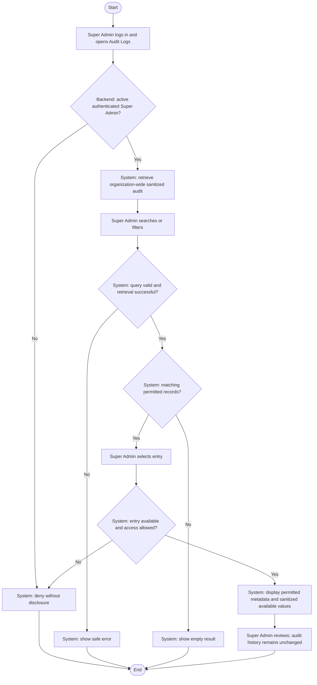

# Activity: View Audit Logs

**Actor:** Super Admin
**Status:** PERM-001 DECIDED; not implemented or tested

## Purpose

Review and trace system changes through permitted audit records. PERM-001 approves authenticated active Super Admin organization-wide sanitized audit read, not implemented functionality or additional business write authority. See [audit specification](../../../project-context/modules/audit-trail.md) and [permissions](../../permissions.md).

## Preconditions

- Super Admin is authenticated and active in the internal portal; backend validates current session/role on every list/detail request.
- PERM-001 organization-wide audit read is DECIDED; data minimization/secret redaction required. Exact pagination/filter/retention/redaction configuration remains pending.
- Audit capture is available for the relevant business operations; missing history must not be fabricated.

## Main Flow

1. Super Admin logs in and opens Audit Logs.
2. System checks approved read permissions and retrieves only permitted records.
3. Super Admin searches or filters using the supported, approved controls; system validates the query and applies scope on the server.
4. Super Admin selects an audit entry.
5. System rechecks entry-level access and displays actor, action, entity, record identifier, timestamp and available permitted before/after values, with sensitive values omitted or redacted.
6. Super Admin reviews the entry; the read operation does not edit or delete audit records.

## Alternative / Error Flows

- Invalid login or missing read permission: deny access without exposing audit data.
- Invalid/unsupported filter: show a safe validation error; do not broaden the authorized scope.
- No matching permitted entries: display an empty result, not invented history.
- Unavailable or inaccessible selected entry: show a safe unavailable/access-denied response without disclosing protected details.
- Retrieval failure: show a safe error without modifying audit history.
- Requests to edit/delete audit entries through the application: reject, including requests from Super Admin.

## Business Rules

- **Confirmed constraints from this workflow request:** Audit records are append-only. No user, including Super Admin, may edit or delete them through the application. Important state-changing operations generate appropriate audit entries atomically with their business changes.
- **SA-001 - DECIDED:** Temporary passwords must never enter audit records or logs; audit responses are not a controlled one-time provisioning mechanism.
- **SA-002 / SA-004 - DECIDED:** Authorized role changes and atomic lead replacements/related account changes require audit entries, excluding credentials. Record previous/new assignment changes while retaining historical audit and business records; failed transactions preserve existing lead/access.
- Audit detail must never expose passwords, tokens or secrets. Before/after values are displayed only when available and permitted; this is not a requirement to store sensitive raw values.
- **Official Requirements:** Audit changes and report transitions and preserve immutable approved report figures. This viewing activity does not create a business mutation; transactions belong to the source mutation workflows, not to an invented audit-edit action.
- **PERM-001 - DECIDED:** Active authenticated Super Admin views organization-wide sanitized audit, never credentials/session tokens/private keys/authentication artifacts. Audit read adds no business-write authority. No application role edits/deletes audit; audited source mutations record actor/system/action/time/record/before-after/branch context transactionally. System actor is not a sixth role.
- **PENDING:** Audit pagination/filter contract, retention/redaction configuration, monitoring and audit-file export authority. EXP-001 to EXP-004 grant financial report exports, not audit exports; privileged database maintenance is not an application role grant.

## Postconditions

- Super Admin has viewed only permitted, sanitized records, or received a safe error/empty result.
- Existing audit records remain unchanged; no audit edit, deletion or export is performed by this flow.

## Activity Diagram

## PERM role boundaries

PERM-002 Finance retrieves only related organization-wide financial audit; PERM-003 Branch Lead only related current-branch audit (direct-ID/former-branch denial); PERM-004 HR only authorized HR audit and PERM-005 Content Editor only CMS audit/history. These do not use Super Admin's organization-wide browsing grant or gain source writes; unrelated domains/secrets excluded. [Full matrix](../../permissions.md).

## Acceptance Criteria

- Active authenticated Super Admin can view organization-wide sanitized audit; invalid/expired sessions/other unauthorized requests deny. Listing/filter/direct-ID requests enforce role-specific scope server-side.
- Valid queries return only permitted records; empty results and retrieval failures do not fabricate or modify history.
- Detail includes the specified metadata and available permitted before/after values without passwords, tokens or secrets.
- Application edit/delete attempts fail even for Super Admin; role/replacement audit entries preserve history and never include temporary passwords.
- Source business changes and appropriate audit entries commit atomically; a failed audit write cannot leave a committed associated mutation.
- No audit-export permission or retention policy is inferred. These are future verification targets, not executed tests.
