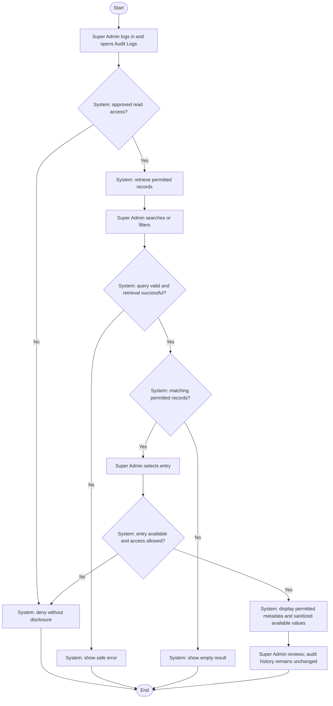

# Activity: View Audit Logs

**Actor:** Super Admin
**Status:** Proposed / Partially Confirmed

## Purpose

Review and trace system changes through permitted audit records. This is a proposed read workflow, not implemented functionality or a blanket Super Admin read grant. See [audit specification](../../../project-context/modules/audit-trail.md) and [permissions](../../permissions.md).

## Preconditions

- Super Admin is authenticated in the internal portal.
- Audit read permissions, permitted scope and sensitive-data handling have been approved before access is enabled.
- Audit capture is available for the relevant business operations; missing history must not be fabricated.

## Main Flow

1. Super Admin logs in and opens Audit Logs.
2. System checks approved read permissions and retrieves only permitted records.
3. Super Admin searches or filters using the supported, approved controls; system validates the query and applies scope on the server.
4. Super Admin selects an audit entry.
5. System rechecks entry-level access and displays actor, action, entity, record identifier, timestamp and available permitted before/after values, with sensitive values omitted or redacted.
6. Super Admin reviews the entry; the read operation does not edit or delete audit records.

## Alternative / Error Flows

- Invalid login or missing read permission: deny access without exposing audit data.
- Invalid/unsupported filter: show a safe validation error; do not broaden the authorized scope.
- No matching permitted entries: display an empty result, not invented history.
- Unavailable or inaccessible selected entry: show a safe unavailable/access-denied response without disclosing protected details.
- Retrieval failure: show a safe error without modifying audit history.
- Requests to edit/delete audit entries through the application: reject, including requests from Super Admin.

## Business Rules

- **Confirmed constraints from this workflow request:** Audit records are append-only. No user, including Super Admin, may edit or delete them through the application. Important state-changing operations generate appropriate audit entries atomically with their business changes.
- Audit detail must never expose passwords, tokens or secrets. Before/after values are displayed only when available and permitted; this is not a requirement to store sensitive raw values.
- **Official Requirements:** Audit changes and report transitions and preserve immutable approved report figures. This viewing activity does not create a business mutation; transactions belong to the source mutation workflows, not to an invented audit-edit action.
- **Pending Decisions:** Retention, exact read permissions/scope, available filters, export permissions and personal-information handling/redaction. System-wide CSV/PDF requirements do not imply an approved audit-export grant. Application append-only rules do not settle retention or privileged database-maintenance policy.

## Postconditions

- Super Admin has viewed only permitted, sanitized records, or received a safe error/empty result.
- Existing audit records remain unchanged; no audit edit, deletion or export is performed by this flow.

## Activity Diagram

## Acceptance Criteria

- Missing read grants deny access; listing, filtering and direct entry requests enforce approved scope on the server.
- Valid queries return only permitted records; empty results and retrieval failures do not fabricate or modify history.
- Detail includes the specified metadata and available permitted before/after values without passwords, tokens or secrets.
- Application edit/delete attempts fail even for Super Admin.
- Source business changes and appropriate audit entries commit atomically; a failed audit write cannot leave a committed associated mutation.
- No audit-export permission or retention policy is inferred. These are future verification targets, not executed tests.
